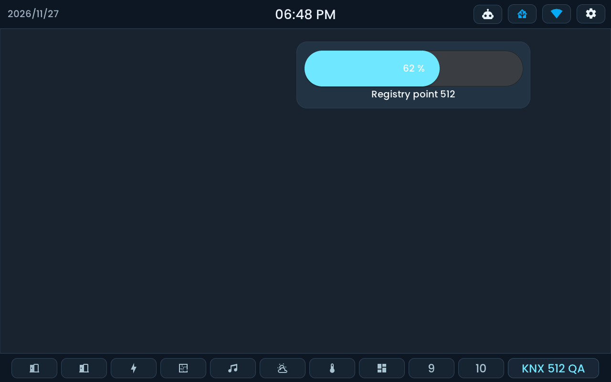

<!-- SPDX-License-Identifier: LicenseRef-FNCL-1.1 | Copyright (c) 2026 andre68723 -->

# Panel10 KNX registry capacity validation

The November 27, 2026 trial used the Waveshare ESP32-P4-WIFI6-Touch-LCD-10.1
LCD-X on COM24. The original `c9d61c30` firmware had 76 KNX objects and
10 dashboard pages with 61 widgets, including the **Light Angle** and **Power history** graphs.

## Backup and application

The administrator exported the layout, KNX registry and state, settings, accounts,
themes, camera configuration and diagnostics. The raw LittleFS backup was
19,529,728 bytes. It mounted with eight files. The saved layout agreed with the
web export after excluding the three display geometry fields added by the API.
The stored KNX registry matched the export byte for byte. The crash inventory was
empty. The backup contained no `.grph` or `.grph.tmp` files for a sample-level history comparison.

The first pre-write check opened an older reference image and stopped the
procedure. The original firmware restarted. Its application and ELF hashes
matched the archived `c9d61c30` build. The repeated backup checked the original
data and running application again before the write.

| Artifact | SHA-256 |
| --- | --- |
| Application, 6,813,520 bytes | `5c96f28580bf4bc9451532e2bac89de9a1a3a34457586a7b8430433f964c9e25` |
| Matching ELF | `194c7df6852f2543bf599fbe8a43c0b44479656427dd8e3b71e84c183477ee84` |
| Entire `ota_0` read back on COM24 | `74556f7bf207270a27f08b045e9254f73d0c5538a18c8649ab486e0d87c3eee4` |

The ESP-IDF 6.1.1 workspace image is based on `bdc15576-dirty`. Its panel build
stamp is **Nov 26 2026 23:52:05**. Its ESP-IDF application descriptor records
**23:31:47**. The application fits the existing OTA slot with 2,224 bytes to spare.
The serial write covered `0x020000–0x69ffff` in `ota_0`. An independent read of
all 6,815,744 bytes reproduced the pinned application followed by the 2,224
original tail bytes. Before the new application booted, the inactive `ota_1`,
metadata including NVS and OTA selection, crash partition and LittleFS matched
their pre-write digests.

The 100.018-second COM24 recording starts at the final reset. The bootloader
selected `0x20000` at 1.317 s, logged ELF prefix `194c7df68` at 2.791 s,
opened HTTP at 22.856 s and loaded the original 76 KNX objects at 24.903 s.
The splash closed at 25.536 s. The authenticated API reported v0.9.2,
`bdc15576-dirty`, **23:52:05**, valid `ota_0`, next `ota_1` and idle OTA.
The editor JavaScript served by the panel matched the copy embedded in the image.

## Isolated registry

The panel and a host-simulated KNXnet/IP Routing peer used
`239.255.71.179:43674`. The fixture assigned 512 unique IDs to 512 unique
group addresses. The last object, `qa_cap_511` on `30/7/255`, was a readable
and writable DPT 5.001 percentage. The other 511 objects were read-only.

Chrome loaded the editor directly from the panel. It imported a 144,435-byte
JSON file, saved it, and listed all 512 objects again after a browser reload.
COM24 recorded a 106,494-byte registry write to LittleFS in 1,276 ms.
Stopping and restarting KNX routing kept all IDs and addresses in order.
The authenticated objects API returned 26 pages, ending with 12 objects at
offset 500.

| Device exercise | Observed result |
| --- | --- |
| Import 513 objects in the editor | The editor displayed “KNX request failed: Invalid or oversized KNX configuration/value” and kept the 512 saved objects. |
| Submit the same 513 objects directly to the authenticated API | HTTP 400 with `Too many KNX communication objects`. The 106,494-byte saved registry was byte-identical before and after. Its SHA-256 was `816d6b717d4e3166438c9fd3d0e5bb16eca92185618098d5a76e7dc44e0f6267`. Registry generation 8 and routing epoch 9 were unchanged. |
| Bind the last object after rejection | The editor fetched the page at offset 500 and saved a temporary slider with `qa_cap_511` as both brightness command and feedback. All ten original pages were preserved. |
| Read the object | The peer captured a GroupValueRead from the panel on `30/7/255`. Its GroupValueResponse with raw 64 appeared in the panel cache as 25.10%. |
| Send 80% using the editor | The API returned HTTP 202. The peer then captured the panel's GroupValueWrite with raw 204 on the same address. |
| Operate the native slider through Live Display | A single tap produced no captured write. After restoring the original registry and reinstalling the isolated fixture, a recorded drag and release issued 61%. The panel's sent counter advanced from 2 to 3, and the peer captured raw 156 on `30/7/255`. |
| Send fresh feedback from the peer | A GroupValueResponse with raw 158 produced 61.96% in the panel cache. The native slider and the re-opened editor preview both displayed **62%**. |

{ width="302" }

The read, the editor's 80% write and the 62% screenshot belong to the same
routing session after the 513-object rejection. The peer received the read and
the raw 204 write before the original registry was restored. The later drag
provides separate evidence for the native control.

At 512 objects with routing active, internal heap had 138,155 bytes free and
an 83,968-byte largest free block. This sample includes the running dashboard
and web services. The 512-point test used browser reload and a routing restart.
Booting the physical panel with 512 objects already stored and operating a
physical KNX actuator remain outside this trial.

## Restoration

After removing the temporary page and reloading the original registry, the
panel was routing with 76 objects. The final layout and registry exports matched
their pre-flash copies byte for byte. The layout SHA-256 was
`b14c3c3dc9adb56498241a024326ff785485a2196237b0f7d967de137043f196`.
The registry SHA-256 was `07ed6611a32e06e4f52dd65c094b4b1192e9dece712d63a578d8981b86bc1b4b`.
Both original graphs retained their IDs and bindings.

Accounts, themes, camera configuration and languages also matched their
exports. Only the live clock and Wi-Fi signal differed in the settings export.
English, Glow, Asia/Shanghai, 12-hour time, the flip clock and the 23:00 night
start were preserved. At uptime 381 s the boot count was still 266
(264 before the trial, 265 after the pre-write stop). The test session signed
out and anonymous layout access returned HTTP 401.

## Local pre-commit checks

The production parser accepted the archived 76-object configuration, a 128-object
configuration in the old format, and the 352- and 512-object fixtures. The native
service loaded 512 objects from simulated storage. Injecting an allocation failure
at each step of the last two-object page, including a composite value and widget
roles, returned an error with all page allocations released. A subsequent page
read succeeded. The browser rejected a short final page and accepted a complete retry.
In a 352-object replacement, feedback reached two aliases at opposite ends of
the file while the objects API retained the configured order.

In an isolated Chromium editor session, a 512-object backup downloaded successfully.
Restoring a 513-object backup over a 128-object registry failed on the first write
and preserved the old registry. Restoring the 512-object backup then reloading
reproduced every object in order. A legacy backup without a KNX section preserved
all 512. The local service used a synthetic dashboard with no active custom theme.

All 13 CTest cases, 696 editor tests and 19 local-server tests passed.
The Panel10 SDL run passed 273 KNX control checks and 388 general control checks.
Only the **23:52:05** image above ran on COM24. Allocation failures and full-backup
restore at maximum capacity were exercised on the host.

Both local builds used ESP-IDF 6.1.1 and the reviewed changes on `a76324f`.
The `panels3` build started from the tracked dependency lock in an
isolated checkout. The component manager regenerated the pending lock exactly,
updating the IDF entry and four graphics or compression libraries. The KNX
transport kept the same component hash and pinned revision `19059496`.

| Image | Application bytes | Smallest application partition | Free bytes |
| --- | ---: | ---: | ---: |
| Panel10, COM24 at 23:52:05 | 6,813,520 | 6,815,744 | 2,224 |
| Panel10, local Nov 27 at 19:52:10 | 6,814,032 | 6,815,744 | 1,712 |
| PanelS3, local Nov 27 at 19:46:33 | 4,645,888 | 6,815,744 | 2,169,856 |
