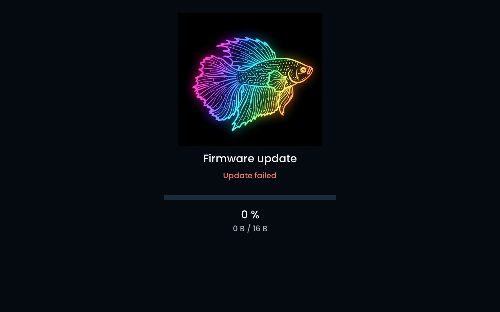
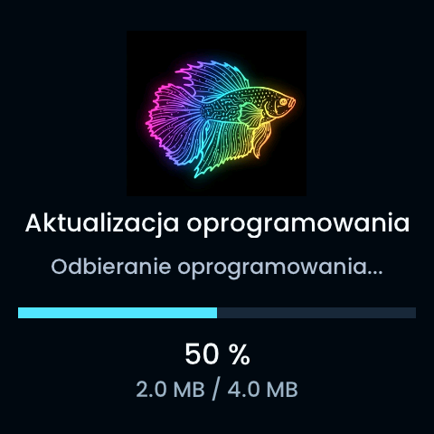

<!-- SPDX-License-Identifier: LicenseRef-FNCL-1.1 | Copyright (c) 2026 andre68723 -->

# Panel10 BETTA OS logo validation

The 2026-11-28 trial used the Waveshare ESP32-P4-WIFI6-Touch-LCD-10.1 (LCD-X),
ESP32-P4 v3.2, 1280 × 800, on COM24. The installed application before the
trial reported `2a8989eb`, boot 273 and a valid `ota_0`.

## Image and backup

| Windows build input or artifact | Verified value |
| --- | --- |
| Project and source | `betta-ha-panel-10.1` v0.9.2, `14db9857-dirty`, ESP-IDF v6.1.1 |
| Fixed image timestamp | `Nov 28 2026 00:00:00` |
| Application | 6,731,744 bytes, SHA-256 `041e35a48d6a38ed76e9d08536172fdcdb1fe67babce5e51457d78efc496ed5e` |
| Matching ELF SHA-256 | `e045b699657c2adb3fbfada7ff013cd30d7107f457e451399e0ba53458799050` |
| Logo | One embedded 96,740-byte PNG, SHA-256 `29268d0c76fdc79c1e027a610f530113970bde38ab0f3028b8717fd971d22cc9` |
| Each application slot | 6,815,744 bytes capacity, 84,000 bytes remaining |

The Windows comparison used the same ESP-IDF, effective configuration,
dependency lock, partition table and fixed build time for both logos.
The embedded PNG shrank from 108,113 to 96,740 bytes (11,373 bytes).
The complete application shrank from 6,743,120 to 6,731,744 bytes
(11,376 bytes), increasing the free space in each OTA slot from 72,624 to
84,000 bytes.

The authenticated editor exported 62,731 bytes. Its layout, configuration,
cameras and KNX registry matched separate API reads. The device denied
anonymous layout access with HTTP 401 and reported zero retained crash reports.
The boot selection record passed its CRC and selected `ota_0` at `0x20000`
(sequence 23). The original full application slot, boot metadata including NVS
and OTA selection, crash partition and 19,529,728-byte LittleFS were backed up.
Reused archive blocks were checked against current on-device digests. The
mounted filesystem's layout and registry agreed with the authenticated reads.

The backup held 10 pages, 61 widgets and 76 KNX objects. The two graph widgets
were **Light Angle** (`light_angle`) and **Power history** (`power_w`). The
filesystem contained no `.grph` or `.grph.tmp` files for a sample-by-sample
history comparison.

## COM24 readback

The serial write covered `0x00020000` through `0x0069ffff`. A fresh serial
read returned all 6,815,744 bytes of `ota_0`. The first 6,731,744 bytes
matched the pinned application byte for byte. The final 84,000 bytes matched
the same range of the pre-flash slot backup.

| SHA-256 | Digest |
| --- | --- |
| Original complete slot | `ff7b760652e21f3644b65ff919dd37aea8365dd9138313925929e38258a530c3` |
| New complete slot, calculated and read back | `936f081412c4697b1367d14e337f7b66a2505537439b570c524125ecc7563238` |

Before the application was restarted, the partition table, boot metadata, NVS,
crash partition and LittleFS matched their pre-write checksums. The entire
inactive `ota_1` returned the same device MD5 before and after the write
(`c216671b4b2ceb216d5c8cf4dd17c3a1`).

## Physical startup

The ROM and application boot were recorded for 338.035 seconds from the host
reset call. The serial log loaded `0x20000` at +1.309 s and identified
v0.9.2, ESP-IDF v6.1.1 and ELF prefix `e045b6996`. Boot 274 reported
`14db9857-dirty` and a valid image in `ota_0`. The independent OTA endpoint
reported idle on startup and listed `ota_1` as the next slot. The boot
sequence stayed at 274 through both display checks.

The owner saw the new multicolor fish on the physical LCD and the normal
handoff to the dashboard. The serial splash markers were +9.012 s (shown)
and +20.539 s (hidden). They measure software events. The first HTTP screenshot
request timed out waiting for the display lock. The matching ELF resolved the
waiter to `api_screenshot_capture` and the holder to `ui_runtime_handle_event`.
This was the single logged LVGL acquisition timeout. Later PNG captures
succeeded. No optical first-frame timing or boot photograph was collected.
The trace also recorded two JPEG header errors on a camera cover and a software
decoder retry. The boot and OTA logo used the embedded PNG.

## OTA screen

The authenticated production upload screen was exercised twice with the same
16-byte plain-text file. Both attempts ended before the firmware had enough
bytes to validate an application header. The device reported zero bytes
written, zero progress, no reboot pending and a valid running image. With an
eight-second pause between the two halves, the upload returned HTTP 400 with
`OTA image is too small or incomplete`. The owner missed that first display.
The repeat used a 16-second pause. The serial log recorded a receive timeout
and the endpoint returned HTTP 400 with `OTA upload aborted`. The owner saw
the multicolor logo, progress bar, percentage and byte count on the LCD, and
confirmed that the overlay dismissed itself.

Both device PNG snapshots were byte-identical (SHA-256
`8266e9bde8e99fd17c4b89cf368a1bfedda88c104aeb281a9aa7b0d6e8d97ee2`).
The image region matched all 125,800 RGB565 pixels of the embedded artwork.
The unfilled track was 440 pixels wide, above the visible `0 %` and
`0 B / 16 B` labels. A later snapshot showed that the overlay had disappeared.
The final OTA endpoint retained the last rejected upload as `error`, with
`running=false` and `rebooting=false`. The running image stayed `valid`.
COM24 showed 0% on both attempts. Progress above zero, completion of an
installable upload and switching to the other slot were outside this trial.

## Data after the test

The final editor export matched the original in every field except its creation
time. Separate reads also matched the original layout and registry bytes, user
roles, camera configuration, themes and language inventory. The settings API
differences were the current time and Wi-Fi signal strength. English,
Asia/Shanghai, the 12-hour flip clock and the enabled 23:00–06:00 night
schedule were preserved. Anonymous layout access returned HTTP 401 after the
test session was closed. The panel retained both graph bindings and reported
zero crash reports before and after the trial.

## Simulator comparison

The 1280 × 800 LVGL simulator used the Panel10 firmware PNG descriptor and
decoder. All 125,800 RGB565 pixels of the 370 × 340 logo agreed with the
embedded asset at (455, 66) on the splash and (455, 34) on the OTA screen.
Only the simulator exercised 50% progress. At 2 MiB out of 4 MiB, 220 of the
440 bar pixels were filled, and the screen displayed `50 %` and
`2.0 MB / 4.0 MB` below the bar.

On the 480 × 480 Guition simulator, the old bar started at y=500, below the
screen. The revised bar spans y=340–351. Pre-commit testing also found that
the Polish title at the largest text size extended from x=−3 to x=483.
Fitting the title to the available width placed it at x=27–453. The production
OTA layout passed in all seven interface languages at all three text sizes.
The Guition results were obtained on the simulator. No Guition panel was
flashed or observed for this change.

The Guition capture uses the firmware PNG decoder. Compared with the
simulator's RGB565 fallback, pixel differences were confined to the scaled
fish. The title, transfer figures, progress bar and background matched.

## Pre-commit builds

The title-fit change was rebuilt locally with ESP-IDF v6.1.1 and the same
configuration, lock and partition table as each board's comparison build.

| Board | Application bytes | Free bytes per OTA slot | Application SHA-256 |
| --- | ---: | ---: | --- |
| Panel10 | 6,731,744 | 84,000 | `73ed2779f469e8278328659bdd3e98c6e5ebc8a1995e696f7e17a8ea839a222d` |
| Guition 480 × 480 | 4,624,752 | 2,190,992 | `15fec5cefa29f8f6106678410ac16d079a729efbe46f6603229cd953e1d60274` |

The Guition title fit added 128 bytes to its first multicolor-logo build.
Panel10 retained its 11,376-byte net saving. COM24 ran the `041e35a4`
image identified above. Pre-commit verification built both applications
locally and exercised their UI sources in the LVGL simulator.
