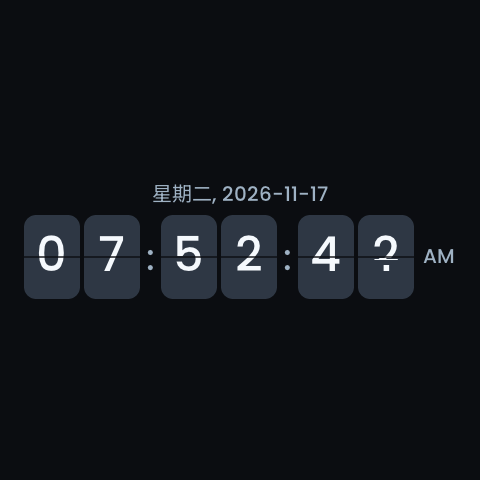

<!-- SPDX-License-Identifier: LicenseRef-FNCL-1.1 | Copyright (c) 2026 andre68723 -->
# S3 447fbf7 validation

Guition ESP32-S3-4848S040, COM18 / `192.168.71.77`, 2026-11-17.
This is a build and device trial of the clean `dev` source at `447fbf7d`.
It updates the same panel previously tested with
[ce2ffa7](panels3-ce2ffa7-validation.md); the address has changed.

**Result: application update and data preservation passed; functional validation
is incomplete.** The owner confirmed normal page switching, flip screensaver
and touch wake. Entity discovery repeatedly timed out on internal-memory
admission, and PNG screenshots failed their output allocation. These failures
remain in the installed source; no firmware fix or second flash was performed.
The subsequent [local memory fixes](panels3-auth-png-memory.md) and their
[separate COM18 trial](panels3-auth-png-validation.md) have their own records;
they do not change the failures measured on this earlier image.

## Build and application update

| Item | Evidence |
| --- | --- |
| Firmware | `v0.9.2-rc2`, source `447fbf7d` |
| Runtime build stamp | `Nov 17 2026 20:36:37` |
| Toolchain | ESP-IDF `v6.1`, esptool `5.3.1` |
| Build entry point | `scripts/build.ps1 panels3 reconfigure build` |
| App size | 4,580,688 bytes; 2,235,056 bytes free in the 6,815,744-byte slot |
| Write target | Existing valid `ota_1`, address `0x6A0000` |
| Device | ESP32-S3 revision 0.2, 16 MiB flash, 8 MiB PSRAM |

App SHA256:
`f922750227c8b82ecef8e83ce79dbc1b824b28d95de68a292676064854d236c4`.
ELF SHA256:
`da5c87a26e635017dc2d761c31b8173dc7116bbcc08e546be48a79f977fa1011`.
The boot ELF prefix and the running API source/stamp matched the archive.

The generated configuration differed from the preceding build only in the
new issuer public key, matching the current S3 defaults. The Wi-Fi IRAM
optimizations remained disabled, HTTP retained its 14 KiB stack, and the
PSRAM configuration remained unchanged. The build completed with existing
unused-function and deprecated-LVGL-call warnings plus SDK/dependency notices.
An initial restricted-host attempt was stopped before compilation; the normal
toolchain run completed successfully.

HTTP diagnostics, layout, settings, theme and reboot history were saved before
opening serial; no retained crash reports were present. ROM identity matched
the LAN MAC and the previous COM18 unit. The installed partition table matched
the build. The old app matched the archived ce2ffa7 image by device digest.

Before writing, the low 128 KiB, complete coredump partition and complete
LittleFS partition were backed up and verified. The previous app was retained
from its verified archive. Only the active app was written, and its flash
digest matched the new image. Before boot, digests of NVS/boot metadata,
coredump, LittleFS and the entire inactive app slot were unchanged. This was
an in-place replacement of a previously valid slot, not a fresh OTA
pending-validation or rollback trial.

## Runtime and retained data

The same serial handle captured 684.8 seconds after the authorized reset.
Boot sequence advanced from 118 to 119. There was one boot header, no panic
or additional restart, and the running image stayed valid. HTTP listened on
port 80, GT911 initialized at `0x5D`, HA authenticated, and network time became
valid. Both UI task heartbeats remained current.

The capture includes 80 early LVGL lock timeouts, all before the first
22-second API checkpoint; that count did not grow during the remaining trial.
It also retains 11 HA energy-preferences warnings and an unsuccessful online
version check. Initial browser navigation exceeded the automation wait, but
the editor subsequently loaded its complete interface and correct version.
These observations are not omitted from the pass/fail record.

At 634 seconds, internal free heap was 32,287 bytes with a 17,408-byte largest
block. Free PSRAM after the BMP capture was 947,920 bytes. Minimum free stacks
were HTTP 6,832/14,336, HA 5,364/12,288, WebSocket 5,936/8,192, LVGL
12,648/20,480 and UI runtime 10,712/16,384 bytes. The boot minimum internal
heap of 7,796 bytes is not an entity-query allocation measurement.

All five pages and 13 widgets were retained. The 3,186-byte layout export
remained byte-identical, SHA256
`aa13870324a9cb46ecabd7fba863e6675cff40afb4797508ee2c0eee304044d7`.
Settings differed only in live time and Wi-Fi signal values; the active theme
was unchanged. Simplified Chinese, `America/New_York`, 12-hour time, flip
screensaver, 60-second idle delay, 15% saver brightness and 22:00–06:00 night
schedule were preserved. No layout/settings save or HA service action was
performed by the test tools.

During documentation checks, the owner enabled account login and explicitly
asked to retain it. The next unauthenticated diagnostic request returned 401.
At 1,270 seconds, authenticated read-only verification still found boot 119,
source `447fbf7d`, HA authentication OK, no crash, and the identical layout.
The only additional settings difference was the expected
`security.password_set` flag. The new login protection was retained; account
creation was an owner action, separate from the firmware test.

The raw LittleFS comparison establishes storage preservation across the flash
before boot. It does not claim filesystem byte identity after ordinary runtime
writes. This layout has no Graph widget, so retained historical chart rendering
was not independently exercised.

## Entity discovery: failed admission

The browser showed the translated low-memory waiting reason, then replaced it
with a timeout and **Retry** after approximately 45 seconds. Retry started a
new generation. Changing `button` to `light` canceled the old query; closing
the picker canceled the new one. Reopening returned to a blank search with no
old results. No entity result was selected and no widget was added.

After closing the test tab, the protocol check confirmed that an old poll or
cancellation could not replace or cancel a newer generation. Four sequential
queries (`button`, `light`, `button`, `light`) all returned
`timeout / internal_memory` after 46.014, 45.467, 46.205 and 46.491 seconds.
There were five terminal timeouts including the initial browser search.
All nine queued generations map to deliberate browser or protocol actions;
the capture contains no unexplained alternating searches.

The immediate blocker was total free internal memory, not the contiguous-block
threshold: typical waits had about 32 KiB free and 12–17 KiB largest blocks,
below the plain-HTTP admission reserve of 34 KiB but above its 8 KiB block
requirement. Queries never reached client preparation. Consequently this trial
does **not** establish HTTP-client allocation/release costs or successful
recovery; there were no corresponding client or page-memory samples.

Compared with ce2ffa7, the runtime internal heap pool fell from 295,787 to
292,059 bytes. ELF inspection identifies new internal static allocations for
user-management sessions (1,792 bytes), accounts (1,346 bytes) and authentication
attempts (384 bytes): 3,522 bytes together, even in open-access mode. This is a
measured contributor to the reduced headroom, not a complete allocation trace
or proof that every free-heap difference has the same cause. Follow-up work
should recover internal memory and qualify the query reserve against actual
allocations; lowering protections without measurement is not validated here.

## Screenshots and physical confirmation

The PNG endpoint failed twice. The recorded response was HTTP 500,
`Failed to allocate screenshot output`. The current handler requests a
contiguous 1 MiB PSRAM output buffer before capture. That allocation did not
fit this runtime state; the test does not distinguish every fragmentation
contributor. No encoded PNG was produced by the device.

BMP succeeded: 480 × 480, 691,254 bytes, with the complete flip-clock overlay.
Its capture held the display lock for 82,238 microseconds. JPEG returned the
expected S3 HTTP 501 response. The image below is a lossless host conversion
of the device BMP, **not** evidence that the PNG endpoint succeeded and not
a physical framebuffer capture.

The owner separately confirmed clear display, normal page switching and touch,
centered flip animation, correct New York weekday/date with AM/PM, and touch
wake without activating underlying controls.

## Local checks and remaining scope

- Ten native C executables passed: discovery policy/session/request/API on S3
  and P4, plus S3 board invariants and license storage/lifecycle.
- All 620 editor tests passed, including discovery waiting and lifecycle cases.
- Six S3 configuration tests and `tools/check_web.py` passed. The first Python
  checks encountered a host temporary-directory permission problem; rerunning
  with a workspace temporary directory passed.
- The serial log and 107 read-only samples cover roughly eleven minutes,
  with no new crash report or watchdog restart. Sampling includes normal
  concurrent activity; it is not a peak-allocation trace or a stress test.
- Successful entity results, natural low-memory recovery, HTTP-client release,
  and PNG output did not pass this device trial. TLS discovery, actual HA
  service actions, license activation/user creation, the 30-minute LCD warning,
  all themes, page hide/restore, populated graph history, OTA rollback and P4
  hardware were not exercised.

Private backups, raw responses, UART log, checksums, test logs and the artifact
manifest are retained under
`.local/validation/panels3-447fbf7-com18-2026-11-17/` and
`.local/firmware/panels3-447fbf7-2026-11-17/`.
The layout backup is also in ignored `.claude/layout-backups/`.
These private files and credentials are not committed.
