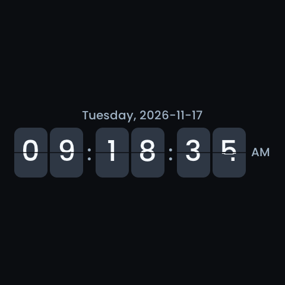
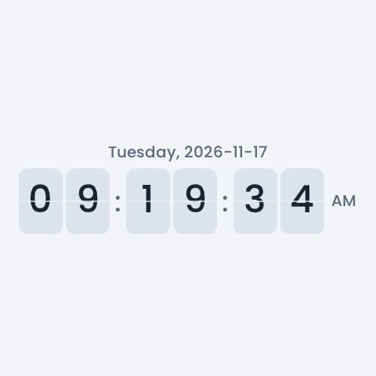

<!-- SPDX-License-Identifier: LicenseRef-FNCL-1.1 | Copyright (c) 2026 andre68723 -->
# S3 authentication and PNG validation

Guition ESP32-S3-4848S040, COM18 / `192.168.71.77`, 2026-11-17.
This device trial uses the exact 21:35:11 image from the
[authentication and PNG memory fix](panels3-auth-png-memory.md), following the
[20:36:37 baseline](panels3-447fbf7-validation.md). No rebuild or source change
was made during this trial. No commit or push was performed.

**Result:** application update, authenticated queries, cancellation/retry,
dark/light native PNG overlays and retained data checks passed. The owner
confirmed the physical flip clock and touch wake. Real low-memory terminal
timeouts and screenshot allocation failures were not reproduced on this image;
their recovery paths remain covered by the preceding local tests, not by new
device fault injection.

## Image and application-only update

| Item | Evidence |
| --- | --- |
| Firmware | `v0.9.2-rc2`, source `447fbf7d-dirty` |
| Runtime build stamp | `Nov 17 2026 21:35:11` |
| Toolchain | ESP-IDF `v6.1`, esptool `5.3.1` |
| Image size | 4,581,200 bytes; 2,234,544 bytes free in the 6,815,744-byte slot |
| Write target | Existing valid `ota_1`, address `0x6A0000` |
| Hardware | ESP32-S3 revision 0.2, 16 MiB flash, 8 MiB PSRAM |

App SHA256:
`2577e02fa9e8b22d8bd3d25d93b80ac1edcb706d33581935ad787a67d6288821`.
ELF SHA256:
`c9d4543f5bf73e00447a4e5c8ea74f930eb3ce42329cd3ba0d13159a29788082`.
The archived manifest and source hashes were verified before flashing. The
boot ELF prefix and the running API source/stamp match that archive. The
sdkconfig, partition table and bootloader remain those of the earlier build.

HTTP version/tasks, layout, settings, theme, logs and reboot history were
saved before opening COM18. There were no retained crash reports to archive.
ROM identity matched the LAN MAC and the previously tested Guition unit.
The installed partition table and active-slot metadata were checked. The
previous app matched its archive by device digest and was retained locally.

The low 128 KiB, full coredump partition and full LittleFS partition were
backed up and verified before writing. Only the active application was
written. Its device digest matched the image; NVS/boot metadata, coredump,
LittleFS and the complete inactive app slot were unchanged before boot.
The previous app's unused slot tail was not backed up; the inactive slot was
digest-checked, not copied. No storage erase, layout import or crash deletion
was performed. This in-place replacement retained existing valid OTA metadata;
it was not a new OTA pending-validation or rollback trial.

## Boot and runtime

The original serial handle recorded **1,053.4 seconds** after the authorized
reset, with one ROM boot header, no panic and no additional restart. Boot
sequence advanced from 119 to 120 and the image stayed `valid` in `ota_1`.
HTTP started, GT911/display initialization completed, HA authenticated and
network time became valid. The final API checkpoint was at uptime 1,034 seconds;
both UI watchdog heartbeats remained current and no retained crash appeared.

The log retains 80 early LVGL lock timeouts, ending at 09:04:19.702 panel time,
plus a deferred splash-hide message and `Live display unavailable: ESP_ERR_TIMEOUT`.
The lock count did not grow during queries or screenshots. There were also
18 HA energy-preferences warnings and a failed online version check. These
are recorded limitations, not silently counted as successful checks; remote
live display and the energy-preferences service were not qualified here.

Runtime internal heap capacity increased from 292,059 to **295,579 bytes**,
matching the ELF's 3,520-byte reduction in static internal allocations. Final
free internal heap was 35,923 bytes, largest block 18,432 bytes, and free PSRAM
954,552 bytes. Free-heap snapshots include other tasks and do not isolate every
allocation. The boot-wide 7,796-byte minimum is not a query-specific minimum.

| Task | Minimum free stack / allocated bytes |
| --- | ---: |
| HTTP | 6,676 / 14,336 |
| HA | 5,412 / 12,288 |
| WebSocket | 5,936 / 8,192 |
| LVGL | 12,648 / 20,480 |
| UI runtime | 9,272 / 16,384 |

## Entity queries and client release

The authenticated browser returned four `button` and twelve `light` results.
It displayed the translated internal-memory waiting reason before completion.
Replacing a waiting `light` query with `button` canceled the old generation;
the new query succeeded. Closing a waiting `sensor` search canceled it.
Reopening showed a blank search and no stale results; a fresh `button` search
succeeded. No entity was selected, no widget was added and no HA service was
called. The test browser then logged out and returned to the sign-in screen.

After that browser session ended, four sequential protocol queries completed:

| Search | Generation | First ready response, seconds | Results |
| --- | ---: | ---: | ---: |
| button | 11 | 8.931 | 4 |
| light | 12 | 8.894 | 12 |
| button | 13 | 8.772 | 4 |
| light | 14 | 8.756 | 12 |

The preceding image timed out on the same four terms after 45.467–46.491
seconds without preparing a client. This bounded trial shows an improvement
for the current workload; it is not a guarantee under all concurrent loads.

An additional `button` query, generation 15, was canceled while waiting;
DELETE returned 200 at 1.294 seconds. Retry generation 17 returned four results
at 8.850 seconds. While the next `light` generation 18 was pending, an old
generation-15 poll returned `error / replaced`; an old cancellation returned
200 without canceling generation 18, which subsequently reached `ready`.
Unauthenticated discovery, cancellation and PNG requests all returned 401.
The existing administrator login remained protected and usable.

All 15 queued searches map to deliberate actions: browser generations
1, 2, 3, 4, 6, 7, 8 and 10; sequential queries 11–14; cancel/retry 15 and 17;
stale-owner check 18. Twelve completed and three were canceled. Generation
gaps are invalidation increments. No unexplained alternating keyword,
old-window restart or terminal query timeout appeared in the captured log.

The waits generally remained below initial 40 KiB admission, then proceeded
under the existing 34 KiB plain-HTTP reserve after eight seconds. Browser
generation 2 briefly fell to 32,855 bytes at 09:08:56.371, then recovered to
36,615 bytes before client preparation at 09:08:59.352 and completed at
09:08:59.745. This is observed recovery from a transient shortage below the
34 KiB floor under ordinary concurrent activity. It does not qualify sustained
pressure or a deliberately controlled recovery test. No admission threshold
was lowered, and admission did not require recovery above 40 KiB.

Twelve client preparations and twelve full releases were logged. Creation
reduced sampled free internal memory by **1,240–1,284 bytes**. Cleanup after
I/O recovered **1,672–1,712 bytes**, always with reason `internal_memory`.
Release includes retained request/header allocations, so these deltas are
not expected to equal the initial client cost. Samples also include concurrency;
they are not allocator-level exclusive sizes or proof of long-duration leak freedom.

All twelve request-page records reached `stage=parse result=0`, using a
2,929–2,930-byte template body and 630- or 1,659-byte response. The lowest
sampled internal free/block values were **33,547 / 14,336 bytes**. Read/parse
headroom remained above the 24 / 4 KiB guard. These are sampled stage minima,
not a continuous heap trace. End-of-sequence free internal memory remained
35,707–35,727 bytes; no cumulative loss appeared in this short sequence.

## Native PNG and physical display

Three `/api/screenshot.png` requests returned HTTP 200, `image/png` and
complete **480 × 480 RGB** images. Every PNG chunk CRC, continuous zlib stream,
decoded scanline size and full image decode passed. No resize, palette reduction
or BMP conversion was used for the source captures below. Visual inspection
confirmed the opaque flip layer covers the top status area and bottom navigation,
with centered clock, weekday/date, AM/PM and the appropriate theme colors.

| Native capture | Bytes | Capture / encode / send, ms | Display-lock hold, ms |
| --- | ---: | ---: | ---: |
| Initial dark, Chinese | 14,095 | 105 / 167 / 66 | 88.370 |
| Dark, English | 15,004 | 93 / 191 / 24 | 81.123 |
| Light, English | 14,140 | 99 / 244 / 40 | 80.299 |

For the final dark capture, free PSRAM before/after was 955,404 / 955,496 bytes;
internal free remained 35,743 bytes. For light, PSRAM was 954,364 / 954,372 and
internal free remained 35,923. At the end of capture, before releasing bands,
PSRAM free/largest was 206,616 / 159,744 bytes for dark and 205,616 / 67,584 for
light. These measurements establish successful bounded output and recovery at
the observed state; they do not measure the exact peak or force allocation failures.

Dark background pixels decode as RGB (11, 13, 17); light as (242, 244, 247),
matching the respective page colors. Digits remain RGB rather than indexed
colors. A single frame may capture a digit mid-flip; it cannot prove animation
timing or physical framebuffer/touch behavior.

Dark SHA256:
`717765b81c356be81bfe61151e7530902aa0d179fb8e98c2bcef3dabf0310bfa`.
Light SHA256:
`4d0a44a68a53bb8f47dada3d4468de1d0b7d79f9c3a6bbf7c966e7145986f423`.
These are dated device LVGL snapshots, not simulator or physical-screen photographs.

The owner separately confirmed normal centered flipping, correct New York
time, weekday/date and AM/PM, and touch wake without activating underlying
controls. That confirmation preceded the owner's language change below.
The original 60-second saver delay and 12-hour format were never changed.

## Preserved data and owner adjustment

All five pages and 13 widgets remain. The 3,186-byte layout export is byte-identical,
SHA256 `aa13870324a9cb46ecabd7fba863e6675cff40afb4797508ee2c0eee304044d7`.
The original `dark_v2` theme was restored after the temporary `light` check;
its full theme JSON matches the backup. The tool's only persistent setting
writes were these two theme selections.

During the trial, a settings save at 09:14:18 panel time changed Simplified
Chinese to English. The owner confirmed making that change and explicitly
requested **English be retained**. The initial Chinese PNG and subsequent
English captures reflect this authorized adjustment. All other settings
match the backup except live time and Wi-Fi signal fields: `America/New_York`,
12-hour time, flip saver, 60-second idle, 15% saver brightness, 300-second
screen-off delay, 22:00–06:00 night schedule and login protection remain intact.

Flash-time LittleFS digest equality proves raw storage preservation before
boot; normal runtime and the authorized theme selections can change filesystem
bytes afterward. This layout has no Graph widget. No history was cleared or
test layout loaded, but populated chart-history rendering was not exercised.

## Checks and untested cases

The preceding local record contains sixteen passing native C executables,
624 editor tests, six S3 configuration tests and the build. Firmware source
did not change here; those results are not relabeled as new device tests.
This phase added raw-response/digest comparisons, PNG CRC/decode checks and
documentation validation. Strict Zensical, documentation-size and whitespace
checks passed. The three linked records loaded over localhost HTTP at 1280-
and 390-pixel viewports without document overflow; both new captures retained
their square aspect ratio, and the image viewer opened and closed. The initial
restricted preview connection failed; the normal local server passed. Browser
URL policy blocked `file://`, so offline rendering/search was not requalified.

The new device did not reproduce terminal low-memory timeout, a retry after
that terminal timeout, sustained-pressure recovery, PNG
allocation/send failure, TLS discovery, session expiry/revocation during an
active search, or the 180-second total query deadline. Local harness coverage
remains the evidence for those failure paths. No deliberate memory exhaustion,
network disruption or routine stress test was introduced. All themes, page
hide/restore, populated graph history, HA service actions, fresh OTA rollback,
P4 firmware/hardware and long-duration leak behavior were outside this trial.

Private backups, UART log, raw snapshots, query polls, memory analysis, owner
confirmations and flash verification are in ignored
`.local/validation/panels3-auth-png-com18-2026-11-17/`. The source/image archive
remains `.local/firmware/panels3-auth-png-memory-2026-11-17/`; the layout also
has an ignored `.claude/layout-backups/` copy. Credentials and cookies were
kept in memory and not included in the evidence or documentation.

## Live Display follow-up

On 2026-11-18 a read-only version request to the same Guition at uptime 700 s
identified the 21:35:11 image, a 480 × 480 screen, normal boot mode and
`remote_display: false`. Free PSRAM was 1,370,392 bytes. The COM18 boot log
above records the one-second lock timeout during the only mirror initialization
attempt. The editor used runtime readiness to decide whether to show the tab.

Even with the mirror initialized, the old connection check required more than
1,462,272 bytes of free PSRAM for two 460,800-byte frames, a 16 KiB packet and
a 512 KiB reserve. Both the November 18 sample and the 954,552-byte November 17
sample fell below that threshold. This memory check is a separate barrier
identified in the source. The installed panel reported failure before a viewer
session reached that check.

The fix separates board support from readiness, retries mirror initialization
after a busy startup and keeps one full-resolution RGB565 frame in eight-row
bands. On Guition a band is 7,680 bytes. The handshake checks total free PSRAM
and the largest free block, and frame allocation verifies that at least
384 KiB remains. The other profiles retain a 512 KiB reserve.

For a 480 × 480 frame the S3 preflight budget is 871,694 bytes, including
the reserve, 844 bytes of frame metadata, a 450-byte tile list and one 16 KiB
packet. Allocator overhead and concurrent allocations can still cause a
refusal. The largest individual request is the packet.

Local LVGL regressions passed all 12 Guition render-mode/rotation cases
and 48 P4 simulator cases. They cover a busy startup, an incomplete first
refresh, overlay changes across tile boundaries, input priority, partial
allocation failure and release on disconnect. All 628 editor tests and six
S3 configuration tests passed. The ESP-IDF v6.1 application build from
`5340a748-dirty` is stamped `Nov 18 2026 19:21:36`, size 4,582,960 bytes,
SHA256 `09e09f25dd2dee2f61c553cdf85180e24535ed9fa0195fee308609781221a579`.
The panel stayed on the November 17 image during these local tests.
The [subsequent COM18 trial](panels3-live-display-validation.md) covers the
November 18 image.
