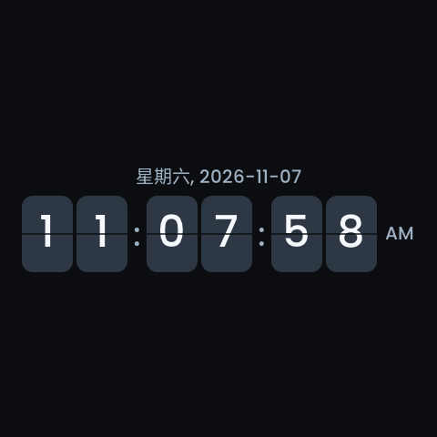
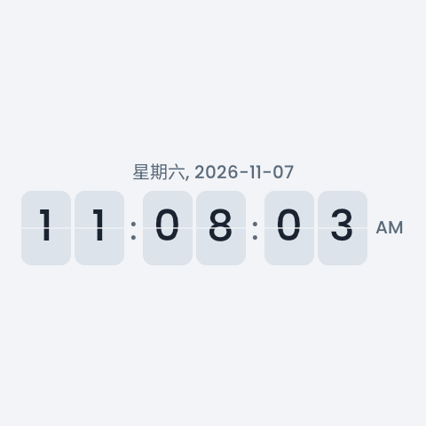

<!-- SPDX-License-Identifier: LicenseRef-FNCL-1.1 | Copyright (c) 2026 andre68723 -->
# S3 BMP screenshot validation

This 2026-11-07 trial covers the Guition ESP32-S3-4848S040 at 480 × 480.
It validates the BMP top-layer fix with the original dashboard underneath the
flip screensaver, page visibility changes and restoration of saved preferences.
It is a bounded trial on one board, not a sustained-load or other-board qualification.

## Firmware and OTA

- Source: `48aa8b35-dirty`, project `betta-ha-panel-s3`, version `v0.9.1`, ESP-IDF 6.1.
- Application: 4,384,256 bytes, SHA256
  `5125d2d2adca5b8ecccdb0811bf5a6c57b84c9ba1090e3290354034a36d02353`.
- Local matching ELF SHA256:
  `601ecd4bea4b98951c7307784151a13eeeab2f159a633da14213172112f91ab7`.
- The incremental build retains `Nov 7 2026 09:33:26` in `app_build_stamp` and
  October 30 in the IDF application descriptor. Identify this image by source
  and file hash, not either timestamp alone. The finished image was not rebuilt.

The first paced upload aborted with 214,720 bytes recorded by the device;
the client stopped at its 205-second deadline. The original image remained valid,
and layout/settings reads still matched the backup except live time/RSSI.
The retry temporarily disabled the clock saver and completed in 114 seconds:
HTTP 200, all 4,384,256 bytes written, followed by the expected OTA restart.
The owner also confirmed improved access-point placement; the move time was not
independently recorded. These changes do not isolate the earlier stall's cause.

The running source matched, OTA became valid, and Home Assistant authenticated.
Only the application was uploaded to the inactive slot; no NVS or filesystem image
was uploaded. The later tests saved visibility/preferences normally. No serial
connection, full erase or extra reset was used.
This HTTP trial did not read back raw flash or the running ELF hash. The local
hashes identify the uploaded artifact; `sha256_verified` in the upload response
is reserved for the published-release digest path and was false.

## BMP evidence

The old handler could return the base page successfully after a top-layer capture
failure. The fix captures opaque full-screen covers directly and rejects incomplete
captures; [host tests](testing.md#screenshots) cover failure cleanup and partial overlays.

The device retained its populated page beneath the saver. In both `dark_v2` and
`light`, two successive BMPs each decoded as complete 480 × 480, 24-bit images
of 691,254 bytes. The top 100 and bottom 100 rows contained only the saver background,
so neither the dashboard header nor bottom navigation leaked through.
Both themes had the same content bounds `(24,184)`–`(454,299)` (exclusive end),
centred hours/minutes/seconds, Chinese weekday/date and AM. Successive images
changed only the seconds digits. These are device LVGL snapshots, not photographs
or proof of physical refresh or touch.

The dark image is `saver-dark-later.bmp` and the light image is `saver-light.bmp`,
converted losslessly to PNG. Raw BMPs, hashes, settings, logs and comparison results
are retained in the ignored `.local/validation/panels3-bmp-ota-2026-11-07/` archive.

## Pages and saved preferences

The new preflight baseline contained three pages and three widgets, unlike the
earlier four-page trial. That current layout was backed up before writing.
One populated page was hidden/restored, then all pages were hidden/restored.
The all-hidden dashboard showed the default clock. Saved layout content matched
the new baseline exactly after restoration; the restored widget content area
also matched its pre-hide BMP pixel-for-pixel. No synthetic layout was loaded.

The device actually started in 24-hour mode. The owner's requested 12-hour mode
was saved and read back. The original dark theme, Matte appearance, language,
60-second flip-saver delay, 15% saver brightness and enabled 300-second off delay
were restored. Other preferences matched the baseline except live time/RSSI.
No graph widgets were present: this trial cannot establish retention of a populated
device graph history. Existing host history-retention coverage remains separate.

The owner confirmed centred, normal flipping, clear weekday/date and AM/PM,
and physical touch wake without operating an underlying control. Read-only
observations recorded the restored 60-second timeout entering the saver at
244 seconds uptime and returning to active at 318 seconds; no remote touch was sent.
At the final 421-second read, OTA remained valid, Home Assistant was connected,
and there was no additional reboot, safe mode or retained crash. After the captures,
minimum remaining HTTP-task stack was 7,344 bytes of 14,336 bytes. These observations
cover this short trial only.

## Submission review

The review added wrong-format and undersized-buffer failure cases for both
composited and opaque captures. All 60 dark/light screenshot scenarios passed,
along with clock protection and the 59,516 flip-clock / 604 navigation checks.
An independent 59-check archive audit recomputed BMP structure, coverage, pixel
comparisons, PNG provenance, layout/settings equality and OTA/wake evidence.
Read-only device checks still matched the accepted layout and preferences except
live time/RSSI, with 12-hour format retained. The production screenshot source
remained identical to the accepted image; this review made no device writes,
firmware build or flash. Only tests and evidence wording changed during review.
