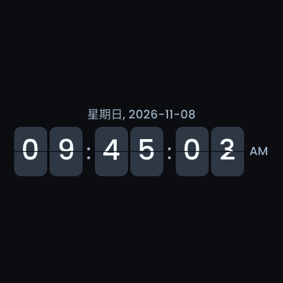

<!-- SPDX-License-Identifier: LicenseRef-FNCL-1.1 | Copyright (c) 2026 andre68723 -->
# S3 ce2ffa7 validation

Guition ESP32-S3-4848S040, COM18 / `192.168.71.76`, 2026-11-08.
The owner authorized rebuilding commit `ce2ffa7`, backing up the device,
replacing only its application and validating entity discovery and the flip
screensaver. This record supersedes no earlier measurements: the
[21:21:39 trial](panels3-http-budget-validation.md) used a different image.

**Eight real HTTP entity queries completed**, including four consecutive
queries and an explicit same-keyword refresh. Initial low-memory waits ended
through bounded priority admission without a reset. Keyword switching, picker
close/reopen and generation-scoped cancellation passed. The owner confirmed the flip saver,
correct New York time and touch wake. No terminal query timeout occurred;
post-timeout UI Retry therefore has local regression evidence only in this run.

## Exact image and application-only flash

The clean source was `ce2ffa72cdbc42c6a644e0d2525d859a72f319f3`.
`scripts/build.ps1 panels3 reconfigure build` passed with ESP-IDF v6.1.
The frozen image was packaged once and flashed without rebuilding. All 800
archived tracked-source hashes still matched after validation.

| Identity | Verified value |
| --- | --- |
| Project / version | `betta-ha-panel-s3` / `v0.9.2-rc1` |
| Runtime source | `ce2ffa72`, clean committed sources |
| Runtime and editor build stamp | 2026-11-08 22:34:30, host Asia/Shanghai |
| App size / OTA slot free | 4,494,352 / 2,321,392 bytes (34% free) |
| App SHA-256 | `ab48584fc11204efa82cbea647dd6f75140eb83859b374a55ff18b57ee87b265` |
| ELF SHA-256 | `232c5f6a74f85839ab9ca16190007f443740a35675f65d2d28120945e1af5273` |

The IDF application descriptor retains the incremental-build time **16:27:36**;
the runtime stamp, committed source and image hashes identify this build.
The sdkconfig, bootloader and partition table match the previous 21:21:39 image
byte for byte. No board, stack, display or partition configuration was changed.

HTTP identity and COM18's ESP32-S3 revision 0.2/MAC matched before writing.
The previous app matched the archived 21:21:39 image. Its exact bytes were
backed up; the unused app tail was not archived. Raw NVS/boot metadata, crash
storage and LittleFS were archived, together with layout/settings and logs.
Only active `ota_1` at **`0x6A0000`** was written. The app device digest matched;
before/after device checksums matched for metadata, crash storage, LittleFS
and the complete inactive app slot before normal boot resumed.

Boot sequence advanced **114 → 115**. The boot log has the matching ELF prefix,
successful HTTP startup, HA authentication and network time synchronization.
After the serial handle closed, readback at uptime 565 seconds was still boot
115, authenticated, synchronized, `valid`, outside safe mode and without a
retained crash or UI-watchdog restart. Replacing an already-valid active slot
does not arm a fresh OTA pending-verification cycle; rollback is not qualified.

The 542.9-second serial capture reused the flasher's handle; COM18 was not
reopened. It retains 79 transient startup LVGL-lock failures, a deferred splash
hide, a live-display timeout and nine HA energy-preferences warnings. These
were not query failures, but the trial must not be described as warning-free.
The later BMP and physical confirmation establish subsequent display operation.

## Entity-query lifecycle

One fresh in-app-browser editor showed the new build stamp. **Panel follows
remained unchecked**. The existing LED page was selected only in the editor;
no result widget was selected, and Save was never used. The test tab was closed
before the API checks. Owner browser tabs were left untouched. The separate
memory observer made no entity-query requests.

| Check | Observed result |
| --- | --- |
| Editor `button`, generation 1 | Internal-memory wait, then four results. |
| Change to `light`, generation 2 | Twelve results; no old-keyword restart. |
| Change keyword during a wait | Generation 3 (`button`) cancelled before generation 5 (`light`) started. |
| Close pending picker | Generation 5 cancelled; reopening showed an empty search. |
| Search after reopening | Generation 7 (`button`, Enter) returned four results. |
| Stale generation and cancellation | Old generation 8 could neither restart nor cancel newer generation 10. Matching cancellation stopped 10; a later poll returned terminal `replaced`. |
| Four sequential queries | Generations 12–15, `button/light/button/light`, returned 4/12/4/12 results in 8.950/8.956/8.949/9.020 seconds. |
| Explicit same-keyword refresh | Generation 16 (`light`, `refresh=1`) returned twelve results in 8.786 seconds. |

All twelve queued generations map to deliberate browser or protocol-test
actions. No spontaneous `button`/`light` alternation appeared. The stale-client
check used ordered API requests representing two clients, not simultaneous
browser sessions.

The editor visibly explained insufficient internal memory. Initial admission
still requires 40 KiB; after roughly eight seconds the protected priority path
admitted these plain-HTTP queries with a 34 KiB free / 8 KiB largest-block
floor. Free internal memory did not have to recover to the initial 40 KiB
floor. This proves a wait-to-success transition through the priority policy,
not recovery from a forced allocation failure or the earlier fragmented heap.
No configuration change, network change or reset was used to unblock queries.

The table's durations run from the first client request to its terminal reply,
including the approximately 1.2-second polling interval; they are not HA server
execution times or isolated HTTP-transfer timings.

No request reached a 45-second stall timeout or 180-second total deadline.
The explicit refresh above validates a new request for the same keyword, not
UI Retry following an observed timeout. The 8.5 KiB largest-block condition
from an older trial was not reproduced. These distinctions remain essential
when comparing this success with earlier low-memory failures.

## Shared-client memory and stacks

Eight client initializations, successful page parses and safe-point releases
were recorded. All releases used `reason=internal_memory`; the separate
two-second idle-only branch was not exercised on this device.

| Measurement | Observed bytes |
| --- | --- |
| Internal-free decrease at client initialization | 1,272–1,296 |
| Internal-free increase at client release | 1,696–1,724 |
| Lowest per-page sampled internal free | 35,183–35,747 |
| Lowest per-page sampled largest internal block | 15,360 throughout |
| Five-second observer, all workloads | 34,683–40,591 free; 96 samples, no collection errors |
| Final internal free / largest block | 37,859 / 14,848 |

The page figures are stage samples taken during request processing, including
the corrected pre-cleanup parse sample. They include concurrent activity and
are not allocator peaks. Release deltas also include transport/request state;
they do not establish the size of the client object alone. The wider observer
range includes rendering, a BMP capture and the owner's language change.

Compared with the [preceding trial](panels3-http-budget-validation.md#shared-client-memory),
client release and successful-query margins remained similar. The earlier
low-memory timeout did not recur in this bounded run. This is not proof of
leak-free indefinite operation or qualification at every memory boundary.

After queries and BMP capture, least-ever free stack was HA **5,384/12,288**
bytes, WebSocket **5,940/8,192**, HTTP **7,444/14,336**, LVGL **12,648/20,480**
and UI runtime **9,172/16,384**. Boot-wide internal low-water was 7,796 bytes;
that startup measurement must not be substituted for query-stage memory.

## Data and screensaver preservation

The five pages and thirteen widget definitions remained byte-identical:
3,186 bytes, SHA-256
`aa13870324a9cb46ecabd7fba863e6675cff40afb4797508ee2c0eee304044d7`.
The saved theme also matched. Whole-LittleFS checksums establish preservation
across the flash before boot resumed, including any stored graph files. The
trial layout had no Graph widget, so populated graph-history rendering was not exercised.
Normal runtime writes after boot are outside that flash checksum comparison.

The preflight timezone was **America/New_York**. The owner explicitly requested
retaining it, superseding the original Asia/Tokyo instruction. During testing,
the owner changed English to Simplified Chinese and confirmed retaining it.
Final settings differed only by that authorized language change and live
time/RSSI values; the original backups were not overwritten.

Flip style, **12-hour format**, date/seconds, **22:00** night start, 06:00 night
end, 60-second saver delay, 15% brightness and enabled 300-second screen-off
were preserved. No settings write, layout write, test layout, graph-history
reset, HA service call, time-setting request or extra device reset was issued
by the validation tools. The log records the owner's settings save separately.

The owner confirmed centred flipping, correct New York time, clear weekday
and date, AM/PM, normal touch wake and no underlying-control activation.
The 480 × 480 BMP below separately shows the flip saver at **09:45:03 AM
America/New_York on 2026-11-08**, with the retained theme and Chinese locale.
It is an LVGL snapshot, not a physical framebuffer or touch measurement.
The published source PNG is pixel-identical to that BMP; its SHA-256 is
`9d9298eeb8a1354d2b1f0b86715ce0858b31894e681628828c51d6ab84eb129a`.

## Local checks, evidence and limits

Targeted local reruns passed **eight C executables** (16 compile/run steps):
policy, shared session, production request and API tests for S3 and a P4
panel4 profile. All **25 entity-query web tests** passed. They cover memory
wait/recovery, timeout, cancellation, retry, late responses, close/reopen,
header failures, post-I/O deadlines and allocation-failure cleanup. These
controlled failures are local tests, not failures induced on the panel.
No firmware source or tracked test was changed during this validation.

The offline device-evidence audit, documentation size/whitespace checks and
strict site build passed. The three linked records passed six HTTP/browser
checks at 1440 and 390 pixels, with two image-zoom open/close checks. The first
loopback server was unreachable under restricted execution; the authorized
local-server rerun passed. Browser policy blocked `file://`, so offline browser
navigation was not exercised or counted as a pass. Local HTML link/asset checks
provide separate static evidence only.

The private evidence directory is
`.local/validation/panels3-ce2ffa7-com18-2026-11-08/`: raw backups and checksums,
boot log, query responses, memory series, final comparisons, owner confirmations,
local test logs and the offline evidence audit. The frozen image/ELF/config
archive is `.local/firmware/panels3-ce2ffa7-2026-11-08/`. Its creation-time
`flashed: false` describes packaging; this trial's `flash-result.json` records
the subsequent installation. The published PNG is an unedited conversion of
the archived BMP; its capture metadata carries the firmware source stamp.

Not covered on this image: terminal timeout and post-timeout UI Retry,
HTTPS/TLS memory, artificial fragmentation/allocation failure, negative or
partial HTTP headers, delayed I/O, idle-only client release, multiple-page
entity results, populated graph history, long-duration stress, OTA rollback
or P4 hardware. Existing local coverage does not convert these into device
passes. No commit or push was performed during the 2026-11-08 device trial.

## Documentation review

The 2026-11-09 pre-commit review independently recomputed image/backup hashes,
all twelve queued generations and eight completed queries, memory ranges,
saved-state differences and BMP/PNG pixel equality from the archived evidence.
It retained the successful C/web results above: firmware and test inputs are
unchanged, so this documentation-only review did not rebuild firmware or
repeat those tests. Original evidence was preserved in place; review outputs
are under `.local/validation/panels3-ce2ffa7-review-2026-11-09/`.

The review clarified priority admission versus actual heap recovery, client
polling time versus server execution time, and the pre-boot boundary of the
storage checksum. It made no device HTTP request, serial open, flash, reset,
query or configuration write. The retained baseline is Simplified Chinese,
America/New_York, 12-hour flip clock and 22:00 night start. This is an offline
review of the dated trial, not new hardware qualification.

The refreshed strict site build, source-size and whitespace checks passed,
along with 466 static local references, six wide/narrow HTTP page checks,
two screenshot-zoom open/close checks and the new review-section anchor.
The earlier `file://` browser restriction remains an explicit gap; static
file checks are not a substitute for offline browser execution.
