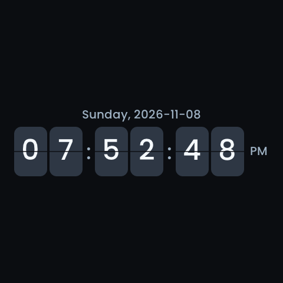

<!-- SPDX-License-Identifier: LicenseRef-FNCL-1.1 | Copyright (c) 2026 andre68723 -->
# S3 discovery follow-up validation

Guition ESP32-S3-4848S040, COM18 / `192.168.71.76`, 2026-11-08.
The owner authorized application-only flashing of the
[prepared follow-up](panels3-entity-discovery-followup.md), entity-query checks
and physical screensaver acceptance. No layout, theme, settings or HA writes,
synthetic layout, additional firmware build/flash, commit or push were performed.

**Bounded-query behavior passed, with a memory limitation:** real `button` and
`light` queries returned four and twelve entities. Cancellation, keyword/picker
transitions, terminal timeout and generation isolation passed. In between those
successes, low total internal memory caused two timeouts, including after closing
the test editor. A later retry succeeded after natural memory recovery. Immediate,
reliably repeated discovery is **not qualified** by this trial. The owner accepted
the flip saver, 12-hour display and touch wake.

## Image, flash and startup

COM18's ESP32-S3 revision 0.2 and MAC matched the HTTP panel before writing.
The old application was verified and archived. Only active `ota_1` at `0x6A0000`
was written; the partition table, bootloader, NVS, OTA metadata, crash partition,
LittleFS and entire inactive application slot had matching device checksums
before and after flashing, before normal boot resumed.

| Identity | Verified value |
| --- | --- |
| Project / version | `betta-ha-panel-s3` / `v0.9.2-rc1` |
| Source / ESP-IDF | `cef3fce1-dirty` / `v6.1` |
| Editor and `/api/version` build stamp | 2026-11-08 19:25:59 |
| Application size | 4,493,616 bytes |
| App SHA-256 | `980a884588e3f635e4392a877368d9d04319f614c7c3e2eb5f05a1373ea702b9` |
| ELF SHA-256 | `b7bb0a79bba0759b2decf1ef6cae0f6d816283feae633bfee116f4c4656f97b8` |

The IDF application descriptor still contains **16:27:36** from its earlier
incremental build. Both the archived image inspection and boot log contain that
descriptor timestamp and the new ELF hash. Image checksum, ELF identity and the
runtime/editor stamp establish the running image; a timestamp alone does not.
The bootloader's older build date is expected because it was not reflashed.

HTTP started at 19:42:31, touch initialized, HA authenticated at 19:42:36 and all
9 layout entity subscriptions synchronized. Boot sequence advanced 112 → 113;
the first end-of-test comparison was at uptime 654 seconds, with no extra reboot
or crash. Closing serial left sequence 113 unchanged; the later retry also ran
in that same boot. The final post-retry comparison at uptime 1,201 seconds still
reported sequence 113, valid firmware, HA authenticated and no retained crashes.
The existing active slot remained `valid`. Replacing that slot in place did not
arm a fresh OTA pending-verification cycle, so this is not an OTA rollback test.

The 669.6-second serial capture used the same serial handle after flashing.
It includes background HA energy-preference/update-check warnings, one RGB DMA
recovery and transient LVGL-lock failures during page activity. They are retained
observations, not evidence of another boot; UI watchdog restart count stayed zero.

## Real query and lifecycle results

The test used one fresh in-app-browser editor with **Panel follows unchecked**.
Existing owner Chrome tabs, including unsaved editor work, were left untouched.
Their presence does not identify the source of the historical alternating trace.
No parallel API entity poller ran during the UI sequence.

| Check | Observed result |
| --- | --- |
| Initial `button`, generation 1 | Queued 19:47:24; internal-memory wait; HTTP began 19:47:32 and returned four entities. They appeared in the add-widget dialog. |
| Change to `light`, generation 2 | Old keyword did not restart. Free memory remained below admission; device terminated after 45 seconds. |
| Timeout display | Waiting changed to “Entity search timed out. The panel has too little free memory. Select Retry.” with a Retry button. |
| Retry | Started a new `light` generation 3. It remained memory-limited; it was cancelled by the next intentional keyword change. A successful retry is not claimed. |
| Pending `light` → `button` | Cancellation logged before new generation 5; no recurring old-keyword query. |
| Button shortcut while general search pending | General picker closed/cancelled; field picker started generation 7 with an empty search, then generation 9 for the deliberately entered `light`. No simultaneous general-picker poll resumed. |
| Field-picker close and general-picker reopen | Generation 9 cancelled before new `button` generation 11. Only the intended query continued. |
| General-picker close/reopen and Enter | Generation 11 cancelled before `light` generation 13. One new query, then cancelled on close. No widget was selected or saved. |
| Stale poll and DELETE, separate API phase | Old generation 15 could neither restart `button` nor cancel newer `light` generation 17. Matching cancellation stopped 17; a subsequent old poll was terminal `replaced`. |
| Query after test-tab closure | `light` generation 19 again timed out for internal memory; terminal response observed at 46.066 seconds. Its failed state was then explicitly cancelled. |
| Natural recovery and explicit retry | A later read-only check found free memory above the priority floor. Generation 21, started with `refresh=1`, waited and then returned twelve `light` matches in 10.507 seconds, without reset or configuration changes. |

Every queued keyword in this capture maps to an intentional test action. There
was no spontaneous `button`/`light` alternation in this bounded sequence. The
two-client protocol check used two generations in sequential API requests; it
was not a simultaneous two-browser UI test. Delayed network replies, allocation
fault injection, rapid typing and overlapping browser contexts retain the local
regression evidence described in the follow-up implementation record.

## Measured memory and remaining limit

The configured HA connection uses `ws`, with a plain HTTP template request.
This trial does **not** qualify HTTPS/TLS request costs. There were two successful
template requests: the first in the serial capture and the later retry in the
device's HTTP log. Neither triggered a request-stage guard.

| First successful request measurement | Bytes |
| --- | --- |
| Internal free before HTTP-client creation | 37,755 |
| Internal free after HTTP-client creation | 36,503 |
| Observed initialization delta | 1,252 |
| Request body / response | 2,930 / 630 |
| Minimum sampled internal free during request | 34,523 |
| Minimum sampled contiguous block during request | 16,384 |
| Internal free at parse completion | 35,543 |

The initialization-to-request sampled reduction was 3,232 bytes. It includes
concurrent tasks, is not an isolated allocation total, and can miss intermediate
peaks. No stage fell below the protected 24 KiB/4 KiB connected-request limits.

The 20:00 retry started with 37,047 bytes free in the diagnostic snapshot. It
reused the HTTP client: the page log began at 37,663 bytes free, sampled a minimum
of 36,675 bytes with a 16,384-byte largest block, and ended at 37,339 bytes.
Its body/response were 2,929/1,659 bytes. The terminal response contained twelve
entities. These values are independently captured stage samples, not a heap trace.

After that request, the first `light` wait repeatedly reported **36,255 bytes**
free: **609 bytes below** the unchanged 36 KiB priority admission floor. The
contiguous block was 16 KiB and met the new 8 KiB requirement. Closing the test
editor did not restore enough total memory: the final query's logged waits were
35,319–35,903 bytes. The shared HTTP client remains allocated after success;
its measured 1,252-byte initialization cost and retained state are relevant to
the next admission decision. Other activity also changes the heap, so this is
not proof of a leak or that the client explains every lost byte. The later
successful retry demonstrates natural recovery; it does not erase the two
observed timeouts or establish that every search will fit the reserve promptly.

This boot had 13,824–17,408-byte contiguous blocks in the observer samples,
not the earlier boot's persistent 8,704-byte block. The 8.5 KiB case is covered
by host tests, not newly demonstrated on hardware. Further work must account
for retained client allocations and admission versus request-stage reserves,
without simply removing memory protection.

The read-only observer saved 149 valid samples at uptimes 81–564 seconds,
with internal free 31,543–39,631 bytes. Its Windows file write failed after the
last sample; the finalizer preserved valid JSON. Sampling therefore does not
cover the whole trial. The continuous serial log and independent before/after
API captures cover generation 19 and the state comparisons. The later generation
21 retry is covered by its API responses and the device HTTP log; serial was not
reopened to capture it, avoiding another reset.

At the first end-of-test capture, internal free was 35,287 bytes and largest block
16,384 bytes. After the successful later retry, internal free was 36,835 bytes.
Least-ever free stack: HA 5,384/12,288 bytes, WebSocket 5,940/8,192, HTTP
7,496/14,336 after BMP capture, LVGL 12,712/20,480, UI runtime 10,852/16,384.
The 7,796-byte boot-wide internal low-water predated discovery and did not fall;
neither that number nor stack low-water isolates this request's peak usage.

## Retained data and physical display

The final layout remained byte-identical: 1,661 bytes, three pages and three
widget definitions, SHA-256
`2ddd60ca08e358b086f10cd33abbfe3543d6f5690bf5f437c8ed6b6a4cdb3f75`.
Theme and settings matched, excluding live clock/RSSI fields. Flip style,
12-hour format, seconds/date display, 60-second saver delay, 15% brightness and
enabled 300-second screen-off setting remained unchanged.

LittleFS preservation was checked across the flash, including any stored graph
history. No test layout, graph deletion or history reset was used. The existing
layout has no Graph widget, so populated graph-history rendering was not exercised.
Normal firmware boot/runtime writes are outside the before-boot flash checksum.

The owner confirmed centred flip animation, clear weekday/date and AM/PM,
normal touch wake and no underlying-control activation. The confirmation belongs
to this 19:25:59 image. The 19:52 BMP below separately shows the configured
dark-theme flip saver; it is an LVGL snapshot, not a physical framebuffer capture.

## Evidence and checks

Private flash backups/checksums, exact-image verification, boot log, partial
memory series, generation API responses, terminal timeout, final state comparison
and owner confirmation are under
`.local/validation/panels3-entity-discovery-followup-com18-2026-11-08/`.
The frozen image/source archive remains under
`.local/firmware/panels3-entity-discovery-followup-cef3fce-dirty-2026-11-08/`;
its creation-time `flashed: false` describes the earlier build phase. This trial's
`flash-result.json` records the subsequent authorized flash.

Firmware code and test inputs were not changed in this device-validation phase.
The earlier 552 Node tests, C S3/P4 policy/request/API checks and panels3 build
remain local results; they do not override the observed hardware memory limit.
The evidence audit, documentation source-size check, whitespace check and strict
site build passed. Four updated pages passed 32 HTTP/file, wide/narrow and page
scale combinations, including four screenshot zoom open/close checks.

The subsequent [HTTP budget update](panels3-http-budget.md) addresses retained
client memory and admission. Its local tests/build do not revise this image's
measured outcomes or constitute a new device trial.
