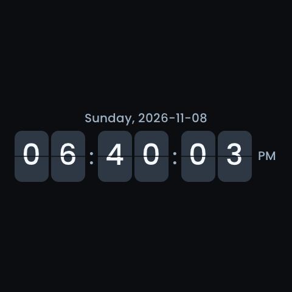

<!-- SPDX-License-Identifier: LicenseRef-FNCL-1.1 | Copyright (c) 2026 andre68723 -->
# S3 entity-search validation

Scope: Guition ESP32-S3-4848S040, `panels3`, 2026-11-08. Local regressions and
the application-only COM18 update passed. **Entity listing and low-memory
recovery did not pass the device trial**: the observed largest internal block
remains below the new admission floor. Timeout feedback and explicit retries
work, but do not establish successful discovery. No layout/settings save,
Home Assistant control action, commit or push was made.

This page preserves the **17:53:03 first-build trial**. The subsequent
[8.5 KiB heap and polling fix](panels3-entity-discovery-followup.md) was built and
tested locally without another device update; it does not supersede the failed
hardware result below.

## Captured failure

Read-only evidence came from the owner's panel at `192.168.71.76` (COM18 identity
established by the earlier trial). It ran source `ad9488e5`, runtime build
2026-11-08 15:40:01, with `ha_auth=ok` and current UI heartbeats.
The entity endpoint returned HTTP 200, `connected=true`, `pending=true`,
`phase=template` and zero loaded items for `domain=any&search=button`.

The log reported `reason=internal_heap_priority`, `wait=436372 ms`,
`int_free=40047`, `int_largest=16384`, `ws_q=0`, `initial_done=1`.
The generic discovery floors were 120/48 KiB (free/largest internal block),
relaxed after eight seconds to 64/24 KiB. Neither pair was reachable at that
idle memory level, so the HTTP template request had not started.
The later `cef3fce` startup fix preserved those discovery thresholds.

The unmodified add-widget function was replayed against that captured response:
after 90 polls at 700 ms it still displayed **Waiting for Home Assistant...**.
That replay used virtual timers and made no device requests.

The layout was byte-identical before/after diagnosis: 1,661 bytes, SHA-256
`2ddd60ca08e358b086f10cd33abbfe3543d6f5690bf5f437c8ed6b6a4cdb3f75`.
No history or settings write was made. This is not a new flash-storage digest
comparison or a new physical screensaver/touch test; the existing flip saver,
12-hour setting and earlier owner acceptance remain untouched.

## First-build allocation review and policy

Sizes below are from the linked S3 ELF's DWARF types, not host pointer sizes or
a measured transient heap peak:

| Allocation | Size / placement |
| --- | --- |
| Ready discovery cache | 640 × 528 = 337,920 bytes, PSRAM |
| Pending discovery items | 640 × 580 = 371,200 bytes, PSRAM; freed on finish/cancel/timeout |
| Query text | 4,096-byte allocation in PSRAM |
| Serialized request body | 3,020 bytes in the tested room-query case; cJSON uses PSRAM first |
| S3 response | At most 8,192 allocated bytes, PSRAM only |
| cJSON node | 40 bytes on S3; nodes/strings use the existing PSRAM-first hooks |
| HTTP client/parser/auth/data/buffer control structs | 488 bytes combined, before transport, headers and allocator overhead |
| HTTP I/O buffers | 2,048-byte receive and 1,024-byte transmit; existing shared client |

The tested S3 configuration prefers PSRAM for allocations above 1,024 bytes
and uses `CONFIG_MBEDTLS_EXTERNAL_MEM_ALLOC`. The 14 KiB HTTP-server task and
12 KiB HA task are unchanged; no discovery worker/task stack is added.
Captured HA-task stack low-water was 3,860 bytes **before a successful discovery**,
so it does not qualify the new request path's stack use.

S3 admission requires 40/16 KiB internal memory initially, then 36/12 KiB after
eight seconds, plus 96 KiB free PSRAM and a 16 KiB PSRAM block. These are
conservative admission budgets for the bounded path, not measured TLS peaks.
The request uses 12 entities per page instead of 40; an oversized page is retried
at half the size, down to one entity, without skipping its offset. A single
oversized entity produces an explicit error. The maximum result count stays 640.
Large S3 cache/response allocations cannot fall back into scarce internal RAM.

P4 retains 120/48 and 64/24 KiB floors, 40-entity pages, a 16 KiB response cap
and the existing allocation fallback. The shared background HTTP budget,
WebSocket grace period and subscription/sync/queue gates remain enforced.
Budget/network failures retry within the discovery deadline instead of waiting
forever. HTTP reads also check an overall five-second deadline between reads;
one blocking transport call can add its existing 2.5-second timeout.

Runtime `HTTP client memory` and `Page memory` log lines can provide allocation
samples once admission succeeds. Neither was reached in the COM18 trial below.
They are sampled before/after values, not a whole-request peak measurement.
No S3 success claim is based on the historical P4 TLS memory measurement.

## Local checks

- Host C: board-specific floors, captured S3 idle values, internal/PSRAM
  protection, memory recovery, stalled/total deadlines, smaller-page retries,
  cancellation, stale generations and explicit restart after failure.
- HTTP C harness: production query/body and response code with chunked replies,
  authentication rejection, short writes, incomplete/oversized/invalid replies,
  slow reads, header allocation failure and injected allocation failures.
  Hardware/network calls are stubbed; tests verify cleanup and S3's no-fallback rule.
- Editor: real search functions and Retry events, low-memory feedback/recovery,
  server and legacy-firmware timeouts, bounded progress, cancellation ordering,
  close/type races, retained layout/search, transport failures and seven languages.
- The complete Node editor suite passed **543 tests**, including 16 new discovery
  tests. Slow replies and cached-list refreshes cannot defeat elapsed-time deadlines.
- Discovery policy executables passed for S3 and all five P4 profiles. HTTP
  harnesses passed on S3/P4, including 26 allocation-failure positions per profile.
  Existing entity-search/name-cache executables and six S3 configuration tests passed.
- Web source/bundle checks, generated translations, source/doc ceilings and host
  runner syntax passed. The normal P4 host runner now includes the S3 discovery
  cases; this Windows session ran the focused C commands, not the full host suite.
- Browser checks use production HTML/CSS/scripts with synthetic loopback responses:
  1440/390 px, dark/light themes, English/Chinese/German, **12 combinations**.
  Memory and longer permission messages, localized Retry, control bounds, close
  and retained layout passed. These are headless Chromium checks, not device captures.
- Strict documentation build passed. Four affected pages passed 32 HTTP/file,
  wide/narrow and page-scale combinations, including local links and image bounds.

## Firmware build

The project wrapper built `panels3` with ESP-IDF **v6.1** (resolved IDF component
6.1.0). The source stamp is **`cef3fce1-dirty`** because the fix is intentionally
uncommitted. Runtime `app_build_stamp`: **2026-11-08 17:53:03**. The incremental
ESP-IDF descriptor retains 16:27:36; use the runtime stamp and hashes below to
identify this image, not that descriptor time alone.

| Artifact | Result |
| --- | --- |
| Application | 4,491,648 bytes |
| App SHA-256 | `797755e2f514629e2fb1bea80b7c308b2153e5b928eb15356244c159d77d6c5b` |
| ELF SHA-256 | `13ba7df1adc99fda09e0aab1e26a3be48b32ea0778f812f405bb73d1bca0a384` |
| Application slot remaining | 2,324,096 bytes (34%) |
| Generated sdkconfig, partition table, bootloader | Byte-identical to the previous archived `cef3fce` build |

The map's internal heap start moves by 48 bytes to `0x3fcb4aa0`; IRAM text remains
78,299 bytes. SDK configure warnings about an unused `esp_hosted` directory and
private component includes remain; `esp_hosted` is absent from the S3 linked
component list. There are no new compiler errors. The same archived image was
subsequently flashed in the owner-authorized trial below; it was not rebuilt.

## COM18 application-only trial

The panel at `192.168.71.76` was identified through HTTP before opening COM18.
Its network MAC matched the serial chip, ESP32-S3 revision 0.2 with 16 MiB flash.
The previous `ad9488e5` application, installed partition table and active OTA
selection matched the archived image and read-only diagnostics.

Only active **`ota_1` at `0x6A0000`** was written. Esptool verified the new app
against flash. Before boot, device digests confirmed identical bootloader,
partition table, NVS/OTA/PHY metadata, complete coredump and LittleFS partitions,
and the inactive application slot. Raw protected-storage backups and the exact
previous application were retained; its unused slot tail was not archived.
This preserves stored graph files across the write. No graph widget was present,
so populated graph-history behavior was not exercised.

The existing serial handle captured **555 seconds / 44,269 bytes** without
reopening COM18. Startup identified ELF `13ba7df1a`, passed the PSRAM test,
started HTTP on port 80 with 12 clients, initialized GT911 and authenticated HA.
At uptime **575 seconds**, source/build still matched, boot sequence remained
112, HA was authenticated, UI heartbeats were current and there was no new crash
or safe mode. `ota_image_state=valid` reflects the retained validated slot;
this app-only replacement did not arm a new pending-verify OTA cycle.

### Entity picker results

The deployed editor was exercised in the in-app browser on the original LED
page, with Panel follows unchecked. Only the search dialog was used; no entity
result was selected and no layout was saved.

| Check | Observed result |
| --- | --- |
| Add-widget entity search | **Failed**: `button` never reached a template HTTP request |
| Low-memory feedback | Passed: explicit insufficient-memory message replaced generic waiting |
| Timeout | Passed: server stopped the first query after about 45 seconds; UI showed timeout and Retry |
| Retry button | Passed for restarting work and retaining the keyword; listing still failed on the memory gate |
| Close pending search | Cancellation recorded at 18:38:18; no successful result was installed |
| Recovery after closing editor | **Failed**: isolated API retry still saw an 8,704-byte block and timed out at 46.219 seconds |
| Reopen timed-out search | Existing terminal state remained visible until explicit Retry |

The keyword-change check also recorded interleaved `button`/`light` requests.
The owner subsequently confirmed **no other entity-search operation** during
that interval. Do not attribute the overlap to owner activity. Device logs do
not identify which page or polling task issued each request; stale work,
overlapping picker activity and test-browser lifetime remain unproven causes.
The later `light` cancellation was recorded at 18:41:57. Keyword-change
cancellation is **not fully qualified on hardware** by this trace.

Follow-up local checks passed all 16 discovery tests and a scheduled-callback
replay of changing the keyword during the poll delay, resuming the old timer,
polling the new keyword and closing the dialog. The old loop stopped and the
layout remained unchanged. These checks did not reproduce or explain the live
overlap, so they do not convert that hardware result into a pass. No device
request or firmware change was made for this clarification.
The stable, single-query timeout above established the separate memory-gate
failure before the overlapping requests.

No artificial memory pressure was added: the real board was already below the
continuous-block floor. Closing the test editor did not restore that block.
The host recovery tests remain useful, but are not hardware recovery evidence.

### Measured memory and preserved state

| Measurement | Actual device result |
| --- | --- |
| Internal free, 159 samples at roughly three-second intervals | 31,331–39,891 bytes |
| Largest internal block, all 159 samples | 8,704 bytes (8.5 KiB) |
| Closed-editor query, 40 samples | 35,003–39,139 internal bytes free; block remained 8,704 bytes |
| Required priority floor after eight seconds | 36,864 bytes free and 12,288-byte block |
| HA task least-ever free stack | 5,168 / 12,288 bytes |
| HTTP task least-ever free stack after BMP | 7,376 / 14,336 bytes |
| Boot-wide internal low-water | 7,796 bytes, already observed at startup before discovery |

The continuous-block requirement is still incompatible with this boot's heap.
There were **zero template HTTP attempts**, so HTTP/TLS transient allocation
cost and successful-query stack use could not be measured. The values above
are sampled process memory and boot-wide low-water, not an isolated request peak.
The pending PSRAM buffer was released on timeout; final free PSRAM was 1,202,740
bytes. Additional background activity prevents treating sample deltas as an
exact per-request allocation total.

The original three pages and three widget definitions remained byte-identical
(same 1,661-byte layout and SHA-256 above). Theme and saved settings matched,
excluding live time/RSSI. Flip style, 12-hour format, 60-second saver delay,
15% saver brightness and enabled 300-second off delay were preserved.

The owner confirmed centred flipping, clear weekday/date and AM/PM, normal
touch wake and no underlying-control activation. Read-only samples recorded
saver to active at uptime 306 seconds and saver again at 371 seconds.

This is a 480 × 480 LVGL snapshot from the identified image, not a photograph
or independent proof of physical refresh/touch. Physical acceptance came from
the owner; entity-query acceptance remains failed.

## Evidence and remaining hardware work

Private raw captures and hashes remain under
`.local/validation/panels3-entity-picker-2026-11-08/`; local fix/build logs are
under `.local/validation/panels3-entity-discovery-fix-2026-11-08/`.
The COM18 flash checksums, boot log, memory samples, terminal response, final
state comparisons and owner confirmation are under
`.local/validation/panels3-entity-discovery-com18-2026-11-08/`.
They are ignored local artifacts, not files required by the test suite.

The follow-up adjusts admission for the 8.5 KiB block and adds stage reserves.
Its subsequent [COM18 trial](panels3-entity-discovery-followup-validation.md)
records successful HTTP queries, total-memory timeouts and recovery after retry;
HTTPS and peak allocation remain unqualified. The failed first trial above did
not reset settings or load a synthetic layout to obtain a pass.
