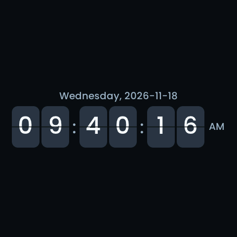

<!-- SPDX-License-Identifier: LicenseRef-FNCL-1.1 | Copyright (c) 2026 andre68723 -->
# S3 Live Display on 65d051b

On November 18, 2026, the Guition ESP32-S3-4848S040 on COM18 at `192.168.71.77`
streamed its 480 × 480 display and yielded remote control to local touch. All 54 logged
LVGL lock timeouts preceded the first viewer. Two connections still closed during
their first frame. Each recovered automatically on a new connection while Live Display
stayed selected. A subsequent local replay reproduced both stops at the same tile counts.
The [22:15:32 repair on COM18](#com18-validation-of-the-221532-repair) completed its
first 225 tiles on the original connection and continued through 40 delta frames.

## Image and data protection

| Item | Verified value |
| --- | --- |
| Source | Clean `65d051b353bdf36f037a5d54609e592d45c3c0e6` |
| Application | `panels3`, `v0.9.2-rc2`, ESP-IDF v6.1, `Nov 18 2026 21:38:15` |
| Size and SHA256 | 4,583,184 bytes, `ba740f946d5ebec8c628e9273262a0fa525e18b55bc13fe45183b177cbcd2980` |
| ELF SHA256 | `adaa83a56d2507dac1c5aaa372181cfd47ceacace42e9e04aa5a6814b0d197ba` |

Two authenticated exports from boot 130 agreed on the layout, settings, theme and
active slot. The archive also contains tasks, device logs, reboot history and OTA
status. COM18 identified the expected S3 revision 0.2 and partition table. The
installed application digest matched the archived 20:43:05 image. Before writing,
device digests verified backups of the low 128 KiB (including NVS and OTA metadata),
the 256 KiB crash partition and the entire 2,752,512-byte LittleFS volume.
The mounted copy contained no graph directory or saved graph payload.

The updater wrote only `ota_1` at `0x6A0000`. Readback verified the application
and matching before/after digests for every protected region and the inactive slot.
The bootloader selected the same offset and printed the expected ELF prefix `adaa83a56`.
The UART recorded GT911 registration, time synchronization and HTTP listening on port 80.
The incremental ESP-IDF descriptor retained its November 17 compile time. The running
API reported `65d051b3` and the November 18 build stamp. Boot 131 retained its valid
slot state. This in-place USB write did not start a new OTA rollback trial.

## Direct editor trials

Chrome signed in through the panel's login form. Caching was disabled. The two reloads
in the completed trial fetched `app.d1a60e082bd49c49.js` with HTTP 200 and matched
the bundle embedded in the application. The observer recorded trusted mouse clicks,
pane visibility and WebSocket traffic. No startup requests were delayed or replaced.
All seven session tickets returned HTTP 200 and the sockets upgraded with HTTP 101.

| Action | Observation |
| --- | --- |
| Quick click with Settings → Display remembered | Clicked 7.4 ms after the tab appeared. The first socket closed after 119 of 225 tiles without a frame acknowledgement. Automatic retry delivered a complete keyframe in 2.034 s from upgrade. The first test driver waited for the original socket and timed out after recovery. |
| Repeat the Settings → Display reload | Clicked after 10.5 ms. The original socket delivered its complete keyframe in 2.577 s. The editor stayed in Live Display through startup. |
| Quick click with Layout remembered, then **Disconnect** | Clicked after 14.5 ms and deliberately disconnected at 7 of 225 tiles (14,546 bytes). Frame download stayed disabled. There was no acknowledgement or new ticket during the 2.025 s quiet interval. |
| Select **Connect**, then keep viewing | The first reconnect closed at 70 of 225 tiles. Automatic retry on a new epoch delivered a complete keyframe in 2.025 s. The same socket then acknowledged 122 consecutive deltas during a 65.160 s observation, reaching sequence 123 including its keyframe. |

Every complete keyframe carried 225 distinct 32 × 32 tiles, totalling 460,800 RGB565
pixel bytes and 6,750 header bytes. The observer validated coordinates, payload lengths,
epoch, sequence, base and acknowledgement. Independently reconstructed pixels matched
the browser canvas at reconnected frames 1 and 123. The median interval between delta
acknowledgements was 0.457 s and the maximum was 1.940 s.

## Lock timeouts and heartbeats

The original COM18 handle captured 555.007 s of UART output (19,400 bytes). Serial
read windows on the host and Chrome's handshake wall-clock/monotonic timestamps
placed all 54 adapter lock timeouts before the first WebSocket upgrade. The last
timeout arrived at 08:44:04.185 New York time. The first upgrade was at 08:44:25.271.
No timeout appeared in any of the seven viewing sockets. The adapter message does
not identify its caller. Idle replies also cover normal polling and pending redraws.

The two interrupted sockets closed 5.334 s and 5.089 s after their last heartbeat
replies. The second trace also showed no new tile batch during the final 5.089 s.
Both intervals are consistent with the editor's five-second no-reply timeout. Neither
trace identifies where replies stopped. During continuous viewing, all 218 pings sent
in the observation window received replies, including one after the boundary. Median
round-trip time was 50 ms and the maximum was 999 ms. This run did not force a lock
timeout during a transfer or establish how many physical redraws the mirror sampled.
In the completed trial, free PSRAM measured 1,391,116 bytes before login, 912,240
while viewing and 1,407,032 after disconnect.

## Local touch and final state

The owner confirmed touches at approximately 21:48:54 and 21:51:52 Shanghai time.
On the explicitly coordinated tap, the physical screen responded. Successive heartbeat
replies 258 ms apart reported control granted and then revoked. The browser subsequently
sent its disable message, unchecked **Enable control** and stayed in **Viewing** on the
same socket. Another frame was acknowledged after revocation. The earlier tap had a
348 ms interval between those replies. Neither session sent a remote pointer event.
These intervals measure the spacing between replies. The S3 touch counters remained zero.

After the last tap, the layout was byte-identical to the pre-flash export (5 pages,
13 widgets, 3,186 bytes, SHA256 `aa13870324a9cb46ecabd7fba863e6675cff40afb4797508ee2c0eee304044d7`).
The active theme matched. Only local time and Wi-Fi signal strength varied in settings.
English, `America/New_York`, 12-hour time, the 22:00 night start, the 60-second flip
saver and `dark_v2` were preserved. After COM18 closed, uptime reached 608 s on the
valid image with no retained crash. Anonymous layout access returned HTTP 401 after logout.
Populated graph replay was outside the available evidence. Private backups, UART arrival
times, protocol traces and original captures are in `.local/validation/panels3-65d051b-com18-2026-11-18/`.

## First-frame transport diagnosis

### Evidence from the installed firmware

The last complete batch ended at tile 119 on the first connection and tile 70 on
the second. Each batch contained seven tiles and occupied 14,546 bytes. Chrome
continued sending application heartbeats after the last complete reply.

| Last complete tile | Complete batch bytes received | Pings sent / pongs decoded | Last pong to close |
| ---: | ---: | ---: | ---: |
| 119 of 225 | 247,282 | 21 / 4 | 5.334 s |
| 70 of 225 | 145,460 | 19 / 3 | 5.089 s |

At this stage the server reads a frozen capture, and its heartbeat handler checks
the control lease independently of LVGL. The COM18 capture contains no concurrent
lock timeout. Chrome recorded complete WebSocket messages. Neither trace recorded
the return value of a socket write or the bytes of an unfinished message.

Five more read-only connections to the installed `65d051b3` image each acknowledged
225 tiles. Four normal connections took 1.370–2.192 s. A fifth with a small receiver
buffer and an 800 ms read pause after tile 70 took 4.066 s. The intermittent failure
did not recur in these trials. Layout, active theme and settings digests matched before
and after, excluding the clock reading and RSSI from settings. The probes requested
no remote input and made no page, graph or configuration writes.

### Reproduction and repair on the host

ESP-IDF v6.1's `httpd_ws_send_frame_async()` calls the session sender once for the
WebSocket header and once for its payload. It accepts any nonnegative count.
The default sender returns the count from one socket write. lwIP can return a
positive partial count when its send timeout expires. The installed mirror had
a 250 ms send timeout and the S3 TCP send buffer was 8,192 bytes.

The local replay compiled the installed IDF writer and default sender and ran the
editor in Chrome over loopback. The socket accepted 8,192 bytes on a single
14,546-byte payload after tile 119 or 70. This count was a controlled input.
On the old transport, Chrome waited for the missing 6,354 bytes. Subsequent pong
frames occupied part of that payload. Chrome could dispatch neither the batch
that triggers the next tile request nor those pongs as independent messages.
The browser then reached its no-reply deadline.

| Injected short write after | Old editor and transport | Repaired editor and transport |
| --- | --- | --- |
| Tile 119 | Chrome decoded 2 of 18 pongs and stopped at 119 tiles. A second connection completed the keyframe. | The first connection acknowledged 225 tiles and received all 4 pongs. |
| Tile 70 | Chrome decoded 1 of 17 pongs and stopped at 70 tiles. A second connection completed the keyframe. | The first connection acknowledged 225 tiles and received all 4 pongs. |

The mirror now sends the remaining suffix and advances its tile cursor only after
the whole batch succeeds. A header or payload that cannot finish within 750 ms
fails the connection. The editor tracks frame progress separately from heartbeats
and backs off repeated reconnects until it acknowledges a complete frame.

The native sender test exercised split headers and payloads, interrupted writes,
temporary and persistent backpressure, zero writes and peer failures. All 639 web
tests passed, including a brief stall that resumes on the same socket and a
pong-only stall that requires a fresh keyframe. The LVGL host suites passed all
12 Guition and 48 P4-profile cases.

The `panels3` image used in the following COM18 trial is `65d051b3-dirty`, ESP-IDF v6.1,
`Nov 18 2026 22:15:32`, 4,584,592 bytes. The app SHA256 is
`c2b1b0bd99283335d39504012d53a169f463ce012cda34d6d93353947c811aff`.
The embedded editor is `app.bb0a8772da0e99e5.js`. The SDK configuration and
partition table match the 21:38:15 build. The original COM18 traces establish
the timing and the host replay establishes the short-write defect. Direct
attribution of either historical socket
would require a wire capture or a socket write count from that connection.

## COM18 validation of the 22:15:32 repair

On November 18, two authenticated exports from boot 131 agreed on the saved
layout, settings and active theme. The backup also included the task list,
runtime log and reboot history. COM18 identified the Guition ESP32-S3 revision
0.2 and the expected partition table. The installed app matched the archived
21:38:15 image. Before the write, device digests verified the low 128 KiB
(including NVS and OTA metadata), the 256 KiB crash partition and the complete
2,752,512-byte LittleFS backup. The mounted copy contained no stored graph files.

Only the active `ota_1` application at `0x6A0000` was written. Device readback
matched the 4,584,592-byte repair image. All protected-region digests, including
the inactive app, matched before reboot. The same COM18 handle captured boot
132 loading this offset with ELF prefix `d71f2bdc9`, starting the HTTP server,
registering GT911 touch and synchronizing time. The running API reported
`65d051b3-dirty`, `Nov 18 2026 22:15:32` and a valid slot. The in-place
application write retained the existing OTA validation state.

### Direct browser observations

Chrome signed in to the panel and loaded its editor over HTTP with caching disabled.
Both reloads returned the fingerprinted bundle `app.bb0a8772da0e99e5.js` with the
same SHA256 as the one embedded in the flashed app. The click and traffic observers
recorded normal panel responses throughout these trials.

| Action | Result |
| --- | --- |
| Open Live Display with Settings remembered | The trusted click landed 6.6 ms after the entry appeared, during startup. On the original socket, Chrome received tiles 70, 119 and 225 at 0.888, 1.126 and 1.633 s after upgrade. It acknowledged the complete keyframe at 1.697 s. The pane stayed selected. |
| Continue viewing on that socket | During 65.223 s the browser acknowledged all 40 deltas, sequences 2–41. All 217 pings sent in that window received replies, with 52 ms median and 301 ms maximum round trip. Between the keyframe and the first delta acknowledgement, Chrome received 165 idle replies and 152 pongs. |
| Disconnect before the first frame, then reconnect manually | With Layout remembered, the entry was clicked after 4.7 ms. Disconnect at 14/225 tiles left download disabled. No acknowledgement or new ticket appeared during the 2.223 s observation. **Connect** opened a new epoch and acknowledged 225 tiles in 2.634 s. |

On that first socket, tiles 77 and 126 arrived at 0.912 and 1.150 s, respectively.
Every complete keyframe contained 225 distinct 32 × 32 tiles. The RGB565 image
reconstructed from the trace matched the browser canvas at sequences 1 and 41
on the continuous connection and on the manually reconnected keyframe.

### Controlled pauses against the running panel

The next two trials delayed one outbound `next` request in the browser. They used
the installed editor, the real panel socket and the normal heartbeat timer.

| Pause | Result |
| --- | --- |
| Hold the next request at tile 70 for 1 s | Three heartbeat exchanges completed during the gap. Tile 77 arrived 1.090 s after tile 70. The original socket acknowledged all 225 tiles at 3.223 s after upgrade. |
| Hold the next request at tile 119 past the five-second progress limit | Seventeen heartbeat exchanges completed while the tile count stayed at 119. The editor closed the socket after 5.186 s without pixel progress. Automatic retry upgraded a new connection 0.617 s later and acknowledged its keyframe in 2.147 s. The delayed request expired on the old socket. |

### Controlled TCP send timeout and recovery

A separate read-only receiver used a 2,048-byte receive buffer and paused reads
after requesting the next batch. A 408 ms pause at tile 70 still delivered all
225 tiles on the same socket, with 14 of 14 heartbeats answered. With a planned
1.6 s pause at tile 119, COM18 recorded a send timeout after 12,288 of the next
14,546 payload bytes (`ETIMEDOUT`, 116). The panel closed the socket during the pause.

To check automatic recovery from that device-side close, Chrome used the installed
editor through a local test relay that paused reads only on its first mirror socket.
COM18 again logged 12,288 of 14,546 bytes and a send timeout. Chrome's first socket
closed 0.978 s after tile 119. Its own retry upgraded a fresh socket 0.646 s later,
acknowledged all 225 tiles in 2.079 s and received nine heartbeat replies. The
only click before recovery was opening Live Display. An earlier relay setup attempt
ended before any WebSocket opened and is excluded from the transfer results.
The host received the timeout log in a window 0.731–0.824 s after the relay
paused reads. The firmware does not timestamp the start of each socket write.

The full serial log contains 70 LVGL lock warnings. Across the six direct browser
connections, six warnings overlapped the
manually cancelled connection and one overlapped the short-pause connection.
All seven preceded the corresponding keyframe's `begin` message. None overlapped
the 65.223 s continuous observation. A spontaneous first-frame failure did not
recur in the ordinary direct trial. The firmware's successful write counts are
not logged, so the exact split of a successful write remains unmeasured.

### Final data check

The final authenticated export matched the original layout byte for byte
(5 pages, 13 widgets, 3,186 bytes). The active theme and all settings matched
after excluding current time and Wi-Fi signal strength. The panel kept English,
`America/New_York`, 12-hour time, the 22:00 night start, the 60-second flip
clock saver and `dark_v2`. LittleFS matched across the flash. The backup contained
no graph payload against which to test populated history.

Free PSRAM measured 1,427,292 bytes before login, 948,580 after the first frame,
910,940 during continuous viewing and 1,392,292 after the last disconnect.
These device-wide samples include the editor and background services.

The serial capture covered 712.484 s. Closing COM18 left the same valid image
running at 715 s uptime. The device reported no retained crash, and anonymous
layout access returned HTTP 401 after logout. The private backups, boot log,
browser captures and correlated timing audit are under
`.local/validation/panels3-first-frame-221532-com18-2026-11-18/`.

## Pre-commit build and local checks

Review reproduced a separate hang before the WebSocket opened. A pending ticket
could outlive **Disconnect**, or leave the editor connecting indefinitely. The
editor now aborts a pending request, including its response body, on disconnect
or at the five-second deadline. Chrome loopback trials held either the headers
or the body. The local HTTP peer observed both manual disconnects and both
deadline closures (5.008 and 5.012 s). Only the timed-out requests retried automatically.

All 641 editor tests, the native sender test and six build-configuration tests
passed. The sender test checks that a writable notification at the 750 ms deadline
cannot extend a partial write. In all 12 Guition and 48 P4-profile LVGL host
cases, closing before the first acknowledgement freed every capture allocation,
and a new viewer started read-only with a full capture. The Chrome/IDF replay
again completed 225 tiles and four heartbeat replies on the first connection
at each injected short write. The browser checks frame progress every 300 ms.
The firmware retains its ten-second total frame limit, checked on incoming messages.

The local ESP-IDF v6.1 `panels3` build is stamped `Nov 18 2026 23:03:35`
(`65d051b3-dirty`, 4,584,656 bytes, app SHA256
`10f4470c38b2182bca7a3b0f865ac33dd05b7cb1252da5657a109f39dfd71190`).
The embedded editor is `app.a3ee1b100062d305.js`. Of the 841 firmware source
inputs checked against 22:15:32, only `js/remote-display.js` changed. The SDK
configuration and partition table matched byte for byte. This build has local
coverage only. All COM18 results above belong to the 22:15:32 build or its
explicitly identified predecessor.
