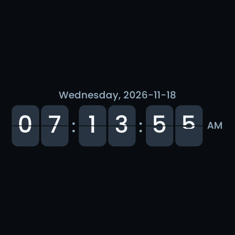

<!-- SPDX-License-Identifier: LicenseRef-FNCL-1.1 | Copyright (c) 2026 andre68723 -->
# S3 Live Display validation

Guition ESP32-S3-4848S040, COM18, `192.168.71.77`, 2026-11-18.
This trial follows the [diagnosis of the November 17 image](panels3-auth-png-validation.md#live-display-follow-up).
That image reported `remote_display: false` after its one-time mirror setup
timed out. Its connection budget also exceeded the free PSRAM measured on this unit.

After startup, two browser connections each received a complete first frame on the
19:21:36 image. Local touch revoked remote control while viewing continued. The owner
also confirmed a physical page change from a remote tap in a separate browser session.
The [20:43:05 trial](#installation-of-the-204305-image) exercised clicks during startup.

## Application image

| Item | Archived build |
| --- | --- |
| Firmware source | `5340a748-dirty` |
| Build stamp | `Nov 18 2026 19:21:36`, ESP-IDF v6.1 |
| Application size | 4,582,960 bytes |
| Application SHA256 | `09e09f25dd2dee2f61c553cdf85180e24535ed9fa0195fee308609781221a579` |
| ELF SHA256 | `0487b8e67a86fceb12a39171e0bcc41719e7ca27ed93829bf29256dc6c7eb319` |

## Before the update

Two authenticated HTTP snapshots collected the version, layout, settings,
theme, OTA status, recent logs and reboot history before COM18 was opened.
The old application reported boot 128, normal mode, no retained crash
reports and `remote_display: false`. Both snapshots recorded 1,392,184
bytes of free PSRAM.

The layout exports matched byte for byte, with five pages, 13 widgets and
SHA256 `aa13870324a9cb46ecabd7fba863e6675cff40afb4797508ee2c0eee304044d7`
(3,186 bytes). No page contained a Graph widget. A read-only mount of the
LittleFS backup found no `/graphs` directory or saved graph payload.
Only the advancing local clock differed between the two settings responses. The baseline used English,
`America/New_York`, 12-hour time, a 22:00–06:00 night window and enabled login
protection. The flip saver was set to 60 seconds, 15% brightness and screen-off
after 300 seconds. The active theme was `dark_v2`.

## Flash and boot

The COM18 ROM identified the ESP32-S3 revision 0.2. The previous
4,581,200-byte application matched the archived image by device digest. Backups
covered the low 128 KiB (including NVS and OTA metadata), the full 256 KiB
coredump partition and the full 2,752,512-byte LittleFS volume. Each backup's
MD5 matched the device. The inactive 6,815,744-byte slot was digest-checked.

Only the active `ota_1` application at `0x6A0000` was written. A second device
digest verified the application, both protected partitions, the low 128 KiB
and the inactive slot before boot. The active slot retained its prior OTA
metadata. Flash-time comparisons cover all saved LittleFS bytes, including
any panel-only history. Populated graph history was absent from the backup.

The bootloader loaded the image at `0x6A0000` and reported ELF prefix
`0487b8e67`, matching the archived ELF. The HTTP server started on port 80
and the GT911 initialized at I²C address `0x5D`.
At uptime 33 s the panel reported boot 129, the expected source and
19:21:36 build stamp, a valid OTA image, normal boot mode, Home Assistant
authentication `ok`, and both mirror support and runtime readiness true.

The original serial handle captured 815.18 s after reset with one ROM boot
header and no recorded panic or subsequent reboot. The log contains 55 LVGL
lock timeouts, a deferred splash hide, 14 Home Assistant energy-preference
warnings and one RGB DMA ISR recovery. The Live Display initialization
deferral message did not appear during this capture.

## First frame and memory

An authenticated protocol client obtained a session ticket (HTTP 200) and
upgraded to WebSocket (HTTP 101). The panel advertised 480 × 480 RGB565LE
and 16 KiB packets. The first frame announced 225 tiles with sequence 1
and base 0. The client received 467,550 binary bytes (460,800 pixel bytes
and 225 tile headers of 30 bytes) and acknowledged the frame.

| Protocol checkpoint | Uptime (s) | Free internal (B) | Largest internal block (B) | Free PSRAM (B) |
| --- | ---: | ---: | ---: | ---: |
| Before connection | 164 | 36,991 | 16,384 | 1,392,384 |
| Viewer connected | 165 | 36,479 | 16,384 | 912,328 |
| After disconnect | 167 | 36,779 | 16,384 | 1,392,360 |

The viewer coincided with a 480,056-byte PSRAM decrease. The post-disconnect
sample recovered 480,032 bytes, within 24 bytes of the initial value.
Other tasks and the diagnostic requests themselves contribute to these readings.

## Browser mirror

The authenticated English editor exposed **Live Display**. The initial
attempt clicked the tab as soon as it became visible. One WebSocket opened
and closed after 95 ms without a recorded hello, and the first-frame wait expired.
That attempt did not record the cause of the close. A [follow-up with browser
call stacks](#early-tab-selection) reproduced it on the same installed image.
A later run waited for workspace navigation to finish restoring before opening
the tab. That run obtained HTTP 200 tickets and HTTP 101 upgrades on both
connections. The first complete, acknowledged 225-tile frame arrived after
3.610 s. The normal **Disconnect** and **Connect** buttons opened a fresh
session with a new epoch and a complete first frame after 3.044 s.

The native-size 480 × 480 browser canvas above shows centered flip digits,
the English weekday/date and AM. The reconnected canvas read 07:14:00 AM.
The second connection acknowledged one keyframe and 34 deltas over 67.552 s.
The sequence and base chain remained valid, with 2–225 changed tiles per
delta. The elapsed time between acknowledgements had a median of 0.625 s
and a maximum of 5.261 s. This interval included the configured transition
to screen-off. The two late captures sampled after that transition were
identical. Both browser connections remained in viewing mode throughout.

| Browser checkpoint | Free internal (B) | Largest internal block (B) | Free PSRAM (B) |
| --- | ---: | ---: | ---: |
| Before connecting | 35,051 | 16,384 | 1,387,148 |
| First frame visible | 35,303 | 16,384 | 905,640 |
| After first disconnect | 35,547 | 16,384 | 1,383,188 |
| Reconnected | 36,239 | 16,384 | 905,216 |
| After final disconnect | 35,639 | 14,848 | 1,404,120 |

## Touch

The owner tapped the panel with an administrator's remote control enabled
and confirmed that the panel woke. The browser's control status changed from
true to false on successive heartbeat replies 0.348 s apart. The checkbox
cleared, the same WebSocket stayed open for viewing, and the subsequent
dashboard capture showed Energy. The S3's exported touch counters remained
zero, so the physical observation and the live control lease supply the
evidence for local priority.

The first automated attempt to tap the navigation bar produced no recorded
pointer messages and failed its coordinate assertion. During the follow-up
the owner's separate viewer held the single session. The automated editor
received HTTP 409 and displayed the occupied-viewer message. In the owner's
browser, **Enable control** followed by a navigation tap changed the page on
the physical display. The owner then disconnected. This remote navigation
result comes from the owner's observation.

## Final configuration and scope

At uptime 772 s the boot sequence was still 129, the image remained valid,
mirror support/readiness were true and the panel reported no retained crash.
The final layout export remained byte-identical to its backup. The full theme
JSON matched, including the active `dark_v2` palette. Comparison of the complete
settings responses found only two changing fields, the local time and Wi-Fi
signal strength. English, New York time, 12-hour clock, night schedule and
flip saver matched the baseline. An anonymous layout request returned HTTP 401.
Separate native PNGs also showed the dated English clock advancing from
07:21:10 to 07:21:26 AM. The browser canvas capture above came directly from
the live RGB565 stream.

The trial covered the existing dashboard on this Guition. It did not exercise
populated graph replay, forced low-memory rejection, alternate rotations,
new OTA rollback or long-running mirror use. Raw captures, saved settings,
flash backups and scoped transaction/serial logs are in the private local
directory `.local/validation/panels3-live-display-com18-2026-11-18/`.

## Early tab selection

On November 18, Chrome opened the authenticated editor on the installed 19:21:36
image. The browser held one completed startup read until it created the mirror
WebSocket. A fresh browser tab had Settings → Display as its remembered location.
Both session requests returned HTTP 200. The two timings exposed separate
navigation calls that closed the viewer before its first frame acknowledgement.

| Startup response released | Browser action on the installed image | Time from socket creation to browser close call |
| --- | --- | ---: |
| `/api/settings` | `startEditor` selected Layout after the server had sent the hello and begun the 225-tile keyframe. | 1,945 ms |
| `/api/ha/diagnostics` | `restoreEditorLocation` selected the remembered Settings tab before the hello arrived. | 3 ms |

Both call stacks ran through `setActivePane`, `RemoteDisplay.setVisible(false)`
and the viewer's teardown. Leaving the pane deliberately closes its socket and
cancels reconnects. The original 95 ms observation had no call stack to identify
which of the two startup calls ran in that attempt.

The editor now reads its per-tab location on the first navigation. An explicit
click selects the pane immediately and retains the remembered Settings section.
With no click, startup restores the saved Settings or Layout pane once. A reload
with Live Display in storage opens Layout until the user requests a new viewer.

### Packaged editor with the installed panel

Chrome substituted only the JavaScript bundle from the new application in its
own response to the script request. The Guition continued serving its 19:21:36
firmware, login, session tickets and real 480 × 480 RGB565 stream. The same startup
reads were held and released as above. Each row includes **Disconnect** followed
by **Connect** in the same tab.

| Startup response held | First acknowledged frame | First acknowledged frame after reconnect |
| --- | ---: | ---: |
| Settings | 2.040 s | 1.577 s |
| Home Assistant diagnostics | 1.542 s | 1.757 s |

Times start at WebSocket creation. Each socket received a 225-tile keyframe
with sequence 1 and base 0. Each reconnect used a new epoch. All four
connections stayed in Live Display until the test clicked **Disconnect**.
In a separate preliminary reconnect the browser received close code 1006
during a keyframe. The pane stayed selected and its built-in retry obtained a
complete frame. The first probe expected the acknowledgement on socket 2 and
timed out after socket 3 had already acknowledged it. The trace identified
the close event but did not establish its lower-level cause.

Before and after the browser trials, the layout matched the backup SHA256 above.
The active theme and settings matched after excluding the live clock and Wi-Fi
signal strength. Anonymous layout access returned HTTP 401 before login and
after logout. The browser requested viewing sessions only. Device configuration,
saved history and firmware partitions received no writes from the tests.

### Local regressions and build

Four regressions failed against the previous editor. The 20:43:05 editor passed all 634 web
tests and the web asset checks. Six cases covered both early-click timings, disconnect
before the first frame, switching to Layout with a pending ticket, a late ticket after
reconnect and an interrupted keyframe. Successful cases acknowledged a full 480 × 480 frame.

The installed `panels3` application is `v0.9.2-rc2`, source `5340a748-dirty`,
built with ESP-IDF v6.1 at `Nov 18 2026 20:43:05`. It occupies 4,583,120
bytes. The app SHA256 is
`8cfdfd87d2d0b38a325fbbeea681e08f69e49a9214a0e0bf69081d6eaa8a069e`.
The binary contains the tested `app.d1a60e082bd49c49.js` bundle. Its
configuration and partition table matched the 19:21:36 build. The
[subsequent COM18 trial](#installation-of-the-204305-image) used the editor served from flash.
The local traces are in `.local/validation/panels3-live-display-startup-2026-11-18/`.

## Installation of the 20:43:05 image

Two authenticated exports identified boot 129, the 19:21:36 image and active slot `ota_1`.
The five-page, 13-widget layout matched the 3,186-byte backup. The archive includes
settings, theme, version with task data, device log, reboot history and OTA status.
COM18 confirmed the ESP32-S3 revision 0.2, partition table and installed app digest.
Device digests verified backups of the first 128 KiB, the 256 KiB crash partition and
the 2,752,512-byte LittleFS volume. The copy contained no graph directory or payload.
The updater wrote 4,583,120 bytes to `ota_1` at `0x6A0000`. Readback matched the new
application and all protected digests, including the untouched `ota_0` slot.

The bootloader loaded `0x6A0000` and logged ELF prefix `1ce70715c`. The
panel acquired its address, synchronized time, started HTTP on port 80 and
initialized the GT911. The existing slot retained its valid OTA state.
The ESP-IDF application descriptor printed its older November 17 compile
time. The matching ELF and the running editor API identified the requested
`Nov 18 2026 20:43:05` build, `v0.9.2-rc2`, on boot 130.

### Direct editor and mirror

Chrome signed in through the panel's login form. Each reload fetched
`/js/app.d1a60e082bd49c49.js` from the panel with HTTP 200 and caching
disabled. Its decompressed SHA256 matched the archived build
(`de64753df803d9f072e2ea2009da81eae5a3ff36e0ed8d625328edbce78d493c`).
The test observed tab visibility and sent browser mouse clicks without
replacing scripts or delaying startup reads. An initial test driver stopped
at the sign-in reload before opening a viewer. The completed run waited for
that reload and established the following three sessions.

| Action | Direct browser result |
| --- | --- |
| Reload with Settings → Display remembered | Clicked Live Display 5.7 ms after the tab became visible. Its original socket acknowledged all 225 tiles (467,550 bytes including headers) 1.660 s after HTTP 101. Live Display stayed selected through startup. |
| Reload with Layout remembered | Clicked after 6.8 ms, then selected **Disconnect** during the first keyframe. Seven of 225 tiles arrived. The browser sent no acknowledgement and kept frame download disabled. It stayed on Live Display, disconnected, through startup and another 2.009 s without a new ticket. |
| Select **Connect** | A new epoch delivered a complete keyframe in 1.474 s after HTTP 101. At the end of a 65.023 s observation the same socket had acknowledged 130 frames, one keyframe and 129 deltas. The sequence and base chain were valid. |

Both early clicks preceded editor startup. The pane became visible once
per reload and stayed visible until the test deliberately navigated away or
closed the browser. All three tickets returned HTTP 200 and upgraded with
HTTP 101. The viewer stayed read-only. The reconnected session received 221
heartbeat replies and the largest gap between acknowledgements was 0.821 s.
The live flip clock advanced from 08:01:56 AM to 08:03:02 AM.

The 389 s serial capture included 61 LVGL lock acquisition failures. Of these, 53 occurred
at dashboard startup (07:57:39.468–07:57:41.508, New York) and four more before the first
viewer. The last four (08:01:54.367–08:01:54.489) fell between the first socket closing
and the third opening, around the deliberate partial-keyframe test. The first canvas file
was written between its ACK and close. That timestamp and the two timed device settings
reads align the UART and browser clocks to within 0.8 s. The log omits the requesting
task, so it cannot assign those four waits to a caller or measure their individual effect.
The UART recorded no lock failures during the reconnected socket's 130 acknowledged frames.
Its 169 idle replies include normal polling and refresh waits. A busy capture requests
a 200 ms retry on the same socket. The ACK sequence measures delivered frames only.
The UART also recorded HTTP socket errors and Home Assistant energy-preference warnings.

At uptime 343 s the layout still matched the pre-flash export byte for byte and
the active theme was identical. Only local time and Wi-Fi signal strength
differed in the settings responses. English, `America/New_York`, 12-hour
time, the 22:00 night start, the 60-second flip saver and `dark_v2` matched.
After COM18 closed, uptime reached 431 s on the valid image with no retained
crashes. Anonymous layout access returned HTTP 401 after logout.

Private backups, serial logs, protocol traces and canvas captures are in
`.local/validation/panels3-live-display-204305-com18-2026-11-18/`.
This unit had no populated graph history to replay. This viewing trial sent no remote input.

## Local review after the COM18 trial

Injected lock contention reproduced unnecessary heartbeat waits. Heartbeats now renew a valid
control lease without the LVGL lock. A revoked or expired lease discards queued input before
delivery. Opening the mirror checks geometry under the allocation lock. A repeated-row test
also exposed an incomplete keyframe. Capture now checks coverage of every requested row.
All 12 Guition and 48 P4 host LVGL cases, 635 editor tests and six configuration tests passed.

The unflashed ESP-IDF v6.1 `panels3` build is stamped `Nov 18 2026 21:28:25` (4,583,184 bytes).
Its app SHA256 is `da54a707dc8ae92584729749456e5d343e2c3fdd24580bea5959bf93ee1c91ad`.
The embedded editor, partition table and SDK configuration match the 20:43:05 image.
