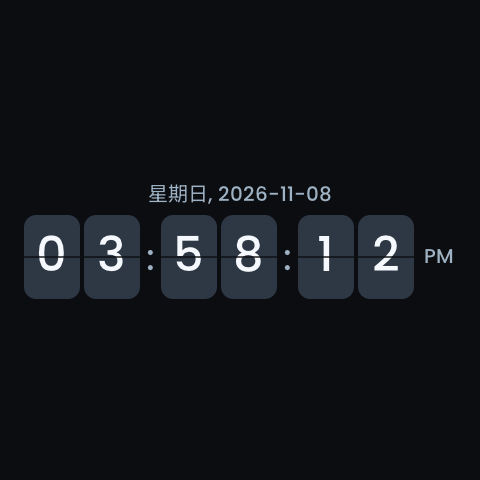

<!-- SPDX-License-Identifier: LicenseRef-FNCL-1.1 | Copyright (c) 2026 andre68723 -->
# S3 startup and COM18 validation

On 2026-11-08, an application-only USB update was verified on one Guition
ESP32-S3-4848S040, revision 0.2, with 16 MiB flash and a 480 × 480 display.
This is a bounded device trial, not sustained-load or other-board qualification.

## Image and memory configuration

- Source: clean `ad9488e5`, firmware `v0.9.2-rc1`, ESP-IDF 6.1.0, variant `panels3`.
- Application build stamp: `Nov 8 2026 15:40:01`.
- Application: 4,488,416 bytes; 2,327,328 bytes remain in its 6.5 MiB slot.
- Application SHA256:
  `f54a465e73e417bfa00db4ec23256137cdaee30d2590cff7c46e972252851924`.
- Matching ELF SHA256:
  `1d9df90ccd54afe8603470b5a977ec8388495a89931c072135ad023977819dfb`.

The archived local sdkconfig disables `CONFIG_ESP_WIFI_IRAM_OPT` and
`CONFIG_ESP_WIFI_RX_IRAM_OPT`. This frees 18,432 bytes of linked internal memory
compared with the same source's original 32-socket build. ESP-IDF documents a
Wi-Fi throughput tradeoff; throughput was not benchmarked. At the time of the
device trial these were local build overrides. The subsequent review promotes
both values into `config/sdkconfig.defaults.panels3` and rejects stale enabled
values at compile time; see [clean regeneration](build.md#guition-esp32-s3).
Retain the archived sdkconfig for the exact tested image. Display/touch configuration, the 32-socket
budget and the 14,336-byte internal HTTP-task stack remain unchanged.

Three earlier images aborted at `ESP_ERROR_CHECK(http_server_start())` with
`ESP_ERR_HTTPD_TASK` (`0xb008`), then rolled back. Their matching ELF decodes
identify failure to create the HTTP task. Reducing sockets to 16 or moving optional
temperature initialization did not resolve it; the source-order experiment was
reverted. The memory configuration above passed the previously failing startup.
This establishes the observed task-creation failure and a working configuration,
not a complete allocation trace or a long-term memory guarantee.

## Application-only write and retained data

Before opening COM18, the version/tasks, layout, settings, theme, logs, reboot
history and both retained crash reports were archived. Each report's SHA256 was
verified. Serial chip identity and MAC matched the HTTP panel; the installed
partition table and active old image matched their archives.

Only active `ota_1` at `0x6A0000` was written. Esptool verified the new application
against device flash. Before firmware boot, device digests confirmed identical:

- Bootloader, partition table, NVS, OTA selection and PHY metadata in `0x0–0x20000`.
- The complete 256 KiB coredump partition and 2.625 MiB LittleFS partition.
- The complete inactive 6.5 MiB application slot.

Raw metadata, coredump and LittleFS backups were retained, along with the exact
previous application verified against the device. Its unused slot tail was not
archived. This protects stored graph files across the write. No graph widgets
were configured, so populated graph-history behavior was not exercised.

After boot, the original three pages, three saved widget definitions, theme and preferences
matched the HTTP baseline, excluding live time/RSSI and newly exposed read-only
network status. No synthetic layout or settings restore was sent.

During physical testing, the owner changed the saver from analog to flip and
cleared the two old crash reports, then explicitly confirmed both actions and
requested that flip be retained. Final comparisons allow only those owner changes.
The local crash backups remain available. The 12-hour format, 60-second saver
delay, 15% saver brightness, enabled 300-second off delay and other settings remain
unchanged. The agent sent no settings-save or crash-deletion request in this trial.

## Startup, editor and physical behavior

The existing serial handle captured 300 seconds of boot/runtime output without
opening another port or resetting the panel again. The boot ELF prefix matched
`1d9df90cc`. HTTP started on port 80 with 12 client slots, GT911 initialized,
the dashboard loaded, and Home Assistant authenticated. Serial page-switch events
covered Energy, Home and LED. No current-image panic or startup failure occurred.

A real browser loaded the editor and all three original pages, switched their
local previews and read the clock settings. No JavaScript errors, failed requests
or device-write requests were recorded. Original analog/12-hour settings were
verified before the owner's later changes. Digital, analog and flip style options
were available; no Home Assistant control action was invoked by the test.

The owner confirmed normal display, text, local page switching, saver operation,
12-hour time and touch wake without operating underlying controls. Read-only
observations recorded saver → active at uptime 318 → 324 seconds and saver entry
again at 385 seconds. The API calls the clock-protection state `weather`; the
saved clock style and BMP identify the actual flip saver.

This 480 × 480 LVGL snapshot shows centred digits, weekday/date and PM.
It is not a photograph or independent proof of physical refresh/touch; that
confirmation came from the owner.

At the final acceptance sample, uptime was 514 seconds, source/build still matched,
HA was authenticated, both UI heartbeats were current and safe mode was off.
Boot sequence advanced only for this update, 110 → 111, with no later restart.
No new crash report appeared. Internal heap was 38,835 bytes free (7,796-byte
minimum); HTTP minimum remaining stack after editor/BMP checks was 6,252 of
14,336 bytes. These are samples from this workload, not capacity guarantees.

The application inherited the active slot's existing **valid** OTA metadata.
No rollback occurred during this USB trial, but no fresh pending-verify OTA cycle
was armed. This does not qualify a new OTA upload or exercise rollback selection.

Private raw evidence, storage digests, exact browser results, owner confirmations
and the image manifest are archived in
`.local/validation/panels3-com18-ad9488e-2026-11-08/`; the image and sdkconfig are in
`.local/firmware/panels3-ad9488e-2026-11-08-memory/`.

## Maintained configuration review

The 2026-11-08 pre-commit review verified hashes of 63 private trial artifacts,
the three failed images' retained dumps/matching ELFs and decoded HTTP-task
creation errors. It made no device requests, resets or writes.

`config/sdkconfig.defaults.panels3` now carries the tested Wi-Fi memory choices.
The production profile rejects either enabled option, including cached sdkconfig
values that override defaults. Six compiler-driven regression tests cover absent
and zero-valued options, each stale option, both together and unchanged P4 profile
selection. The S3 geometry/memory/OTA identity/navigation, HTTP socket-budget and
461-location time-zone C tests passed. This does not shrink the HTTP stack,
change partition geometry or suppress startup errors/rollback protection.

A new `build/panels3` directory, with no `EXTRA_DEFAULTS`, passed the ESP-IDF 6.1
wrapper build. Its internal heap start remains `0x3fcb4a70` and IRAM text is
78,299 bytes, matching the successful COM18 image. The partition-table SHA256
also matches. Among 2,217 normalized sdkconfig values, the only difference from
the trial is the existing repository fallback `APP_TIME_TZ="Europe/Berlin"`
instead of the old local POSIX rule. That unrelated override was not promoted;
saved time-zone preferences take precedence. This review did not change the
panel's saved time zone or its 12-hour clock.

The pre-commit image (`ad9488e5-dirty`) has runtime build stamp
`Nov 8 2026 16:30:12`, extracted from its ELF's `app_build_stamp`; its separate
ESP-IDF descriptor stamp is `Nov 8 2026 16:27:36`. It is 4,488,384 bytes,
leaving 2,327,360 bytes (34%) in its application slot.
Its SHA256 is
`0ef0e7f96bedc95c16c31b8f054f7e33966a027bde4e0969076322cbd864ef11`;
its ELF SHA256 is
`471fededdf80272df7e276187f7d5af043e7c97e96063592b29f164bb19863b8`.
This review image was **not flashed**; the physical results above belong to the
earlier, explicitly identified COM18 image. Review logs and configuration
comparisons are in `.local/validation/panels3-startup-review-2026-11-08/`.
