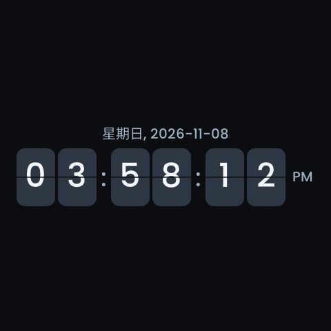

<!-- SPDX-License-Identifier: LicenseRef-FNCL-1.1 | Copyright (c) 2026 andre68723 -->
# S3 startup and COM18 validation

On 2026-11-08, an application-only USB update was verified on one Guition
ESP32-S3-4848S040, revision 0.2, with 16 MiB flash and a 480 × 480 display.
This is a bounded device trial, not sustained-load or other-board qualification.

## Image and memory configuration

- Source: clean `ad9488e5`, firmware `v0.9.2-rc1`, ESP-IDF 6.1.0, variant `panels3`.
- Application build stamp: `Nov 8 2026 15:40:01`.
- Application: 4,488,416 bytes; 2,327,328 bytes remain in its 6.5 MiB slot.
- Application SHA256:
  `f54a465e73e417bfa00db4ec23256137cdaee30d2590cff7c46e972252851924`.
- Matching ELF SHA256:
  `1d9df90ccd54afe8603470b5a977ec8388495a89931c072135ad023977819dfb`.

The archived local sdkconfig disables `CONFIG_ESP_WIFI_IRAM_OPT` and
`CONFIG_ESP_WIFI_RX_IRAM_OPT`. This frees 18,432 bytes of linked internal memory
compared with the same source's original 32-socket build. ESP-IDF documents a
Wi-Fi throughput tradeoff; throughput was not benchmarked. At the time of the
device trial these were local build overrides. The subsequent review promotes
both values into `config/sdkconfig.defaults.panels3` and rejects stale enabled
values at compile time; see [clean regeneration](build.md#guition-esp32-s3).
Retain the archived sdkconfig for the exact tested image. Display/touch configuration, the 32-socket
budget and the 14,336-byte internal HTTP-task stack remain unchanged.

Three earlier images aborted at `ESP_ERROR_CHECK(http_server_start())` with
`ESP_ERR_HTTPD_TASK` (`0xb008`), then rolled back. Their matching ELF decodes
identify failure to create the HTTP task. Reducing sockets to 16 or moving optional
temperature initialization did not resolve it; the source-order experiment was
reverted. The memory configuration above passed the previously failing startup.
This establishes the observed task-creation failure and a working configuration,
not a complete allocation trace or a long-term memory guarantee.

## Application-only write and retained data

Before opening COM18, the version/tasks, layout, settings, theme, logs, reboot
history and both retained crash reports were archived. Each report's SHA256 was
verified. Serial chip identity and MAC matched the HTTP panel; the installed
partition table and active old image matched their archives.

Only active `ota_1` at `0x6A0000` was written. Esptool verified the new application
against device flash. Before firmware boot, device digests confirmed identical:

- Bootloader, partition table, NVS, OTA selection and PHY metadata in `0x0–0x20000`.
- The complete 256 KiB coredump partition and 2.625 MiB LittleFS partition.
- The complete inactive 6.5 MiB application slot.

Raw metadata, coredump and LittleFS backups were retained, along with the exact
previous application verified against the device. Its unused slot tail was not
archived. This protects stored graph files across the write. No graph widgets
were configured, so populated graph-history behavior was not exercised.

After boot, the original three pages, three saved widget definitions, theme and preferences
matched the HTTP baseline, excluding live time/RSSI and newly exposed read-only
network status. No synthetic layout or settings restore was sent.

During physical testing, the owner changed the saver from analog to flip and
cleared the two old crash reports, then explicitly confirmed both actions and
requested that flip be retained. Final comparisons allow only those owner changes.
The local crash backups remain available. The 12-hour format, 60-second saver
delay, 15% saver brightness, enabled 300-second off delay and other settings remain
unchanged. The agent sent no settings-save or crash-deletion request in this trial.

## Startup, editor and physical behavior

The existing serial handle captured 300 seconds of boot/runtime output without
opening another port or resetting the panel again. The boot ELF prefix matched
`1d9df90cc`. HTTP started on port 80 with 12 client slots, GT911 initialized,
the dashboard loaded, and Home Assistant authenticated. Serial page-switch events
covered Energy, Home and LED. No current-image panic or startup failure occurred.

A real browser loaded the editor and all three original pages, switched their
local previews and read the clock settings. No JavaScript errors, failed requests
or device-write requests were recorded. Original analog/12-hour settings were
verified before the owner's later changes. Digital, analog and flip style options
were available; no Home Assistant control action was invoked by the test.

The owner confirmed normal display, text, local page switching, saver operation,
12-hour time and touch wake without operating underlying controls. Read-only
observations recorded saver → active at uptime 318 → 324 seconds and saver entry
again at 385 seconds. The API calls the clock-protection state `weather`; the
saved clock style and BMP identify the actual flip saver.

This 480 × 480 LVGL snapshot shows centred digits, weekday/date and PM.
It is not a photograph or independent proof of physical refresh/touch; that
confirmation came from the owner.

At the final acceptance sample, uptime was 514 seconds, source/build still matched,
HA was authenticated, both UI heartbeats were current and safe mode was off.
Boot sequence advanced only for this update, 110 → 111, with no later restart.
No new crash report appeared. Internal heap was 38,835 bytes free (7,796-byte
minimum); HTTP minimum remaining stack after editor/BMP checks was 6,252 of
14,336 bytes. These are samples from this workload, not capacity guarantees.

The application inherited the active slot's existing **valid** OTA metadata.
No rollback occurred during this USB trial, but no fresh pending-verify OTA cycle
was armed. This does not qualify a new OTA upload or exercise rollback selection.

Private raw evidence, storage digests, exact browser results, owner confirmations
and the image manifest are archived in
`.local/validation/panels3-com18-ad9488e-2026-11-08/`; the image and sdkconfig are in
`.local/firmware/panels3-ad9488e-2026-11-08-memory/`.

## Maintained configuration review

The 2026-11-08 pre-commit review verified hashes of 63 private trial artifacts,
the three failed images' retained dumps/matching ELFs and decoded HTTP-task
creation errors. It made no device requests, resets or writes.

`config/sdkconfig.defaults.panels3` now carries the tested Wi-Fi memory choices.
The production profile rejects either enabled option, including cached sdkconfig
values that override defaults. Six compiler-driven regression tests cover absent
and zero-valued options, each stale option, both together and unchanged P4 profile
selection. The S3 geometry/memory/OTA identity/navigation, HTTP socket-budget and
461-location time-zone C tests passed. This does not shrink the HTTP stack,
change partition geometry or suppress startup errors/rollback protection.

A new `build/panels3` directory, with no `EXTRA_DEFAULTS`, passed the ESP-IDF 6.1
wrapper build. Its internal heap start remains `0x3fcb4a70` and IRAM text is
78,299 bytes, matching the successful COM18 image. The partition-table SHA256
also matches. Among 2,217 normalized sdkconfig values, the only difference from
the trial is the existing repository fallback `APP_TIME_TZ="Europe/Berlin"`
instead of the old local POSIX rule. That unrelated override was not promoted;
saved time-zone preferences take precedence. This review did not change the
panel's saved time zone or its 12-hour clock.

The pre-commit image (`ad9488e5-dirty`) has runtime build stamp
`Nov 8 2026 16:30:12`, extracted from its ELF's `app_build_stamp`; its separate
ESP-IDF descriptor stamp is `Nov 8 2026 16:27:36`. It is 4,488,384 bytes,
leaving 2,327,360 bytes (34%) in its application slot.
Its SHA256 is
`0ef0e7f96bedc95c16c31b8f054f7e33966a027bde4e0969076322cbd864ef11`;
its ELF SHA256 is
`471fededdf80272df7e276187f7d5af043e7c97e96063592b29f164bb19863b8`.
This review image was **not flashed**; the physical results above belong to the
earlier, explicitly identified COM18 image. Review logs and configuration
comparisons are in `.local/validation/panels3-startup-review-2026-11-08/`.

## COM25 startup display lock follow-up

The [November 20 COM25 trial](panels3-optional-ha-setup-validation.md#effect-of-the-startup-lvgl-lock-timeouts)
ran commit `1e8b1e3` on boot 143. UART recorded the dashboard load
at 07:16:03.359 and 52 adapter lock timeouts spaced 40 ms apart from
07:16:03.390 through 07:16:05.430 China Standard Time. One additional
timeout at 07:16:05.370 matched the splash-close deferral. The splash
was removed 956 ms after that deferral.

The previous dashboard handoff set the hide flag and then waited up
to two seconds for the same lock held while LVGL renders. The UI
runtime also left its once-per-second status-bar and screen-protection
check due on a failed lock attempt. Its 20 ms lock wait and 20 ms
task delay match the 40 ms cadence. Attribution of those 52 messages
to the periodic check follows from the timing and the code path.
The splash deferral has its own diagnostic in the trace.

The boot task now posts a dismissal request. The existing LVGL timer
enforces the 1.2-second minimum show time, removes the splash and
records activity when the dashboard is exposed. The provisioning
splash stays visible until requested to close. A timer allocation
failure exits before creating the overlay. The C6 updater retains
its existing dismissal entry point. The UI runtime starts its
periodic deadline when its task starts and advances it before
each lock attempt, eliminating the 40 ms retry loop for that check.

The real-LVGL regression reproduced the old competing lock request.
The new run checked an early dismissal request, a simulated busy
render, persistent Wi-Fi setup, reopening a splash with a pending
dismissal, and the existing synchronous dismissal path. The
periodic check made two lock attempts in a simulated three-second
busy period, then succeeded at the next deadline without catch-up
attempts.

Thirteen targeted SDL tests passed, including the splash, screen
settings, screen saver, screenshot and page-transition checks. Two
480 × 480 simulator captures exercised the empty-layout clock and
Wi-Fi setup. All 661 web tests, the web bundle and translation
checks, and the S3 storage and discovery API tests passed. The
storage test verified that a failed skip save preserves the previous
settings and that a successful skip persists on reload.

Chromium also ran the HTML, CSS and `js/app.cf2fda844f46af0d.js`
embedded in the new image against a loopback fixture. It verified
skipping Home Assistant, retaining the choice after restarting the
fixture, adding credentials later and retrying entity discovery
after a connection failure.

ESP-IDF v6.1 built `panels3` from the working tree at
`dfff308c-dirty`. The `v0.9.2-rc2` image has the API build stamp
`Nov 20 2026 07:53:45` China Standard Time and the ESP-IDF descriptor
stamp `07:49:26`. It is 4,592,656 bytes with 33% of the application
slot free. Its SHA-256 is
`2a3baa2d8cf233a89847b43c887413be736637307d44dcc23586d073a7c15103`.
The SDK configuration and partition table are byte-identical to
those of the COM25 `1e8b1e3` build.

The build logs, image fingerprints and local test results are saved in
`.local/validation/panels3-boot-display-lock-2026-11-20/`.

### COM25 hardware verification of the 07:53:45 build

An incorrect backup label took the full previous-image read path.
That attempt ended before any write and the original image booted
again. On retry, COM25 read fresh flash metadata and verified the
saved coredump, LittleFS and previous application against device
digests. The mounted LittleFS layout matched the editor export.

The update wrote `ota_1` at `0x6A0000` and the application readback
matched the archived image. The bootloader, partition table, NVS,
OTA metadata, inactive slot, coredump and LittleFS retained their
pre-write digests. UART reported ELF prefix `b838dd5e5` and initialized
GT911. The API reported `dfff308c-dirty`, build `07:53:45` and valid
`ota_1` on boot 145. SNTP synchronized before HTTP started.

| UART measurement | Boot 143, `1e8b1e3` | Boot 145, `07:53:45` |
| --- | ---: | ---: |
| Layout build, 13 widgets | 588 ms | 588 ms |
| Layout loaded to splash hidden | 2,967 ms | 2,019 ms |
| Adapter lock timeouts | 53 | 0 |
| Splash-close deferrals | 1 | 0 |
| UART capture duration | 236.6 s | 245.4 s |

UART has no refresh-complete entry for the initial dashboard switch
within the firmware's 700 ms logging window. A complete 480 × 480 Energy
snapshot arrived 1,958 ms after the host observed the splash-hide message.
That interval includes authentication, snapshot rendering and transfer.
The first visible frame on the physical LCD was not timed. The owner
confirmed normal display and touch navigation. UART recorded the first
completed software refresh at 127 ms when switching to the second page
and 136 ms on returning to Energy.

The editor opened the saved layout and **+ Widget** returned `ready`.
The five pages, 13 widgets, theme and saved settings matched the
baseline. The settings responses differed only in the live clock and
Wi-Fi signal level. Anonymous layout access returned HTTP 401 and
administrator login worked. The backed-up LittleFS contained zero local
graph history files. History with samples was outside the scope of this
retest. At 264 seconds, the panel still reported boot 145, valid time
and zero retained crashes.

The panel-served HTML, JavaScript and CSS matched the archived image
and passed the isolated browser replay. It covered skipping Home
Assistant, restoring the choice after a fixture restart, saving
credentials later, and the missing-credentials, disconnected and
rejected-token states. Entity queries resumed on retry with the search
text preserved. A blank-settings hardware boot and a physical reboot
after skipping remain untested. The UART trace, first snapshot,
backup comparison and replay results are in
`.local/validation/panels3-boot-display-lock-com25-2026-11-20-r2/`.

### Pre-commit review and local rebuild

The real-LVGL test reproduced a synchronous dismissal clearing a splash
that had just been shown again. The splash setters now check the overlay
under the display lock. Synchronous dismissal rechecks the request and
minimum show time under the same lock. The minimum-time wait releases the
lock so the LVGL timer can render and handle a pending dismissal.

The expanded C regression passed a late title update after timer deletion,
cancellation by an explicit show, timer fallback after a lock timeout,
and an early wake before the minimum show time. The periodic check resumed
after a simulated busy render without a burst of retries. All 13 targeted
SDL checks and 42 Home Assistant editor tests passed. Web assets and
translation catalogs checked cleanly.

ESP-IDF v6.1 built the reviewed `panels3` image from `dfff308c-dirty`.
The first incremental build reused the API timestamp. Refreshing
`build_stamp.c` before invoking the build produced the final API stamp
`Nov 20 2026 08:36:01` China Standard Time. The application is 4,592,768
bytes, with SHA-256
`c5bc60450e5ebb59493d4bd27ae552e0cedff1fa3ca30a842aff7841f9fe9224`.
The SDK configuration, partition table and editor assets matched the
07:53:45 image. The embedded editor passed the isolated browser replay.

The 08:36:01 image was verified locally. The COM25 observations apply to
the 07:53:45 build. The review evidence and rebuild manifest are in
`.local/validation/panels3-boot-display-lock-review-2026-11-20/` and
`.local/validation/panels3-boot-display-lock-review-final-2026-11-20/`.
