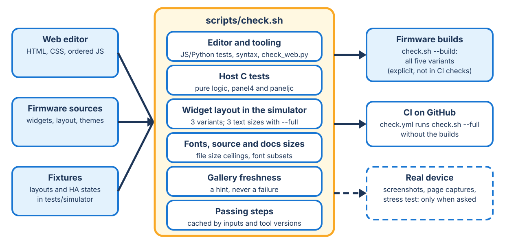

<!-- SPDX-License-Identifier: LicenseRef-FNCL-1.1 | Copyright (c) 2026 andre68723 -- file added in the andre68723/BETTA-HA-PANEL fork, see docs/release-notes.md -->
# Checks and device tests

## Checks without a device

### Native screen settings

Run `tools/simulator.sh <variant> --regression screen-settings --fixture tests/simulator/screen_settings.json`.
It exercises actual LVGL control events, Save/reopen, disabled-option retention, failed-save retry,
unrelated-settings preservation and 100 view rebuilds. Header checks include AP, MQTT and crash-marker
combinations. Use Tab5 for `--rotation 0|90|180|270`; fixed-orientation variants reject that option.
The dedicated empty fixture avoids unrelated widget orientation projection during these checks.
`betta-clock-test <width> <height>` exercises the production saver with a controlled clock: idle/off
deadlines, movement bounds, night priority, complete wake gestures, storage-busy retention and
the 30-second preview deadline. Both tests are registered with CTest.

Local validation on 2026-10-24 passed the settings regression at default/largest text on 480 × 480,
720 × 720 and 1280 × 800, plus all four Tab5 directions at largest text (720 × 1280 / 1280 × 720).
Each run covers all seven languages; clock checks passed at four geometries. English and Chinese
wide/compact renders and German portrait/landscape renders were inspected. All 317 browser tests,
built-in translation parsing, font/catalog checks and the strict documentation build passed.
The ESP-IDF 6.1 `panel10` build succeeded (5,652,416-byte app; 17% app-partition headroom).
The tested image was built before commit from `cab3c41` plus the screen-settings changes;
its embedded source stamp is `cab3c412-dirty` (2026-10-24 10:26:01).

Device validation on 2026-10-24 used the Waveshare ESP32-P4-WIFI6-Touch-LCD-10.1
on COM24, with app SHA256 `c34548d26fa83a0ddedbb5dcba20a35892276929a74948b0543269c72e3c90cc`.
The supported P4 stub verified the application readback and unchanged protected metadata,
NVS, coredump and complete LittleFS checksums before boot. The running ELF stamp matched;
OTA was valid and the boot splash exited. Native 12-hour Save/reopen and restoration to
24-hour format passed, preserving the latest settings, layout and English language.
The owner confirmed the rightmost settings gear, matching Wi-Fi/HA frames, saving,
stable physical display and aligned touch. Two one-minute runtime samples showed no reboot
or new crash. Rapid remote input encountered transient display-lock contention; paced
input completed the control tests. Local backups and retained crash reports were preserved.

The System settings extension on top of `4a308a6` adds language, time zone, appearance
and built-in/imported theme selection. On 2026-10-24, native events passed at default
and largest text on 480 × 480 and 1280 × 800, plus Tab5 and all four rotations.
Runs cover seven languages (1,063 checks on the compact panel, 1,070 on wide/rotated
layouts), Save/reopen, Cancel, failed-save retry, concurrent unrelated settings,
imported theme names and expanded dropdown bounds. CJK/font, web-source and strict
documentation checks passed; English and Chinese renders were inspected.
The ESP-IDF 6.1 `panel10` build passed (5,662,944-byte app). On 2026-10-24, COM24
ran app SHA256 `1f54dedba317d52abbb952d463433f79966890e3d773155ff0236cb98b5d7890`
with matching ELF and valid OTA state. Stub checks confirmed unchanged protected storage
before boot. Native simplified/traditional Chinese, time-zone, Flat appearance and Light
theme selections passed Save/reopen, with each tested value subsequently restored.
The owner confirmed normal settings/saving, stable display, aligned touch and no unexpected
restart. Seven final samples over 61 seconds showed no reboot or new crash. Restoration
API requests initially used the default settings restart; the local helper now explicitly
disables that restart. Two pre-existing PPA timeout reports from `4a308a6` were retained;
this short acceptance test does not resolve that earlier intermittent display-driver issue.
User edits during testing were backed up separately; English and local backups were retained.
At the owner's request, the final configuration was restored to English,
`America/Argentina/Buenos_Aires` and `dark_v2`, then read back successfully;
all other settings were unchanged. The tested image was built before this commit
with source stamp `4a308a63-dirty`; the binary hash above identifies the device-tested artifact.

### Remote display

The `betta-remote-test` simulator target exercises the production remote-display
module with real LVGL. Run it with width, height, render mode (0 partial, 1
direct, 2 full) and rotation (0–3), for example `betta-remote-test 480 480 0 0`.
It checks complete capture, bounded dirty-region redraw, idle updates, rotated input, read-only default,
physical-touch priority, cancellation, heartbeat expiry, OTA suspension and
reopening. The web tests also cover protocol corruption, edge tiles on larger
screens, reconnects and browser lifecycle cancellation.
Build the target, then run `ctest --test-dir build/simulator/panels3 --output-on-failure`
for its 48 registered geometry/mode/rotation cases.

Firmware and the SDL2 simulator share the LVGL widget sources; the editor has its own checks. Run the local checks
first, then review on hardware.

- `uv run --locked --only-group checks tools/check.sh` reproduces CI with pinned FontTools, Brotli and Pillow.
- `tools/check.sh` runs editor JavaScript syntax, editor tests (`tests/webui/*.test.mjs`), HTML balance, `en`/`de`
  tables with identical keys and an ASCII English firmware table (German may use umlauts and `ß`), the source and
  documentation size checks and, with cmake and SDL2, the simulator regressions, the widget layout check and the host
  tests. `--build` also builds all five variants (`panel4`, `panel10`, `paneljc`, `paneljc-v2`, `tab5`) with the full
  define set and checks the flash size in `flash_args`. Run it before committing editor or translation changes.
  `.github/workflows/check.yml` runs the checks with `--full`; `.github/workflows/build.yml` builds and packages every
  variant in the ESP-IDF 6.1 image on a version tag, a push to `main` or by hand, and only uploads artifacts.
- Output is one line per step; the full output is in `${TMPDIR:-/tmp}/betta-check/<step>.log` (`BETTA_CHECK_LOG_DIR` overrides). A slow step whose command and
  input files are unchanged since its last pass is skipped (`build/check-stamps/`, `--force` runs it anyway). The widget
  layout runs at the standard text step on every check and at the Larger and Largest steps with `--full` and in CI.
  [Run levels](tools.md#run-levels) say which tool runs when.
- `tests/host/test_i18n_builtin.c` parses all seven built-in tables as strict JSON, requires one `lvgl` root and current English keys,
  and checks real `ui_i18n_get()` lookups. `tests/webui/chinese_i18n.test.mjs` checks all generated
  catalogs, current browser keys and printf/interpolation placeholders. `multilingual_selection.test.mjs` exercises
  language events, saved JSON, reload and custom overrides. Font checks cover Chinese and European accents.
  `tests/simulator/languages.json` exercises the compact complex pages; use `--language de|es|fr|pl` at each text step.
- `tests/host/test_history_stats.c` covers the Recorder statistics parser with reply shapes from a real Home Assistant:
  metadata and eligibility (measurement versus counter, unit class, state class), the 168-hour window, gaps, duplicates,
  off-hour and out-of-window rows, and hourly changes summed into local days across both daylight-saving changes.
- The statistics parser test also covers a cumulative counter classified from its metadata alone, summing several
  sources and marking an hour or a whole source as missing. `tools/check_web.py` fails when a `ui_i18n_get` key in
  `main/` has no entry in the built-in tables.
- `tests/host/test_admin_auth.c` includes `main/settings/admin_auth.c` with a fake NVS (`tests/host/auth_stubs/`) and injects faults:
  open and read errors, damaged or foreign-version records, half a legacy salt/hash pair, failing writes. It checks that "never set"
  stays open, "unreadable" answers closed and heals when the storage does, and that a legacy pair migrates.
- `tests/host/test_history_week.c` runs the real 7-day worker (`main/ha/ha_history_week.c`) on the host with pthread-backed
  FreeRTOS stubs (`tests/host/week_stubs/`), a counting heap and a scriptable WebSocket: a busy heavy-request gate with bounded
  retries, a reply that never comes (and the cancel), a reply that arrives after the timeout, failing and wrongly shaped replies,
  a failing or partial source, other units and unit classes, queue overflow, and no allocation left behind after a thousand
  requests. The waits are compile-time overrides (`WEEK_*_MS`) so the test needs seconds, not minutes.
- The history and energy regressions end with a memory loop: 300 popup or page cycles are judged against a baseline cycle (a lock popup,
  a page built and deleted without taps), because LVGL keeps some bytes per cycle on its own; the range switching and the node
  taps may add at most 512 bytes per cycle.
- `tests/host/test_alarm_state.c` covers the alarm state names, the arm and disarm actions an entity offers from its
  `supported_features`, the `code_format` and `code_arm_required` rules and the per-tile `alarm_actions` mask.
- Host tests need cJSON (`libcjson-dev`, `brew install cjson`, or fetched sources); `tools/test_host.sh` exits with 2
  when neither exists.
- `tests/host/test_coredump_store.c` checks two-report retention, failed imports, duplicate imports,
  raw downloads, metadata/diagnostic round-trips, corrupted payloads and stable-ID deletion.
  `tests/webui/coredump_reports.test.mjs` exercises individual erase clicks, confirmation,
  status refresh, errors, banner identity and compatibility with single-report firmware.
- `tests/host/test_ha_controls.c` covers parent-area inheritance, missing/cyclic parents,
  empty/custom names, bounded effect and suction lists, overflow preservation and escaped service values.
  The SDL `--regression controls` test taps the real Light/Vacuum controls, checks service payloads,
  failed sends, unavailable devices and popup cleanup during state changes, hiding and deletion.
  Control choices retain at most 24 complete values shorter than 96 bytes; compaction drops
  trailing choices to fit the existing attribute buffer without losing brightness or vacuum capabilities.
- `--regression fonts` (font manager failure acceptance, `tests/simulator/font_budget_regression.c`) requests every integer size and every icon font
  with `UI_FONTS_TEST_HOOKS` compiled in: a failed creation and the 64-instance budget never give a caller a NULL font, instances stay bounded and a
  key created before keeps its instance. `GET /api/version` reports the same counters under `fonts` on a panel.
- With SDL2, `check.sh` runs the regressions `controls`, `wallbox`, `bambu`, `history`, `energy`, `fonts` and
  `notification` through `tools/simulator.sh <variant> --regression <name>` for panel4, paneljc and tab5.
  `--regression bambu` exercises the real widget buttons, mocked service targets, pending commands, timeout/disconnect and popup
  ownership during hide, resize and deletion. It sends no Home Assistant commands. `--regression history` runs
  alongside it and drives the history popup's real 24 h / 7 days buttons, quick switching, close and reopen, and
  the entities that get no selector. `--regression energy` taps the real Gas, Water
  and Solar circles of the Energy page: popup versus right-hand panel (only where it fits), nodes without a source,
  a new selection replacing the old one and the page being deleted with a popup or selection open.
- `check.sh` lists checks it could not run (no Node, no cmake/SDL2) under "not run". With `CI` set, a missing
  prerequisite fails the run. Pass the editor tests as files: Node 22 (CI) treats a directory as a module.

Storage regressions use the actual settings/layout stores and automatic-update worker with injected NVS, file, lock and allocation failures. They cover credential generations and migration, rollback-version retention, queue saturation, atomic history replacement, graph quotas and orphan cleanup. Transfer deadlines cover silence and continuous slow progress.

## Widget layout check

`python3 tools/check_widget_layout.py` renders every gallery widget in the simulator in all four styles and reads each
object's rectangle (`--dump-layout`). It fails when two texts overlap, a text overlaps a button or lies half on a panel,
bar or picture, or anything reaches outside its tile. `check.sh`, CI and `tools/generate_simulator_gallery.py` run it
(panel4; `--variant paneljc|tab5` for the 1280 px geometry; the panel4-only readability fixtures are skipped there). It
also renders the Matte comparison (`tests/simulator/matte_reference.json`) and edge cases
(`tests/simulator/layout_cases.json`: tiles at minimum and large sizes and in every variant).

- Rectangles cannot see a ring's shape, and a widget that leaves content out passes: look at the images for text on
  arcs and knobs and for whether a tile still shows what it is for.
- A new or changed widget layout needs a tile in the gallery fixture (`tests/simulator/gallery_data.json`,
  `build_spec()` in `tools/gallery_content.py`) and its minimum size and variants in `layout_cases.json`.
- `--variant panels3` checks the existing fixtures one card per page, with large
  cards bounded to the 456 × 336 inset, plus real detail popups and date/time
  scrolling in English and German. Explicit `--fixture` layouts keep their coordinates.
  Run text steps 0, 1 and 2. Calibrate its separate table with
  `python3 tools/calibrate_text_caps.py --variant panels3 --write`.
- Two LVGL traps behind most findings: an object placed with `lv_obj_align()` keeps that anchor, so a later
  `lv_obj_set_pos()` offsets from it (use `lv_obj_align(obj, LV_ALIGN_TOP_LEFT, x, y)`); sizes read right after creation
  are 0 until `lv_obj_update_layout()` runs.
- The [simulator](../simulator.md) renders a local layout and state fixture at the panel's pixel size. Compare with a
  device screenshot before calling a result hardware-verified.

## Semantic readability checks

The simulator JSONL dump reports role, font identity (including Poppins fallback wrappers), nominal size, line height,
H/x/0 ink boxes and H angles at 30/40 cm (71.93 mm active panel4 width). `tools/check_readability.py --strict
<dump.jsonl>` checks reviewed essential text for clipping and capital height below the 16 arcminute reference; compact
20 px fits are reported and unassigned labels stay diagnostics. Font height alone does not establish comfort. The layout
check includes `tests/simulator/readability.json` (saved geometry, lower-density alternatives, negative and large
values, German titles, unknown and unavailable states, missing dates, rain) and two `readability_history_*.json`
fixtures for numeric and discrete details.

## Screenshots

`tools/screenshot.sh <panel-ip> [out.png]` saves what the panel shows (popups and the update screen included) via
`GET /api/screenshot.bmp`. Do not give `curl` a short timeout: the image is about 3 MB on the 10-inch panel and a timeout
truncates it silently.

## Device page captures

`tools/capture_device_pages.py <panel-ip> [--reference-dir DIR]` visits every page of the saved layout, saves each
framebuffer as PNG and writes `manifest.json` (firmware commit, layout hash, with `--reference-dir` the SHA-256 of the
compared images). It never overwrites an existing set and returns the panel to its first page. Then
`tools/import_device_captures.py [--board panel4|paneljc] --from <set>` replaces `docs/img/<board>/` and rewrites
`docs/gallery-<board>.md` (one current set per board). Keep household captures and their metadata under ignored
local storage, such as `.local/`, rather than committing them. Only import captures made with public synthetic
data and owned or licensed artwork; inspect every image and the manifest before publication. The maintained
documentation examples use the simulator's public fixtures.

## Gallery

`python3 tools/generate_simulator_gallery.py` regenerates the widget images of `docs/gallery.md` with the
[simulator](../simulator.md) from `tests/simulator/gallery_data.json`, in each style. It needs no panel and no Home
Assistant; re-run it after every change to a widget's look. Each tile is rendered alone on its own page (free size up to
720 × 600); the packing in `build_spec()` only matters for a capture on a real panel. `--variant paneljc|panel10|
paneljc-v2|tab5` renders only the house and energy pages at that geometry into `docs/img/gallery-<variant>/` and
`docs/gallery-sim-<variant>.md`. The special pages come from the simulator too: House from the fixture's `house`, Energy
from its `energy` sensors, the doorbell popup from its `doorbell` notification with a placeholder camera picture
(`tests/simulator/doorbell_camera.png`, via a `file:` entity_picture).

- Both generators share `build_rows()` in `tools/gallery_content.py`. The fan rotor lands differently on each run:
  discard those three images when nothing else changed.
- `tools/generate_gallery.py <panel-ip>` compares against hardware: it screenshots every widget and page on a real
  panel4 against real entities (`tools/gallery_entities.json`, gitignored, copy the `.example.json`), backs up and
  restores the panel's layout and style, and replaces the simulator images until the next simulator run. Optional extras
  (car precondition row, segmented gauge) render only with compatible entities configured; a missing extra is silently
  left out.
- Never hand-edit the generated files or `docs/img/gallery/*.png`. Image names are stable
  (`<slug of the title>_<style>.png`), so a commit touching one widget changes only its images. A run prunes unreferenced
  images and writes `docs/img/gallery/sources.json`, a hash stamp of every rendering input. `check.sh` runs
  `tools/check_gallery_fresh.py`, which warns (never fails; `--strict` fails) when sources changed since the stamp.
  Regenerate only on that warning and commit the images separately as `docs(gallery): ...`. After a refactor that did
  not change rendering, `generate_simulator_gallery.py --stamp-only` refreshes the stamp.
- The published gallery contains demo-data widgets and special pages from the simulator. Real household pages captured
  with `tools/capture_device_pages.py` remain local test evidence.

## Memory and stability stress test

`tools/stress_test.py <panel-ip>` combines rapid page navigation, repeated entity discovery (Room/House import) and
concurrent loads of every editor asset in `index.html` (six connections, `--webui-concurrency`). It reports memory from
`GET /api/version` before, during and after a cool-down, counts failed requests and exits nonzero on any failure or
memory probe. `--no-navigate --no-discovery` isolates the editor load, `--no-webui-load` reproduces the older test.
A one-time cache allocation drops once and stays flat; a leak keeps dropping after the load stops. It only does GETs and
page switches and never touches USB. Errors under combined load count as failures even if the panel recovers.

## Bottom navigation: full and compact tabs

`ui/nav_layout.c` (pure, host-tested) places the tabs, `ui_pages.c` draws them. Tabs are **full** (icon and title) while
each is at least `NAV_FULL_TAB_MIN_W` (112 px) wide: 5 pages on the 4-inch bar, 10 on the 10-inch bar
(`nav_layout_full_pages()`, `full_nav_pages` in `/api/version`). Beyond that the bar is **compact**: the shown page keeps
icon and title (at most a quarter of the bar), the others are 64-96 px icon tabs (the page number without an icon).
`nav_layout_max_pages()` is the limit at 64 px: 8 pages at 720 px, 12 at 1280 px (`APP_MAX_PAGES`, `max_pages`). 64 px is
6.4 mm on the 4-inch panel (254 ppi) and 10.8 mm on the 10-inch panel (150 ppi). The editor asks for a distinct icon per
page once the bar is compact (`navIconIssue()`); the simulator draws every icon as the list glyph, so judge icons in the
editor or on a panel. More tabs would need a "More" list or lazy page building (owner decision 2026-10-01: not wanted).
The widget total stays 224 (`APP_MAX_WIDGETS_TOTAL`).
