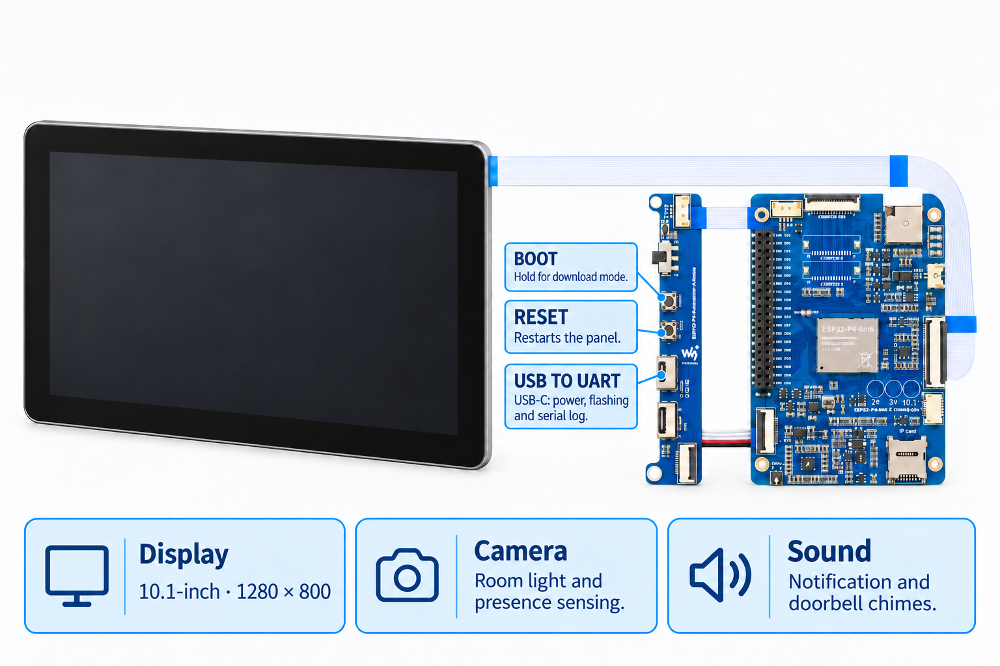

<!-- SPDX-License-Identifier: LicenseRef-FNCL-1.1 | Copyright (c) 2026 Cpt_Kirk | Copyright (c) 2026 andre68723 -- file added in the andre68723/BETTA-HA-PANEL fork, see docs/release-notes.md -->

# Waveshare 10.1-inch panel

<figure class="board-hero">
  
  <figcaption>Illustration based on Waveshare's LCD-X hardware diagram and 10.1-inch dimensions.</figcaption>
</figure>

This guide shows the Waveshare **ESP32-P4-WIFI6-Touch-LCD-10.1** from the
LCD-X series. The `panel10` firmware profile provides 1280 × 800 geometry and
uses the Waveshare LCD-X BSP with JD9365 display and GT9271 touch support.
The profile targets ESP32-P4 Rev3.x; verify the chip revision before flashing.
The size-optimized build keeps camera and voice support within the existing OTA slots.
The separate ESP32-P4-Nano plus DSI display kit is not supported by this profile.

## Specifications

| Item | Device / firmware profile |
| --- | --- |
| Display | 10.1-inch, 1280 × 800 |
| Dashboard area | 1280 × 680, after the top and bottom bars |
| Host / Wi-Fi | ESP32-P4 at 360 MHz / ESP32-C6 through ESP-Hosted |
| Flash / PSRAM | 32 MB flash / Hex PSRAM at 200 MHz |
| Display / touch controller | JD9365 / GT9271 |
| Navigation | Up to 12 pages |
| Camera / sound | OV5647 light/presence sensing, off by default; ES8311/ES7210 audio for optional AI Assistant |

## Firmware and revisions

Use **v0.9.2-rc1 or newer** for this LCD-X assembly. Earlier `panel10` release images use the inherited
Nano BSP and do not implement this profile.

The current profile targets **ESP32-P4 Rev3.0 or later**. Check the chip revision
before installation; older Rev1.x units require a different build and are not
covered by this profile. The screen size alone does not identify compatible hardware.
Use the `panel10` factory image when the release lists this LCD-X device and revision.
Follow [Install and set up](../getting-started.md#2-flash-the-panel) for browser installation.

The LCD-X board uses PWM backlight control. BETTA's brightness, night mode and
wake-touch policy apply. Camera-based brightness/presence and AI Assistant are
optional features, with their saved settings off by default.

## Buttons and ports

For flashing, connect a USB data cable to **USB TO UART (USB-C)** on the I/O
board shown above. It is the upper of the two USB-C ports; the lower **USB OTG**
port has a different role.

## Optional wired network

The LCD-X board has no onboard Ethernet PHY or RJ45 port. Wi-Fi remains the
default. An external IP101 RMII module can be enabled by a separate firmware
build; see the [Ethernet build option](../development/build.md#panel10-ethernet).
The module needs the specified clock, address, power and wiring; a USB Ethernet
adapter is not supported by this driver.

When enabled, Ethernet is preferred after link and DHCP succeed. Wi-Fi stays
connected for fallback. Losing Ethernet link or its IP address selects usable
Wi-Fi, and Home Assistant reconnects on interface or address changes. This is
link/IP failover, not a test of Internet or Home Assistant reachability through
each gateway. Settings and the connection popup report the active interface.
The COM24 unit has no external PHY, so wired link and fallback are not yet
hardware-qualified on it.

## Camera and sound

The built-in **OV5647** front camera supplies light and presence sensing under
**Settings → Display**. **Adapt to room light** adjusts the backlight; **Wake on
approach** wakes a dimmed display. Night wake is a separate option. Both camera
options start off. **Test now** samples presence for at most 30 seconds; the
panel owns the timeout even if the browser disconnects. Images stay on the
panel; this feature records and streams nothing.

[AI Assistant](../xiaozhi-ai.md) uses the **ES8311** speaker and **ES7210**
microphone path. Notification and doorbell chimes remain disabled on this profile:
the independent chime driver cannot share the assistant's persistent audio owner.
See [Display and brightness](../display.md) and [audio ownership](peripherals.md#optional-chime-output).

## Validation status and next checks

The current local [AI Assistant spectrum baseline](../development/assistant-spectrum-baseline.md)
freezes COM24 source `dc55fb12`, accepted on 2026-11-07 for speech, interruption,
echo suppression, reawakening, spectrum/quiet line, display and touch. It records
CPU/memory/stack observations, remaining LVGL lock waits and HTTP latency peaks.
The [f30122b record](../development/assistant-acceptance.md) retains the earlier
farewell-intent, 30-second silence, countdown-renewal and clock-recovery evidence;
those cases were not all repeated in the spectrum trial.

The 2026-11-06 COM24 [Xiaozhi acceptance baseline](../development/xiaozhi-acceptance.md)
records the exact tested `7ec2109d` image, bounded voice results and recovery steps.
It does not extend acceptance to other panel10 units or long-duration operation.

Camera automation supports **Adapt brightness to room light**, **Wake on approach**,
**Also wake at night**, sensitivity 1–10 (default 5), and **Test now (30s)** under
**Settings → Display**. It processes light and movement locally, without recording
or streaming images. Both automation switches default to off.

[Settings → Cameras](../cameras.md) also provides manually enabled JPEG/MJPEG
output, image adjustments, motion zones and saved IP/HA sources. These expanded
features are separate from the device-tested automation below; hardware acceptance
of the new output path is pending.

On 2026-10-27, the v3.2 panel at `192.168.71.120` passed a bounded camera trial
using source `2e48ed6f-dirty`, build stamp `21:53:56`, app SHA256
`b3d261563ea7d2b8018f67f4af50becf8871e7c2174dfd1fb70a1809a09a15e2`.
OTA reported `valid`; no new crash or unexpected restart was observed.

- Covering the lens produced a 10% room-light factor and 8% backlight output;
  uncovering it in room light produced 76–78% and 57–59%. The owner confirmed
  the physical brightness change. These percentages are software readbacks,
  not optical measurements.
- The owner confirmed approach wake without touching the display. During a
  forced night schedule, motion restored brightness from 10% to 75% with
  night wake enabled. A repeat trial with night wake disabled detected motion
  above the sensitivity-5 threshold while backlight output stayed at 10%; the
  owner confirmed that movement without touching did not brighten the screen.
- The 30-second test expired on the device. Repeating start and saving a
  sensitivity change from 5 to 7 did not extend it.
- Original settings and Xiaozhi preferences were restored, including sensitivity
  5. Layout content was retained; two page-title edits made by the owner during
  the trial were explicitly kept.

Xiaozhi was paused for the isolated night tests and restored afterward.
Wider lighting/distance calibration and long-term touch/audio coexistence remain
untested. Night wake needs visible light; this camera does not add night vision.

On 2026-10-21, the COM24 ESP32-P4 v3.2 unit (32 MB flash and 32 MB PSRAM)
booted the LCD-X adaptation based on `3a77ecd0`. USB writes passed hash checks,
the running ELF matched, and ESP-Hosted updated the C6 to 2.12.13. The panel
joined Wi-Fi at `192.168.71.120`, reported a valid app and authenticated to HA.
The owner confirmed correct setup-screen colors/orientation, a stable dashboard,
accurate touch and normal local page switching. API navigation and a 1280 x 800
screenshot passed. The complete original P4 flash was backed up locally.

The owner subsequently confirmed that Live Display returns the mirrored screen
in the web editor. Two earlier automated browser trials reported busy and logged
display-lock timeouts; their cause and repeatability have not been established.
Backlight optical measurements, remote-touch input and long-duration stability
have not been verified.

On 2026-10-21, clean commit `0a551a2` was reflashed on the same COM24 unit
using esptool 5.3.1 and the P4 flasher stub with GD25Q256 flash. In one stub
session, application write/readback passed and pre/post-write MD5 checksums
matched for metadata/NVS, the coredump partition and all 18.625 MiB of LittleFS
through the 32 MiB boundary. Firmware remained stopped until comparison passed.
After boot, the source stamp and valid OTA state matched; layout and saved
settings were preserved (time, clock-valid status and RSSI are live values).
Boot splash exit and touch initialization appeared in the log. The separate
clean-build display trial also passed owner-confirmed screen stability, local
touch alignment and Live Display following local page changes.

The earlier ROM-only storage digests are not valid full-filesystem evidence:
ROM cannot address beyond 16 MiB. Use the [stub preservation procedure](../development/build.md#32-mib-p4-preservation-checks).
This verifies bytes before boot; normal boot diagnostics may subsequently write NVS.

[AI Assistant](../xiaozhi-ai.md) adds optional cloud-paired voice conversation using
the onboard audio codecs. It defaults to off. This is the only profile that
advertises the assistant's Common, KNX and User Only MCP tools because it is the only
profile with supported microphone and speaker drivers.

On 2026-10-24, the localization and overlay-lifetime build based on `af827c0`
(with local changes; embedded ELF `329ee66bfab2f60a24f8f066def30d82eb3132e71a5ffe89d41de4d99982dfc1`)
passed an app-only COM24 flash with the P4 stub. Metadata/NVS, crash storage and
the complete LittleFS region matched before and after writing, before boot.
The original HA credentials authenticated successfully. Three unchanged layout
saves and simplified/traditional Chinese language switches passed; seven status
samples over 61 seconds showed increasing uptime and no new crash reports.
The owner confirmed no further reboots, clear Chinese text, stable display and
normal touch. English was saved and read back afterward. Layout and settings
were retained; only live clock/RSSI fields changed during final comparison.
This trial kept Xiaozhi disabled and did not test cloud pairing or audio.

### COM24 application update, 2026-11-20

The LCD-X Rev3.2 unit ran `panel10` built with ESP-IDF v6.1 from `dev`
at `e3b91b80`. The `v0.9.2-rc2` image reported `e3b91b80-dirty` because
the checkout contained staged documentation edits. Its API build stamp
was `Nov 20 2026 09:48:02` China Standard Time and its ESP-IDF descriptor
stamp was `09:42:34`. The 6,782,736-byte application left 33,008 bytes
in the slot. Its SHA-256 is
`64f53e8d8127381bdf95b8aa6f1e5a1320a1c88367d7ff9d3a7f1052aa7d37e8`.

The P4 stub verified the original app-slot backup and wrote `ota_1` at
`0x6A0000` once. Windows reported `Access is denied` on two verification
attempts after the write. Reconnecting COM24 and saving each check
separately completed verification before the new application booted.
The full application readback and the build image shared MD5
`6a98aff3c5dcd2202c250e75609cae61`. The metadata region, including the
bootloader, partition table, NVS and OTA data, retained its pre-write
digest. The coredump partition, all 18.625 MiB of LittleFS, the inactive
app and the unused tail of `ota_1` also matched. [App-only preservation procedure](../development/build.md#32-mib-p4-preservation-checks)

The 225-second UART capture recorded one LVGL lock timeout 50 ms after `Boot splash shown`.
It was followed at the same timestamp by the Wi-Fi recovery policy. ELF `3496adf70` and
the interval point to the 50 ms `ui_boot_splash_set_status()` request in `app_main` after
the first refresh. A timeout skips “Initializing Wi-Fi”. The lock owner remains unverified.
UART reported ESP-Hosted 3.1.0 on both chips, GT9271 initialization and an 855 ms interval
from layout loaded to splash hidden. HTTP reported boot 230 and valid `ota_1` at 231 seconds
of uptime, after COM24 closed. There were no new retained crash reports.

The administrator signed in through the web form. Anonymous layout
requests returned HTTP 401 and the served editor assets matched the image.
Add Widget reported Home Assistant `ready`, and Live Display delivered a
complete 1280 × 800 frame in view-only mode. The owner confirmed physical
display, touch, page switching and a short voice exchange. The saved
screensaver PNG at 588 seconds showed the centered 12-hour flip clock with
seconds, weekday, date and AM. The version API reports this overlay as
`weather`, its shared state for active non-page screensavers.

The nine pages, 36 saved widgets, themes, camera and KNX settings, and
permanent license matched the backups. The editor export differed only
in its creation timestamp. The settings response changed only in the
live clock and the newly reported Home Assistant setup and timezone fields.
Build, readback, UART, browser and PNG evidence is archived locally in
`.local/validation/panel10-dev-com24-2026-11-20/`.

### Startup splash lock diagnosis, 2026-11-20

The fix draws both initial lines under the splash creation lock. Simulated contention on the
old path reproduced the missing Wi-Fi line. All nine selected host checks passed.

The `Nov 20 2026 10:49:49` China Standard Time image (`5b25a9eb-dirty`, ESP-IDF v6.1)
updated only COM24 `ota_1` at `0x6A0000`. The full slot readback matched the application and
preserved the unwritten tail. Metadata/NVS, coredump, the inactive application and all 18.625 MiB
of LittleFS matched before boot. The LittleFS backup mounted read-only with layout and settings
present and zero `.grph` files. Boot 231 still reported valid `ota_1` at 226 seconds. The nine
pages, 36 widgets and saved settings matched, and administrator login and anonymous HTTP 401 passed.

The splash-to-Wi-Fi interval was 1 ms with zero lock timeouts, compared with one in the earlier
trial. The full 225-second count was 12 versus the earlier 1. One timeout followed splash dismissal
by 4.058 seconds, and 11 occurred 206–225 seconds after the host started the reset. The later callers
remain unverified. GT9271 initialized and the layout-loaded to splash-hidden interval was 851 ms.
The dashboard snapshot and two later clock-saver snapshots succeeded. The latter showed the seconds
advancing at 392–394 seconds of uptime. The owner saw “Initializing Wi-Fi” and confirmed normal
dashboard handoff and touch navigation. Touch wake and page switching also worked after the later
timeouts. Optical first-frame timing remains unmeasured. The evidence is archived in
`.local/validation/panel10-boot-splash-com24-2026-11-20/`.

### Post-handoff lock follow-up, 2026-11-20

The first timeout followed splash dismissal by 4.058 seconds and Home Assistant state import by
362 ms, before the 180-second clock deadline. Eleven later warnings came at roughly whole-second
intervals near flip-clock entry. The matching ELF contains a 20 ms request in the one-second
`ui_runtime` refresh. Earlier diagnostics sampled `lvgl_worker` on comparable waits. The 10:49:49
log lacks per-event task and caller addresses to establish individual waiters and holders.

The Wi-Fi line is drawn before Wi-Fi initialization, and splash dismissal deletes its timer.
The adapter's LVGL timer runs the top-bar and screen-protection refresh. Home Assistant status,
alert and weather reads skip a busy mutex and retry on a later tick. A Panel10 timeout records the
waiter, caller PC and available holder context after the wait expires. Use the matching ELF for the PCs.

COM24 boot 235 used the ESP-IDF v6.1 image stamped `Nov 20 2026 12:05:11` China Standard Time
(`5b25a9eb-dirty`, ELF `420a6eefc`). Only `ota_1` at `0x6A0000` was written and the application
readback matched byte for byte. Metadata/NVS, coredump, LittleFS, the inactive app and the unwritten tail
matched before boot. Boot 235 stayed valid at 304 seconds. The 300.083-second UART capture showed zero
LVGL lock timeouts. The count fell from 1 to 0 in the first eight seconds after handoff and from 11 to 0
around reset +206–225 seconds. The clock overlay was active at +210 and +223 seconds, and two snapshots
showed advancing seconds. The owner confirmed the Wi-Fi prompt, saver, wake and page switching. Nine
pages, 36 widgets, settings and login protection matched. LittleFS held zero `.grph` files. Optical
first-frame timing and on-device attribution remain unverified. See `.local/validation/panel10-post-splash-com24-2026-11-20/`.

The review keeps the existing HA alert while the status lock is busy. Wi-Fi loss or disabling HA clears it.
The local ESP-IDF v6.1 rebuild stamped `Nov 20 2026 15:37:58` China Standard Time (ELF `794a658a3`)
had 32,240 slot bytes free. The 17 selected simulator checks, HA and adapter host checks, and eight storage checks
passed. The local build record is in `.local/validation/panel10-precommit-2026-11-20/`.

### Clean `022efa0` COM24 retest, 2026-11-20

ESP-IDF v6.1 built `022efa0` in a clean worktree at `Nov 20 2026 16:06:35` China Standard Time (ELF `4d38d7ff0`).
The full `ota_1` readback at `0x6A0000` verified every application byte and the unchanged unwritten tail.
Metadata/NVS, coredump, all LittleFS and the inactive slot matched before boot. Boot 237 ran `022efa09` with OTA `valid` at 328 and 391 s.
The 330.098-second UART capture logged zero LVGL lock timeouts, including handoff +0–8 s and reset +206–225 s.
The owner confirmed the Wi-Fi prompt, dashboard handoff, flip saver, touch wake and page switching.
Nine pages and 36 widgets matched. Administrator login and anonymous HTTP 401 passed. Only live local time differed in settings.
The LittleFS backup contained zero `.grph` files, leaving no local graph samples for individual comparison.
HA authenticated and exchanged heartbeats. Busy-lock alerts and timeout caller and holder attribution remain unverified on-device.
UART, readback and screenshots are in `.local/validation/panel10-022efa0-com24-2026-11-20/`.

## Technical notes

The default profile rotates partial RGB565 buffers on the CPU. Retained COM24
crash reports show PPA SRM completion timeouts during 270-degree partial updates;
CPU rotation avoids that accelerator path while retaining the display watchdog.
COM24 passed the bounded [CPU-rotation trial](../development/testing.md#panel10-cpu-rotation-regression),
including owner-confirmed output and touch; all-day validation remains pending. Existing build
directories must also unset `CONFIG_APP_DISPLAY_PPA` in their saved sdkconfig;
changing defaults alone does not override a previously saved value.

Pin assignments, schematic checks, BSP versions and open points are in the [device technical notes](device-notes.md#panel10).

## Manufacturer references

- **Documentation:** [Waveshare ESP32-P4-WIFI6-Touch-LCD-10.1](https://docs.waveshare.com/ESP32-P4-WIFI6-Touch-LCD-X#esp32-p4-wifi6-touch-lcd-101), including the LCD-X hardware diagram and 10.1-inch dimensions.
- **Official source and examples:** [Waveshare ESP32-P4-WIFI6-Touch-LCD-X](https://github.com/waveshareteam/ESP32-P4-WIFI6-Touch-LCD-X), including camera and audio identification.
- **Flashing instructions:** [Waveshare LCD-X firmware flashing](https://docs.waveshare.com/ESP32-P4-WIFI6-Touch-LCD-X/Firmware-Flashing), including download-mode recovery.

## Related guides

[Install and set up](../getting-started.md) · [Display and brightness](../display.md) · [Home Assistant setup](../home-assistant.md)
