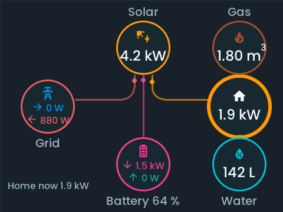

<!-- SPDX-License-Identifier: LicenseRef-FNCL-1.1 | Copyright (c) 2026 andre68723 -->
# Guition ESP32-S3-4848S040

## Hardware

The `panels3` profile targets the **capacitive GT911** version of the Guition
ESP32-S3-4848S040: 4-inch 480 × 480 ST7701S display, 16 MB flash and 8 MB Octal
PSRAM. The dashboard has 480 × 360 pixels after the status and navigation bars.
This is a different device from the ESP32-P4 Guition JC8012P4A1 (`paneljc`).

## Firmware

Build this checkout's `panels3` profile. Existing P4 release images cannot run on
this board. The S3 project name is `betta-ha-panel-s3`; OTA validation checks that
identity. No S3 image has been published by this change.

Native 2.4 GHz Wi-Fi provides the dashboard connection and setup access point;
there is no ESP32-C6 coprocessor or C6 firmware update. Brightness, dimming and
night mode use the shared display policy through GPIO38 PWM.

## Installation

Use the board's USB connector with a data cable. Follow
[Build and flash](../development/build.md#guition-esp32-s3) for the S3 commands.
The first installation needs USB because the partition layout differs from
older upstream S3 images. Export settings/layout and back up flash before
migrating an existing installation. A factory image overwrites stored credentials.

## Compact widgets

Complex cards use a separate S3 text-growth table and a 16 px floor.
Small price and stock cards limit text growth to keep their plots and readings visible.
Wallbox and Bambu printer cards fit from
320 × 320; a single large card with a 12 px margin can use 456 × 336. The Energy
page places all six nodes within the 480 × 360 canvas and opens details in popups.
Date/time fields scroll when both groups are present; Save and Cancel stay visible.

These are LVGL simulator previews with public synthetic data, in Flat style:

[Wallbox preview](../img/gallery-panels3/wallbox.png) ·
[Bambu printer preview](../img/gallery-panels3/bambu.png)

## Limits and validation

On 2026-10-18, the `dev` working tree based on `dd4f752` built with ESP-IDF
6.1 for `esp32s3`. The app fits within its 0x680000-byte OTA slot.
The S3 geometry/OTA identity/navigation test, 17,607 font-scale checks, 250 editor
tests, web checks and the strict documentation build passed. The compact
`tests/simulator/panels3.json` fixture passed overlap/bounds checks in all four
styles at all three text steps (12 renders). This is a compact fixture check,
not validation of every widget. The compact-widget changes additionally passed
6,138 gallery/edge/state renders across three text steps and 234 focused popup
renders, including English/German, all four styles and date/time scrolling.
The font-manager budget/failure test passed 292 checks. The full POSIX host suite is blocked by the
Windows CRT's missing POSIX functions; the targeted C tests ran natively.

The earlier basic-hardware trial used a COM18 unit identified as ESP32-S3 revision 0.2 with 16 MB flash and
8 MB PSRAM. A full flash backup preceded installation. Seven LittleFS files were
migrated from the older S3 partition layout with matching content hashes; NVS was
retained. The old layout file remains preserved but fails current validation.
PSRAM passed its startup memory test. GT911 at address 0x5D registered with LVGL,
the setup access point started and the HTTP server listened on port 80.

Double full refresh stalled the display task on this unit. Single-framebuffer
partial refresh removed the lock failures through the 90-second boot capture;
the owner confirmed clear text and correct colors on the physical screen.
Partial refresh can tear during updates; it does not promise tear-free animation.
The final app's flash digest matched the build, and its boot ELF hash matched the
local ELF. A 90-second final capture had no display-lock failures, panic, invalid
core-dump errors or repeated Wi-Fi-driver initialization.

After provisioning, station Wi-Fi, the editor HTML/JS/CSS, version/task/log/layout
APIs and a 480 × 480 LVGL snapshot were read successfully over the LAN. The running
image reported `dd4f752c-dirty`, build 2026-10-18 20:59:46, valid OTA state and no
retained crash dump. At 269 seconds uptime, internal heap was 63,879 bytes free
(8,336-byte minimum) and PSRAM heap was 2,754,368 bytes free. This is a short
default-dashboard trial, not an all-widget or sustained-load measurement.

Dashboard startup and early rendering logged 33 short display-lock timeouts;
the count did not grow between the 111- and 269-second observations. Both UI
heartbeats remained current, HTTP responded and the watchdogs reported no restart.
The configured Home Assistant token was rejected, so authenticated HA operations
were not exercised.

The owner confirmed accurate physical touch on the upper icons, popup close
button and lower left/right page tabs, with normal page switching.

The compact-widget image (`dd4f752c-dirty`, build 22:26:34 on the same date)
was subsequently flashed through COM18. A fresh 16 MiB backup preceded the
app-only write; flash digests confirmed that NVS/boot metadata and the complete
LittleFS partition were unchanged before boot. Wi-Fi and HA authentication
reconnected. Temporary isolated Printer, Wallbox, Weather, Solar and Energy
pages rendered on the device, and the owner confirmed complete display, accurate
touch and normal page switching. These bindings had no matching HA devices, so
live printer/charger actions and populated forecasts were not tested. The
original two-page layout was restored byte-for-byte; exported settings differed
only in the live Wi-Fi signal reading.

The owner also reported occasional whole-screen shifts/flashes while idle.
Lowering RGB scanout to 8 MHz and using conditional bounce-buffer recovery alone
did not resolve it. The final image initializes RGB/GDMA on the LVGL core (CPU1),
enables the cache-safe RGB ISR and keeps its 2,576-byte adapter callback context
in internal RAM. The owner then confirmed stable idle display and page switching
without further jitter. This is a short device trial, not a sustained-load test.
Its app SHA256 is `466fbfda59c9b38c3a25c25239155754306448d921dccd96844c5e9c6e34196f`;
the boot ELF prefix `cdbfda58c` matches the archived ELF. At 185 seconds uptime,
internal heap was 53,219 bytes free (7,852-byte minimum), PSRAM was 2,732,596 bytes
free, both UI heartbeats were current and no watchdog restart was reported.
Settings and the original layout were verified again after the test.
Two startup reports belonged to an intermediate image (`7aa162ca0`) whose
cache-safe driver rejected a PSRAM callback context; the final image has no new
crash report. At the owner's request, the old reports were erased from the panel
after verifying their local backups. The warning disappeared; settings and the
original layout remained unchanged. The diagnostics remain preserved locally.

### Browser mirror validation

On 2026-10-19, the mirror implementation based on `54f70265` passed 268 editor
checks and 48 real-LVGL capture/input cases covering four geometries, three
render modes and four rotations. Only the S3 firmware was built and flashed.
The COM18 unit passed complete/delta frame decoding, remote page switching,
read-only default, heartbeat expiry, stale-session rejection and reconnect tests.
The browser displayed the actual Energy page and downloaded a 480 × 480 PNG.

The owner observed whole-screen jitter with the initial bounce-buffer images,
including after disconnecting the mirror. A 6 MHz trial did not resolve it;
the byte-identical previously stable image also jittered in the same setup.
The final image uses 8 MHz direct EDMA scanout. The owner confirmed stable idle
and page switching, normal colors and position with mirroring open and closed.
Free internal memory was 70,227 bytes at the protocol-check sample. This remains
a short trial on computer USB power, not a sustained-load or all-board result.
Its app SHA256 is `9c256375283267c93c7ea6709e44202dc917c6ff88414575624a89334b637f09`;
the boot ELF prefix `ada66942d` matches the saved build. OTA state was valid,
HA reconnected and no new crash or watchdog restart was reported. The app-only
write preserved NVS/boot metadata and LittleFS digests; settings and the original
layout were checked again. Backups and private captures remain outside Git.

- Brightness/dimming, real Home Assistant service actions and OTA rollback
  still need completion of the device trial.
- The profile allows five pages and caches up to 512 Home Assistant entities and
  states, leaving PSRAM for RGB framebuffers, TLS, fonts and images.
- Text uses a compact profile with a 16 px floor. Use widgets that fit the
  480 × 360 canvas; layouts from 720 px or larger panels need rearranging.
- Use a separate page for a large device card; old layouts still need arranging
  for the smaller canvas. Camera JPEG decoding is slower in software than on P4.
- Audio output, relay control, SD card and camera sensing are not enabled.
- Touch uses the board's default orientation, with no axis mirroring.
  Resistive/no-touch assemblies are outside this profile.

### Chinese validation

On 2026-10-19, a working-tree build based on `d490f0f9` was flashed to COM18.
Both Chinese languages passed editor selection, panel rendering and Live Display
checks; simplified Chinese also persisted across browser reload. Remote navigation
worked, and the owner confirmed clear traditional Chinese text, stable display
and accurate local touch with the mirror connected. Only this S3 was device-tested.
The compact font contains 699 codepoints (204,804 bytes); S3 XIP also consumes
PSRAM for embedded font data, so a larger general-purpose subset was excluded.
Free PSRAM was about 2.50 MB after boot. The 8 MHz direct-DMA driver is unchanged.
The final app SHA256 is `fb44ffec01b014783d03566ce8379ace39c830254f247b4087d0f6e7dbbcbba9`;
boot ELF prefix `5fe432646` matched, OTA state was valid and no new crash was found.
App-only flashing preserved NVS and LittleFS digests before boot. The temporary
language change was restored to English after the trial; local backups were kept.

### European language validation

On 2026-10-19, a working-tree build based on `d490f0f9` passed German,
Spanish, French and Polish Energy-page and accented-character checks on this S3.
The owner confirmed clear text, stable output and working local touch/navigation.
The app SHA256 was `49d0999b64a9cd54393a594cbaddaf6bfa59eb7aff9eaa2ce5df6d9377503e6a`;
boot ELF prefix `dbb50c086` matched and OTA state was valid. App-only flashing
preserved metadata/NVS and filesystem digests. After testing, simplified Chinese
was restored and settings (excluding live Wi-Fi signal strength) and layout
matched the pre-flash snapshots. Local backups remain outside Git.

### Time zone validation

On 2026-10-19, the time zone working-tree build based on `dba487f9` passed
Shanghai, Kolkata, Kathmandu and UTC offset/persistence checks on COM18.
The device-backed browser passed search, selection and reload; invalid locations
were rejected. The original `CST-8`, language, brightness and layout were restored.
Boot ELF prefix `99ebaa5b1` matched and OTA state was valid. App-only flashing
preserved metadata/NVS and filesystem digests. The owner confirmed correct
Beijing time, normal local touch/page switching and no visible display anomaly
during this trial. The display driver was unchanged; this was not a sustained-load test.

### Save stability validation

On 2026-10-20, the owner reproduced persistent right displacement after editor
saves. The profile now uses 6 MHz direct EDMA, a 9,600-byte internal draw buffer and one post-write
resynchronization on the LVGL task after a quiet interval. Physical validation
of this combination passed on COM18: the owner confirmed stable idle, editor
saves/page switching and aligned physical touch. This remains a short device
trial, not sustained-load or all-widget validation. ELF prefix `05b98b7f1` matched;
12 editor saves coalesced to three requested resets, with no additional reset
between 94 and 168 seconds uptime. OTA was valid and HA authenticated. App-only
flashing preserved NVS/filesystem digests; settings matched except live clock
and signal fields. Owner edits to the layout were retained, and detailed private
evidence remains in local backups.
The trials also exposed a discarded boot-overlay hide request on display-lock
timeout. LVGL now retains the request until it can remove the overlay. Real-LVGL
tests reproduce the old failure and pass the fixed automatic/manual-progress
and immediate-hide cases. The owner confirmed dashboard entry and aligned touch.

### Page visibility and flip clocks

The 2026-11-07 compatibility review covers the shared page visibility,
empty-dashboard flip clock and flip clock screensaver on the `panels3` profile.
No page-visibility or flip-clock defect was reproduced. The backup/layout fixture
uses in-memory S3 rectangles while retaining content and subscription assertions.
The clock regression covers digit clipping and all seven languages/weekdays at
all three text steps on both 480 × 360 and 480 × 480, in 12/24-hour formats.

Local checks passed: 515 editor tests; 522 backup/layout assertions; graph-history
byte retention and queued saves through hide/reload/restore; history merge;
218 injected storage faults and 12 clock-style/disable/re-enable round trips.
Ten selected S3 simulator CTest cases passed, covering native settings, clock
protection timing, fixed centring, themes, touch dismissal and timer/animation cleanup.
The final review rerun passed 59,516 flip-clock and 604 navigation assertions.
The fixed-clock test used the existing local IANA time-zone data on Windows.
Across four appearances and two themes, 32 synthetic dashboard renders matched
byte-for-byte between hidden/empty layouts and between visible/restored pages.
Two additional 480 × 480 flip-saver renders were inspected. These are local
LVGL simulations, not physical display, refresh-performance or touch validation.

The Windows `scripts/build.ps1 panels3 reconfigure build` entry point completed
with ESP-IDF 6.1, the existing S3 defaults and 16 MB partition layout. The
4,384,096-byte application leaves 36% of its 0x680000-byte OTA slot free; SHA256:
`0ea80623b6a779c1333e8bd640eaa7a71b96622a1f07b64f6f1d2d088da342a7`.
The matching ELF is archived locally with prefix `ced0eed96`.
The embedded source is `84668816-dirty`, with build stamp
`Nov 7 2026 09:33:26`. The incremental ESP-IDF application descriptor retains
its older October 30 compile date; identify this image by its hash and source stamp.

The read-only preflight identified `3a77ecd0` from 2026-10-20 with valid OTA and no
retained crash: four pages, two widgets and no graphs. Before/after layouts matched;
settings differed only in live time/RSSI, with increasing uptime. This phase used
only HTTP reads. The old API exposed no `hardware.clock` or format field, so it
could not establish an existing 12-hour preference. Persistence was tested locally.

### Page visibility and clock OTA trial

Later on 2026-11-07, the owner-authorized OTA trial installed the above
4,384,096-byte image on this Guition S3. Two ordinary uploads aborted after
429,888 and 956,651 bytes, leaving the original valid image, layout and settings
intact. The old handler had a 180-second total limit; the second request returned
HTTP 400 after 180.3 seconds. After the owner improved access-point placement,
a paced upload allowed preparation before the main transfer and completed in
110 seconds with HTTP 200. Only the application was uploaded to the inactive OTA
slot; normal slot erasure still occurs. No serial or full-flash erase was used.
The successful workaround does not isolate the earlier stall's cause.

The running source/build stamp matched `84668816-dirty`, `Nov 7 2026 09:33:26`.
The log confirmed that the image became valid after 62 seconds; HA authenticated,
and no retained crash or safe mode was reported. The file hash identifies the
uploaded artifact; this OTA trial did not read back raw flash or NVS/filesystem digests.

One populated page was hidden and restored, then all four pages were hidden.
Saved page content matched the backup after restoration; the two restored widgets'
content area also matched the pre-hide screenshot pixel-for-pixel. The default
clock showed seconds, Chinese weekday/date and AM/PM in the original Matte
appearance, in dark and light themes. The requested 12-hour preference was saved
and read back without changing other existing preferences.

The flip screensaver activated at a temporary 15-second timeout and 30% brightness.
Read-only Live Display frames showed the full-screen, centred clock with weekday,
date and AM/PM in both themes. Ordinary BMP snapshots omitted this overlay on
this S3 during the trial, so those captures are not screensaver visual evidence.
The subsequent [BMP capture fix and OTA trial](../development/panels3-bmp-validation.md) captured the complete
flip saver in both themes on this device; that record distinguishes screenshots from physical acceptance.
Live Display observes LVGL flush output, not physical refresh or touch. The owner
separately confirmed both clocks displayed normally and centrally with readable
weekday/date and AM/PM, normal flipping, a full-screen saver and physical touch wake.
The original page data, dark theme, Matte appearance and disabled screensaver were
restored. Layout comparison excluded newly exposed root canvas metadata. Settings
matched the post-update baseline except the requested 12-hour preference and live
time/RSSI; new API defaults/capabilities were distinguished from saved preferences.
At 738 seconds uptime, OTA was valid, HA authenticated, and no retained crash or
safe mode was reported.
There were no graph widgets on this device; graph-history retention remains
covered by the host checks above, not measured device-history retention.

The submission review tightened exact localized weekday/date and AM/PM assertions
and restored the previous text-size step after the clock regression. Focused C/SDL
checks passed again; 43 archive checks reconciled image/ELF hashes, OTA results,
layouts, settings, captures and the owner's acceptance. Current HTTP reads matched
the accepted pages/theme/settings except live time/RSSI, with 12-hour format retained.
This review made no device writes or firmware changes.

## Manufacturer references

- [Guition specifications](https://www.guition.com/ku/icms/upload/fb081940d6fc11f09850077a33e1404f/FTPData/UEditor/file/2026121/1768961092477/ESP32-4848S040%20Specifications-EN.pdf)
- [Guition board support](https://components.espressif.com/components/guition-jc/guition_boards)
- [ESPHome board configuration](https://devices.esphome.io/devices/guition-esp32-s3-4848s040/)

See [Device notes](device-notes.md#panels3) for wiring and driver details.
