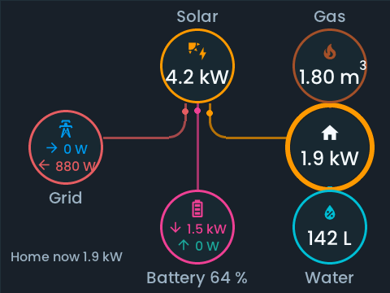

<!-- SPDX-License-Identifier: LicenseRef-FNCL-1.1 | Copyright (c) 2026 andre68723 -->
# Guition ESP32-S3-4848S040

## Hardware

The `panels3` profile targets the **capacitive GT911** version of the Guition
ESP32-S3-4848S040: 4-inch 480 × 480 ST7701S display, 16 MB flash and 8 MB Octal
PSRAM. The dashboard has 480 × 360 pixels after the status and navigation bars.
This is a different device from the ESP32-P4 Guition JC8012P4A1 (`paneljc`).

## Firmware

Build this checkout's `panels3` profile. Existing P4 release images cannot run on
this board. The S3 project name is `betta-ha-panel-s3`; OTA validation checks that
identity. No S3 image has been published by this change.

Native 2.4 GHz Wi-Fi provides the dashboard connection and setup access point;
there is no ESP32-C6 coprocessor or C6 firmware update. Brightness, dimming and
night mode use the shared display policy through GPIO38 PWM.

## Installation

Use the board's USB connector with a data cable. Follow
[Build and flash](../development/build.md#guition-esp32-s3) for the S3 commands.
The first installation needs USB because the partition layout differs from
older upstream S3 images. Export settings/layout and back up flash before
migrating an existing installation. A factory image overwrites stored credentials.

## Compact widgets

Complex cards use a separate S3 text-growth table and a 16 px floor.
Wallbox and Bambu printer cards fit from
320 × 320; a single large card with a 12 px margin can use 456 × 336. The Energy
page places all six nodes within the 480 × 360 canvas and opens details in popups.
Date/time fields scroll when both groups are present; Save and Cancel stay visible.

These are LVGL simulator previews with public synthetic data, in Flat style:

[Wallbox preview](../img/gallery-panels3/wallbox.png) ·
[Bambu printer preview](../img/gallery-panels3/bambu.png)

## Limits and validation

On 2026-10-18, the `dev` working tree based on `dd4f752` built with ESP-IDF
6.1 for `esp32s3`. The app fits within its 0x680000-byte OTA slot.
The S3 geometry/OTA identity/navigation test, 17,607 font-scale checks, 250 editor
tests, web checks and the strict documentation build passed. The compact
`tests/simulator/panels3.json` fixture passed overlap/bounds checks in all four
styles at all three text steps (12 renders). This is a compact fixture check,
not validation of every widget. The compact-widget changes additionally passed
6,138 gallery/edge/state renders across three text steps and 234 focused popup
renders, including English/German, all four styles and date/time scrolling.
The font-manager budget/failure test passed 292 checks. The full POSIX host suite is blocked by the
Windows CRT's missing POSIX functions; the targeted C tests ran natively.

The earlier basic-hardware trial used a COM18 unit identified as ESP32-S3 revision 0.2 with 16 MB flash and
8 MB PSRAM. A full flash backup preceded installation. Seven LittleFS files were
migrated from the older S3 partition layout with matching content hashes; NVS was
retained. The old layout file remains preserved but fails current validation.
PSRAM passed its startup memory test. GT911 at address 0x5D registered with LVGL,
the setup access point started and the HTTP server listened on port 80.

Double full refresh stalled the display task on this unit. Single-framebuffer
partial refresh removed the lock failures through the 90-second boot capture;
the owner confirmed clear text and correct colors on the physical screen.
Partial refresh can tear during updates; it does not promise tear-free animation.
The final app's flash digest matched the build, and its boot ELF hash matched the
local ELF. A 90-second final capture had no display-lock failures, panic, invalid
core-dump errors or repeated Wi-Fi-driver initialization.

After provisioning, station Wi-Fi, the editor HTML/JS/CSS, version/task/log/layout
APIs and a 480 × 480 LVGL snapshot were read successfully over the LAN. The running
image reported `dd4f752c-dirty`, build 2026-10-18 20:59:46, valid OTA state and no
retained crash dump. At 269 seconds uptime, internal heap was 63,879 bytes free
(8,336-byte minimum) and PSRAM heap was 2,754,368 bytes free. This is a short
default-dashboard trial, not an all-widget or sustained-load measurement.

Dashboard startup and early rendering logged 33 short display-lock timeouts;
the count did not grow between the 111- and 269-second observations. Both UI
heartbeats remained current, HTTP responded and the watchdogs reported no restart.
The configured Home Assistant token was rejected, so authenticated HA operations
were not exercised.

The owner confirmed accurate physical touch on the upper icons, popup close
button and lower left/right page tabs, with normal page switching.

The compact-widget image (`dd4f752c-dirty`, build 22:26:34 on the same date)
was subsequently flashed through COM18. A fresh 16 MiB backup preceded the
app-only write; flash digests confirmed that NVS/boot metadata and the complete
LittleFS partition were unchanged before boot. Wi-Fi and HA authentication
reconnected. Temporary isolated Printer, Wallbox, Weather, Solar and Energy
pages rendered on the device, and the owner confirmed complete display, accurate
touch and normal page switching. These bindings had no matching HA devices, so
live printer/charger actions and populated forecasts were not tested. The
original two-page layout was restored byte-for-byte; exported settings differed
only in the live Wi-Fi signal reading.

The owner also reported occasional whole-screen shifts/flashes while idle.
Lowering RGB scanout to 8 MHz and using conditional bounce-buffer recovery alone
did not resolve it. The final image initializes RGB/GDMA on the LVGL core (CPU1),
enables the cache-safe RGB ISR and keeps its 2,576-byte adapter callback context
in internal RAM. The owner then confirmed stable idle display and page switching
without further jitter. This is a short device trial, not a sustained-load test.
Its app SHA256 is `466fbfda59c9b38c3a25c25239155754306448d921dccd96844c5e9c6e34196f`;
the boot ELF prefix `cdbfda58c` matches the archived ELF. At 185 seconds uptime,
internal heap was 53,219 bytes free (7,852-byte minimum), PSRAM was 2,732,596 bytes
free, both UI heartbeats were current and no watchdog restart was reported.
Settings and the original layout were verified again after the test.
Two startup reports belonged to an intermediate image (`7aa162ca0`) whose
cache-safe driver rejected a PSRAM callback context; the final image has no new
crash report. At the owner's request, the old reports were erased from the panel
after verifying their local backups. The warning disappeared; settings and the
original layout remained unchanged. The diagnostics remain preserved locally.

### Browser mirror validation

On 2026-10-19, the mirror implementation based on `54f70265` passed 268 editor
checks and 48 real-LVGL capture/input cases covering four geometries, three
render modes and four rotations. Only the S3 firmware was built and flashed.
The COM18 unit passed complete/delta frame decoding, remote page switching,
read-only default, heartbeat expiry, stale-session rejection and reconnect tests.
The browser displayed the actual Energy page and downloaded a 480 × 480 PNG.

The owner observed whole-screen jitter with the initial bounce-buffer images,
including after disconnecting the mirror. A 6 MHz trial did not resolve it;
the byte-identical previously stable image also jittered in the same setup.
The final image uses 8 MHz direct EDMA scanout. The owner confirmed stable idle
and page switching, normal colors and position with mirroring open and closed.
Free internal memory was 70,227 bytes at the protocol-check sample. This remains
a short trial on computer USB power, not a sustained-load or all-board result.
Its app SHA256 is `9c256375283267c93c7ea6709e44202dc917c6ff88414575624a89334b637f09`;
the boot ELF prefix `ada66942d` matches the saved build. OTA state was valid,
HA reconnected and no new crash or watchdog restart was reported. The app-only
write preserved NVS/boot metadata and LittleFS digests; settings and the original
layout were checked again. Backups and private captures remain outside Git.

- Brightness/dimming, real Home Assistant service actions and OTA rollback
  still need completion of the device trial.
- The profile allows five pages and caches up to 512 Home Assistant entities and
  states, leaving PSRAM for RGB framebuffers, TLS, fonts and images.
- Text uses a compact profile with a 16 px floor. Use widgets that fit the
  480 × 360 canvas; layouts from 720 px or larger panels need rearranging.
- Use a separate page for a large device card; old layouts still need arranging
  for the smaller canvas. Camera JPEG decoding is slower in software than on P4.
- Audio output, relay control, SD card and camera sensing are not enabled.
- Touch uses the board's default orientation, with no axis mirroring.
  Resistive/no-touch assemblies are outside this profile.

### Chinese validation

On 2026-10-19, a working-tree build based on `d490f0f9` was flashed to COM18.
Both Chinese languages passed editor selection, panel rendering and Live Display
checks; simplified Chinese also persisted across browser reload. Remote navigation
worked, and the owner confirmed clear traditional Chinese text, stable display
and accurate local touch with the mirror connected. Only this S3 was device-tested.
The compact font contains 699 codepoints (204,804 bytes); S3 XIP also consumes
PSRAM for embedded font data, so a larger general-purpose subset was excluded.
Free PSRAM was about 2.50 MB after boot. The 8 MHz direct-DMA driver is unchanged.
The final app SHA256 is `fb44ffec01b014783d03566ce8379ace39c830254f247b4087d0f6e7dbbcbba9`;
boot ELF prefix `5fe432646` matched, OTA state was valid and no new crash was found.
App-only flashing preserved NVS and LittleFS digests before boot. The temporary
language change was restored to English after the trial; local backups were kept.

### European language validation

On 2026-10-19, a working-tree build based on `d490f0f9` passed German,
Spanish, French and Polish Energy-page and accented-character checks on this S3.
The owner confirmed clear text, stable output and working local touch/navigation.
The app SHA256 was `49d0999b64a9cd54393a594cbaddaf6bfa59eb7aff9eaa2ce5df6d9377503e6a`;
boot ELF prefix `dbb50c086` matched and OTA state was valid. App-only flashing
preserved metadata/NVS and filesystem digests. After testing, simplified Chinese
was restored and settings (excluding live Wi-Fi signal strength) and layout
matched the pre-flash snapshots. Local backups remain outside Git.

## Manufacturer references

- [Guition specifications](https://www.guition.com/ku/icms/upload/fb081940d6fc11f09850077a33e1404f/FTPData/UEditor/file/2026121/1768961092477/ESP32-4848S040%20Specifications-EN.pdf)
- [Guition board support](https://components.espressif.com/components/guition-jc/guition_boards)
- [ESPHome board configuration](https://devices.esphome.io/devices/guition-esp32-s3-4848s040/)

See [Device notes](device-notes.md#panels3) for wiring and driver details.
