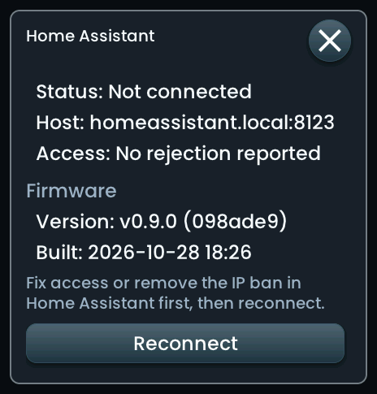

<!-- SPDX-License-Identifier: LicenseRef-FNCL-1.1 | Copyright (c) 2026 andre68723 -- file added in the andre68723/BETTA-HA-PANEL fork, see docs/release-notes.md -->
# Top bar

The strip across the top of every page: your chosen **items** on the left (date, weather, a stock quote), the
**clock** in the middle and **status chips** for the connections on the right. It stays in place while the pages
change, separate from the [widgets](widgets/README.md).

## Choose the items

Open **Settings → Top bar**, pick what goes into each left-hand slot, and choose the entities that need one.
Changes apply immediately.

| Choice | Shows | You need |
| --- | --- | --- |
| Date | The local date | nothing |
| Weather | A condition icon and the temperature | a `weather.*` entity in **Weather entity** |
| Stock | A symbol and value | a numeric sensor in **Stock sensor** |
| None | an empty slot | nothing |

How many slots there are depends on the display: **two** on the 4-inch panel and **three** on the 5-inch Tab5 and
the 10-inch panels (the third is **Left item 3**). A choice that is used twice appears once, and weather or stock
disappear while their entity has no usable value. New panels show only the date.

**Quote history:** a tap on the stock item opens its history: the daily means of the last 30 days, and with the second
button the weekly means of the last 12 months, with the change over the range. The data comes from the Home Assistant
statistics of the sensor, so it needs a numeric sensor with a `state_class` (Easy Stock sensors have `measurement`);
a sensor that Home Assistant has recorded for a short time shows less.
Missing days or weeks leave gaps in the line. Dates keep their elapsed-time positions, including across clock changes.

!!! tip "Example: an ETF quote"

    An **Easy Stock** sensor such as `sensor.vwce_de` works: the bar takes the value and currency
    from the sensor and the symbol from its attributes (or from the entity ID, here `VWCE.DE`). The price in the
    pictures is a demo value.

## Clock and time

The clock shows hours and minutes, with a 12/24-hour choice in the panel's screen settings. Set the **time zone** and the **time server** under
**Settings → Language & time → Time**. The time zone applies at once; save a changed time server.

## Status chips

Tap a chip on the right for details. On the Tab5, whose pixels are small, each chip's touch area is as tall as the bar. **Blue** means connected, **grey** disconnected. The MQTT chip sits between the
clock and the Home Assistant chip and only appears while MQTT runs.

Wi-Fi uses the same framed height and normal width as Home Assistant. Its frame widens for **AP** during setup. The rightmost gear opens **System settings**. On compact panels the clock and left items make room for these controls; optional left items disappear when space runs out.

The Xiaozhi robot icon highlights in the selected theme while its dialogue is
open. Closing the dialogue or reaching its idle timeout restores the normal icon.

## System settings

The rightmost gear opens language, time zone, appearance, colour theme and display controls.
Choose a language by its native name, a Region/City time zone, one of the four appearances,
or a built-in or imported colour theme. The saved custom language and legacy POSIX zone
remain available as the first option. Only changed fields are saved; Cancel keeps existing settings.
Language, appearance and colour changes rebuild the dashboard after saving.

Tap the gear to adjust the display without opening the web editor. This page is shared by all panel variants, including 480 × 480; scroll the controls while the title and Save/Cancel buttons stay visible.

- Set active and dimmed brightness and the delay before dimming. **Preview** temporarily shows a brightness level for 30 seconds; touch the screen to end it early.
- Choose disabled, clock, screen off, weather or cycling pages after inactivity. Existing weather and page options remain configurable in the editor.
- For the clock, set its start delay, brightness, optional duration before turning off, seconds and date. The 12/24-hour choice also controls the top bar. The clock moves periodically; night mode retains priority. A wake touch dismisses the saver without activating the dashboard below it.
- **Save** applies the changes and stores only the fields edited on this page. **Cancel** discards unsaved changes. A failed save keeps the form open for retry; reopen the page to check values if storage failed partway through saving. Credentials, layouts and unrelated settings are preserved.

The editor's **Settings → Display** has the same clock options. Disabling the clock or its automatic screen-off retains its configured values. All labels are included in the seven offline language catalogs. Existing installations retain their current display-protection mode; the new clock is opt-in.

## Connection details

=== "Wi-Fi"

    

    Network, IP address and signal strength. In setup mode the card also shows the setup network's password.

=== "Home Assistant"

    

    **Reconnect** retries the HA connection without restarting the panel. It is
    available while disconnected, with at least 15 seconds between attempts.
    Fix an invalid token or remove an IP ban in HA first; the popup shows rejected
    access and stays disconnected if HA still refuses the request.

    Connection and sync state, the host, and this panel's firmware: version, build and an available update.

=== "MQTT"

    

    Status, broker with port and the device ID that Home Assistant discovery uses.

Close a card with its close button or by tapping outside it. Connections are configured in the
[web editor](editor.md#settings); MQTT is described under [Notifications](notifications.md).
The cards grow with the text size. Long values wrap, and details can scroll when they exceed the screen height.

## Alerts { #crash-warning }

The yellow triangle sits to the left of the AI agent icon, or to the left of the
connection icons when the assistant is hidden. Tap it to open **Alerts** with
scrollable details. It is hidden when there are no alerts. Closing the screen
does not delete reports or send Home Assistant commands.

- **Crash reports:** the two newest retained reports, with time, task, cause,
  build and report identifiers. These are historical records, not necessarily
  current faults. Download or erase them in **Web Settings → Device**.
- **Connections:** Wi-Fi, Home Assistant and MQTT failures after a 30-second boot
  grace period. Unconfigured integrations stay silent. A Wi-Fi outage shows one
  network alert instead of duplicate HA/MQTT failures. Entries clear on recovery.
- **Configured sensors:** an editor alert whose entity is `on` stays listed until
  a usable state turns off. Unknown/unavailable samples do not erase a known
  active alert. An already-active sensor appears after boot without ringing.
- **Doorbell events:** a new `event.*` timestamp adds a temporary entry for the
  configured timeout (30 seconds by default, at most one hour). Boot/reload does
  not replay earlier events. These entries are not a persistent event history.

The list updates while open, and an empty list shows **No alerts**. All display
variants, rotations, text sizes and seven built-in languages share the screen.

## What fits on each display

How much room the left side has depends on the width. Pictures from the simulator at one pixel scale with
**Date + Stock**, and **Date + Weather + Stock** where three slots exist; click to enlarge.

=== "4-inch (720 px)"

    

      <figure>
        
        <figcaption>Two items fit. A stock quote may shorten its symbol, drop the currency or show only the value.</figcaption>
      </figure>
    

=== "5-inch Tab5 (1280 px)"

    

      <figure>
        
        <figcaption>Date + Stock: room for the full identifier, value and currency.</figcaption>
      </figure>
      <figure>
        
        <figcaption>Date + Weather + Stock: all three fit left of the clock.</figcaption>
      </figure>
    

=== "10-inch (1280 px)"

    

      <figure>
        
        <figcaption>Date + Stock, the same 1280 × 60 pixels as the Tab5.</figcaption>
      </figure>
      <figure>
        
        <figcaption>Date + Weather + Stock.</figcaption>
      </figure>
    

These are simulator renderings of the firmware layout; [device validation](choose-display.md) is recorded separately.
