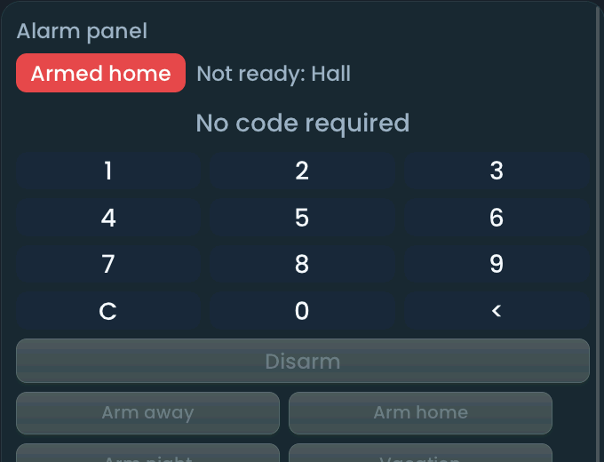

<!-- SPDX-License-Identifier: LicenseRef-FNCL-1.1 | Copyright (c) 2026 andre68723 -- generated by tools/generate_widget_docs.py, see docs/release-notes.md -->

# Alarm panel

Shows an **alarm dashboard** for an `alarm_control_panel.*` entity with a keypad, zones, auxiliary controls and Home Assistant event history.

<figure></figure>

## Entities

| Entity | Domains |
| --- | --- |
| Alarm panel | `alarm_control_panel.*` |
| Keypad message *(optional)* | `sensor.*` |
| Zones (up to 16) *(optional)* | `binary_sensor.*` |
| Controls (up to 8) *(optional)* | `switch.*`, `input_boolean.*`, `button.*`, `input_button.*` |

## Requirements

Home Assistant's Logbook integration supplies event history. Alarm actions depend on the entity's supported features and code requirements.

## Options

| Option | Effect |
| --- | --- |
| Zones / Controls | ordered entity bindings with optional display names; duplicate bindings within each list are rejected |
| History hours | 1–168 hours, default 24; at most the newest 40 events are shown |

## On the panel

- Wide cards use three columns. Cards narrower than 900 pixels stack the keypad, zones and history in a scrollable view.
- Enter a numeric code on the panel when required, then choose an available arm or disarm action. Codes are never saved in the layout; they clear after submission, 20 seconds of inactivity, hiding the widget or losing the alarm connection. Text codes must be entered in Home Assistant.
- Home Assistant remains authoritative: an accepted request does not imply the alarm has changed state. Unsupported and unavailable actions are disabled.
- Switches use explicit on/off commands. Button entities require one continuous two-second hold; releasing or leaving the widget cancels the hold.
- Zones show their reported state; unknown or unavailable zones do not count as clear. History refreshes on demand and periodically while visible. Missing history does not disable alarm controls.

## Size

- Minimum: **320 × 300 px**.
- Maximum: **dashboard width × dashboard height**, capped by the display's dashboard area.

The minimum is a validation limit, not a recommended size. [Choose your display](../choose-display.md) lists the dashboard geometry; [Widget anatomy](../widget-anatomy.md) explains spacing and touch targets.

## Related guides

[Widget library](README.md) · [Web editor](../editor.md) · [Appearance](../appearance.md#compare-the-four-styles) · [Home Assistant requirements](../home-assistant.md)
