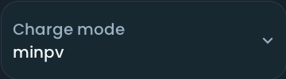
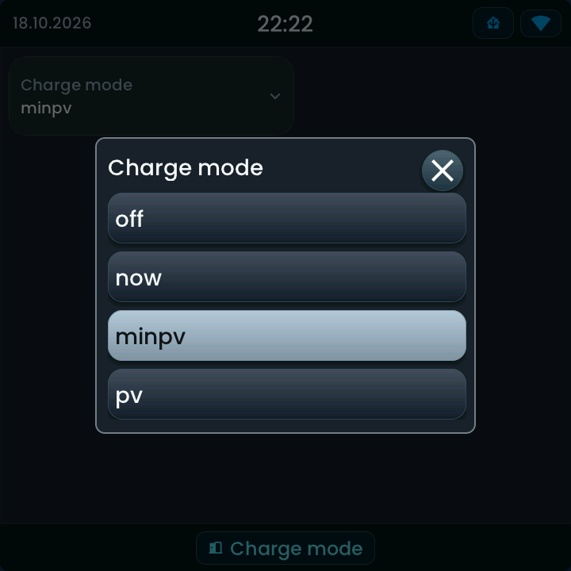

<!-- SPDX-License-Identifier: LicenseRef-FNCL-1.1 | Copyright (c) 2026 andre68723 -- generated by tools/generate_widget_docs.py, see docs/release-notes.md -->

# Select

Chooses an **option** of a `select.*` or `input_select.*` entity.

<figure></figure>

## Entities

| Entity | Domains |
| --- | --- |
| Select | `select.*`, `input_select.*` |

## Requirements

For a KNX operating preset, select KNX as the source and bind a DPT 20.102 command, feedback, or both. See [KNX widget bindings](../knx.md#dashboard-widgets).

## Options

No options beyond the entities; the controls follow what the entity supports.

## On the panel

- Tap the tile when the arrow is visible to choose an option. A feedback-only KNX preset displays the reported mode.
- Leave enough width for the title and the longest option; the example is 360 × 100 px.

### Option picker

The list marks the current option. Tap an option to request it. For a Home Assistant entity, the tile waits for the reported state. A KNX preset with a feedback object waits for its bus report. With feedback unassigned, the tile shows the last successfully sent command, including Auto (0).

## Size

- Minimum: **160 × 80 px**.
- Maximum: **dashboard width × 200 px**, capped by the display's dashboard area.

The minimum is a validation limit, not a recommended size. [Choose your display](../choose-display.md) lists the dashboard geometry; [Widget anatomy](../widget-anatomy.md) explains spacing and touch targets.

## Related guides

[Widget library](README.md) · [Web editor](../editor.md) · [Appearance](../appearance.md#compare-the-four-styles) · [Home Assistant requirements](../home-assistant.md)
